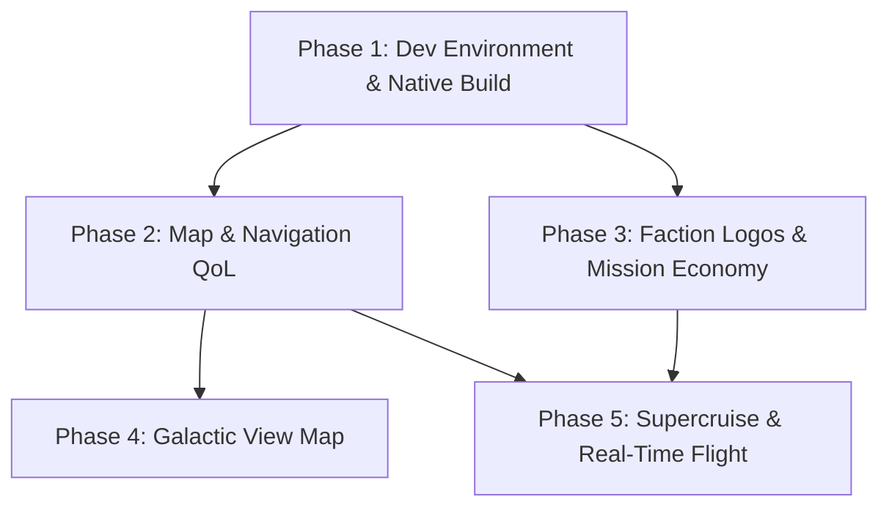

# Pioneer: Dangerous — Implementation & Modernization Plan

Transform the open-source space simulation game **Pioneer** (inspired by *Frontier: Elite II*) into an enhanced, single-player *Elite Dangerous*-style experience.

---

## Architectural Principles & Core Decisions

1. **Independent Fork**:
   * Upstream Pioneer does not accept AI-assisted code. This repository is an independent single-player fork.
   * Remote `upstream` tracks `https://github.com/pioneerspacesim/pioneer.git` for manual code merges and engine updates.
2. **Single-Player Real-Time Clock & Mission Timing**:
   * **1:1 Real-Time During Play**: In-flight time progression runs in 1:1 real-time. Supercruise allows in-system travel in minutes ($0.1c$ to $2,001c$), eliminating the need for flight time acceleration.
   * **Offline Time Freeze**: When the player exits the game, the in-game clock freezes. A "3-hour mission" guarantees 3 hours of **actual gameplay time**—the player will never fail a contract just because they were offline or busy in real life.
   * **Station "Wait / Pass Time" Service**: If a mission requires waiting for a contact at a scheduled hour, station services (e.g. Starport Lounge / Berth) provide a "Wait / Advance Clock" feature.
3. **Aesthetic & Tone**:
   * Replace procedural composite facegen with corporate logos, faction crests (Federation, Empire, Alliance, Independents), starport authority seals, mining guild emblems, and syndicate insignias.
   * Remove joke/unserious missions (`DonateToCranks`, easter eggs) in favor of serious spaceflight and commerce.

---

## Project Roadmap



---

### Phase 1: Dev Environment & Build Pipeline (COMPLETED)
* [x] Extracted source code into `/home/austeregrim/Projects/pioneer`.
* [x] Initialized Git repository tracking `main` branch with `upstream` remote.
* [x] Installed Linux build dependencies (`cmake`, `ninja-build`, `libsdl2-dev`, `libglew-dev`, `libassimp-dev`, etc.).
* [x] Configured CMake with Ninja generator (`CMAKE_BUILD_TYPE=Release`).
* [x] Successfully compiled native binary `./build/pioneer` and `build-data` models.
* [x] Successfully ran and verified unit test suite (`./build/unittest` - 9/9 passed).

---

### Phase 2: Navigation & Map Quality of Life (QoL)
* **Goal**: Streamline target selection directly from sidebar lists and maintain destination lock across hyperspace jumps.
* **Target Files**:
  * `data/pigui/modules/system-view-ui.lua`:
    * Add direct **"Target"** and **"Set Destination"** action buttons on each row in the celestial body and station tree list.
    * Add double-click shortcut on any list item to immediately lock it as the active nav target (no need to zoom in and right-click 3D models).
    * Add type filter buttons (Stations, Starports, Outposts, Planets, Moons) to quickly filter the system overview list.
  * `src/SystemView.cpp` & `src/ship/PlayerShipController.cpp`:
    * Implement **Cross-System Target Memory**: When a player targets a specific station or moon in another star system on the sector/system map, store the target body path in the player ship navigation state.
    * Upon completing hyperspace jump into the destination system, automatically select and lock the previously chosen station/body as the primary nav target.

---

### Phase 3: Mission Overhaul & Aesthetic Polish
* **Goal**: Curate mission content, rebalance economic payouts for real-time play, and replace procedural faces with sleek corporate/faction insignias.
* **Target Files**:
  * `data/pigui/libs/face.lua` & `data/pigui/modules/station-view/02-bulletinBoard.lua`:
    * Deactivate procedural facegen compositing (`data/facegen/`).
    * Replace portrait placeholders with high-resolution corporate logos, faction crests (Federation, Empire, Alliance, Independents), starport authority seals, mining guild emblems, and syndicate insignias.
  * `data/modules/`:
    * Deactivate joke/unserious modules (`DonateToCranks/DonateToCranks.lua` and goofy `EasterEgg/Message.lua`).
    * Audit `Advice/Advice.lua` for lore-consistent, serious operational tips.
  * `data/modules/MissionUtils.lua`:
    * Replace legacy multi-day Newtonian travel formulas (`MissionUtils.TravelTimeLocal = distance/AU * 2*Days`) with realistic Supercruise travel times and reasonable gameplay deadlines (e.g. 2–8 hours of gameplay time).
    * Scale rewards based on distance, cargo mass, system security level, and pirate interdiction risk.
  * `data/pigui/modules/station-view/08-stationHotel.lua` (NEW):
    * Station "Pass Time" Service: Accessible when docked at any station or planetary outpost.
    * Allows the player to advance the in-game clock by 1 hour, 6 hours, or 24 hours if waiting for a specific event or mission contact.

---

### Phase 4: Macro Galactic View
* **Goal**: Provide galactic context showing the Milky Way structure, galactic arms, and the player's position in the galaxy.
* **Target Files**:
  * `src/SectorView.cpp` & `data/pigui/views/map-sector-view.lua`:
    * Add a **Galactic Overview Map** tab / transitional zoom level.
    * Render the galactic disk, core, spiral arms (Perseus, Sagittarius, Orion Spur, Centaurus), and major galactic regions.
    * Display a prominent **"You Are Here"** navigational reticle showing coordinates relative to Sol and the galactic center ($X, Y, Z$).
    * Add a Mini-Map (PIP) in the sector view showing the current sector's location within the wider galaxy.

---

### Phase 5: In-System FTL Supercruise Flight Mechanics
* **Goal**: Implement an *Elite Dangerous*-style Frame Shift Drive (FSD) Supercruise mode for in-system space flight, replacing in-flight time compression.
* **Target Files**:
  * `src/Ship.h` & `src/Ship.cpp`:
    * Add `FlightState::SUPERCRUISE` state to ship flight model.
    * Supercruise engages via hotkey (`J` / FSD toggle) when mass-lock conditions are cleared.
    * Disables standard Newtonian thruster inertia; ship velocity aligns with orientation vector and throttle percentage.
    * Time acceleration keys ($10\times, 100\times$) are disabled during flight in favor of real-time FTL throttle.
  * `src/ship/SupercruiseController.h` & `src/ship/SupercruiseController.cpp` (NEW):
    * Minimum speed: $30\text{ km/s}$ ($0.0001c$).
    * Maximum theoretical speed: scales smoothly up to $2,001c$ with prolonged throttle application in deep space.
    * **Gravity Well Deceleration (Mass Drag)**: Sample distance and mass of nearby celestial bodies (stars, gas giants, planets). Reduce maximum throttle velocity dynamically as gravitational potential increases.
    * **Safe Disengage / Drop-Out Logic**: When distance $< 1,000\text{ km}$ and speed $< 1,000\text{ km/s}$, activate the "Safe Disengage" HUD indicator. Dropping drops the ship into local station coordinate frame at $\sim 10\text{–}15\text{ km}$ distance with sub-light flight restored.
  * `data/pigui/modules/flight-ui/`:
    * Add Supercruise HUD flight gauges: throttle scale showing current $c$ / $\text{km/s}$ velocity, target distance and ETA (with the 6-second safe braking zone), and orbital trajectory guide rings around stars and planets.

---

## Verification & Build Commands

* **Compile Game & Assets**:
  ```bash
  cmake --build build --target pioneer build-data -j 8
  ```
* **Run Unit Tests**:
  ```bash
  cmake --build build --target unittest && ./build/unittest
  ```
* **Run Game on Dedicated NVIDIA GPU**:
  ```bash
  __NV_PRIME_RENDER_OFFLOAD=1 __GLX_VENDOR_LIBRARY_NAME=nvidia __VK_LAYER_NV_optimus=NVIDIA_only ./build/pioneer
  ```
