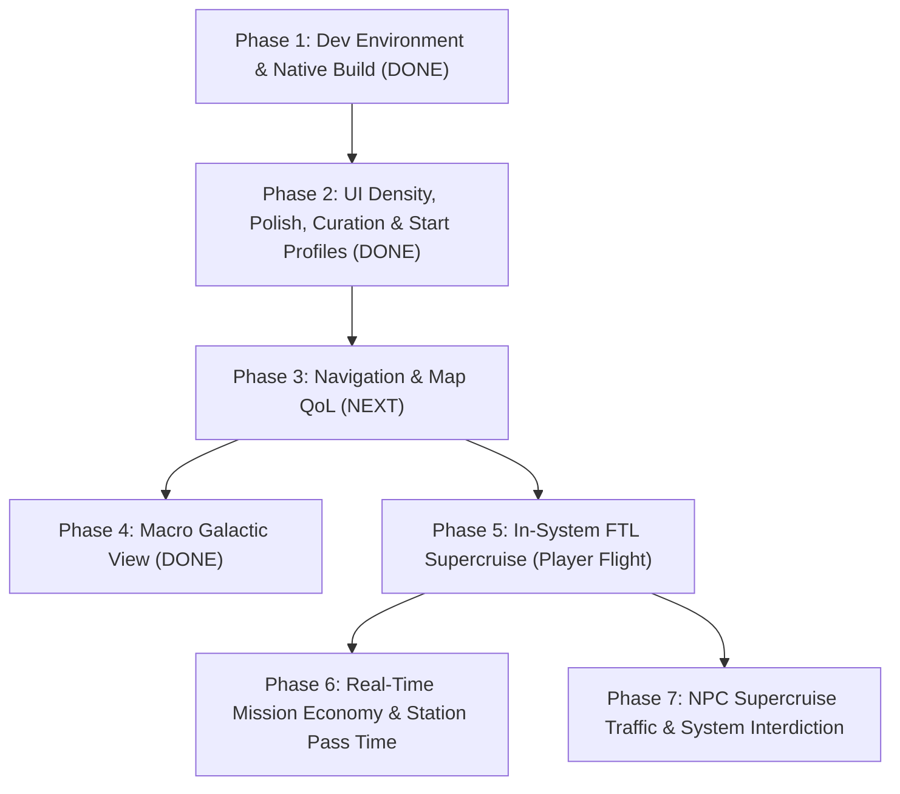

# Pioneer: Dangerous — Implementation & Modernization Plan

Transform the open-source space simulation game **Pioneer** (inspired by *Frontier: Elite II*) into an enhanced, single-player *Elite Dangerous*-style experience.

---

## Architectural Principles & Core Decisions

1. **Independent Fork**:
   * Upstream Pioneer does not accept AI-assisted code. This repository is an independent single-player fork.
   * Remote `upstream` tracks `https://github.com/pioneerspacesim/pioneer.git` for manual code merges and engine updates.
2. **Single-Player Real-Time Clock & Mission Timing**:
   * **1:1 Real-Time During Play**: In-flight time progression runs in 1:1 real-time. Supercruise allows in-system travel in minutes ($0.1c$ to $2,001c$), eliminating the need for flight time acceleration.
   * **Offline Time Freeze**: When the player exits the game, the in-game clock freezes. A "3-hour mission" guarantees 3 hours of **actual gameplay time**—the player will never fail a contract just because they were offline or busy in real life.
   * **Station "Wait / Pass Time" Service**: If a mission requires waiting for a contact at a scheduled hour, station services (e.g. Starport Lounge / Berth) provide a "Wait / Advance Clock" feature.
3. **Aesthetic, UI Density & Tone**:
   * Tighten UI scaling (native `1920x1080` baseline instead of `1600x900`), typography, and widget padding for a clean, professional, high-density cockpit and station interface.
   * Disable procedural composite `facegen` (`data/facegen/`) and `<< >>` customization sliders; replace contact portraits with high-resolution SVG **corporate logos, faction crests (Solar Federation, Commonwealth, Haber Corp, Independents), starport authority seals, police badges, engineering corps emblems, and syndicate insignias** (`data/icons/logos/`).
   * Structure New Game creation around **Allegiance** + **Career Role** buildouts so players start in allied space with role-appropriate ships, equipment, and working hyperdrives.
   * Remove joke/unserious missions (`DonateToCranks`, easter eggs) and placeholder dev text in favor of serious spaceflight and commerce.

---

## Project Roadmap



---

### Phase 1: Dev Environment & Build Pipeline (COMPLETED)
* [x] Extracted source code into `/home/austeregrim/Projects/pioneer`.
* [x] Initialized Git repository tracking `main` branch with `upstream` remote.
* [x] Installed Linux build dependencies (`cmake`, `ninja-build`, `libsdl2-dev`, `libglew-dev`, `libassimp-dev`, etc.).
* [x] Configured CMake with Ninja generator (`CMAKE_BUILD_TYPE=Release`).
* [x] Successfully compiled native binary `./build/pioneer` and `build-data` models.
* [x] Successfully ran and verified unit test suite (`./build/unittest` - 9/9 passed).

---

### Phase 2: UI Density, Aesthetic Polish, Content Curation & Start Profiles (COMPLETED)
* **Goal**: Tighten global UI scale/typography for a clean, professional layout, replace procedural `facegen` portraits with non-customizable corporate/faction/authority SVG logos, overhaul New Game start profiles into Allegiance + Career Role selectors, and remove goofy content.
* **Completed Work**:
  * [x] **Base Resolution & Global UI Tightening**:
    * Updated `defaultBaseResolution` from `1600x900` to `1920x1080` in `data/pigui/libs/rescale-ui.lua` and across 13 hardcoded station/info/table/chat UI modules.
    * Refined `pionillium` and `orbiteer` font breakpoints in `data/pigui/libs/text.lua`.
    * Tightened global button dimensions, spacing, and padding in `data/pigui/themes/default.lua`, `data/pigui/views/tab-view.lua`, `data/pigui/modules/time-window.lua`, and `data/pigui/modules/system-overview-window.lua`.
    * Compacted Bulletin Board (`data/pigui/modules/station-view/02-bulletinBoard.lua`) and Station View (`data/pigui/views/station-view.lua`) typography and row spacing (note: further HUD/station menu passes can be refined iteratively during playtesting).
  * [x] **Replaced `facegen` with Corporate, Faction & Authority Logos**:
    * Disabled procedural `facegen` compositing and removed all `<< >>` customization buttons in `data/pigui/libs/face.lua` and `data/pigui/modules/new-game-window/crew.lua`.
    * Created 12 high-resolution SVG emblems in `data/icons/logos/` (`faction_solfed`, `faction_commonwealth`, `faction_haber`, `faction_independent`, `authority_starport`, `authority_police`, `authority_engineering`, `pilots_federation`, `corp_logistics`, `corp_mining`, `corp_mercenary`, `corp_science`, `corp_syndicate`) and wired `data/pigui/libs/face.lua` to render them automatically by role, system faction, and contact seed.
  * [x] **New Game Start Profiles — Allegiance + Career Role** (`data/pigui/modules/new-game-window/class.lua`):
    * Replaced the 3 blind location-based starts with two side-by-side selectors:
      * **Allegiance**: *Solar Federation (Sol — Mars, Cydonia)*, *Commonwealth of Independent Worlds (Epsilon Eridani — New Hope)*, *Haber Corporation (Zekonbur — Fort Gaillard)*, *Independent Frontier (Barnard's Star — System Admin. Resting)*.
      * **Career Role**: *Trader / Hauler (`Sinonatrix`)*, *Miner / Prospector (`Coronatrix`)*, *Explorer / Pathfinder (`Coronatrix`)*, *Mercenary / Escort (`Coronatrix`)* — all equipped with a working Class 2 Hyperdrive and role-appropriate gear.
  * [x] **Content Curation & Lore Cleanup**:
    * Deactivated joke modules `data/modules/DonateToCranks/DonateToCranks.lua` and `data/modules/EasterEgg/Message.lua`.
    * Cleaned up placeholder faction descriptions in `data/factions/001_Solar_Federation.lua` and `data/factions/002_Commonwealth_of_Independent_Worlds.lua`, and updated `data/lang/module-advice/en.json`.

---

### Phase 3: Navigation & Map Quality of Life (QoL) (NEXT UP)
* **Goal**: Streamline target selection directly from sidebar lists and maintain destination lock across hyperspace jumps.
* **Target Files & Tasks**:
  * [ ] `data/pigui/modules/system-overview-window.lua`, `data/pigui/modules/flight-ui/system-overview.lua`, & `data/pigui/modules/system-view-ui.lua`:
    * Add direct **"Target"** / **"Set Destination"** action buttons or one-click/double-click targeting on rows in the celestial body and station tree list (both in Flight UI and F2 System Map).
    * Add a **"Set as Navigation Target"** action button in the F2 System Map `infoView` sidebar when inspecting a body/station.
    * Improve type filter toggles (Stations/Starports, Moons, Planets) in the system overview widget so stations are easy to see and target immediately.
  * [ ] **Cross-System Target Memory** (`data/pigui/modules/system-view-ui.lua` / `src/SystemView.cpp` / `onEnterSystem` hook):
    * Allow targeting a specific station, planet, or moon in **another** star system while browsing the F2 System Map (even when `sBody.physicsBody` is not yet instantiated because the player is in a different system), and store that target `SystemPath` in persistent player navigation state (while also queuing/selecting the destination star system for hyperjump).
    * Upon completing a hyperspace jump into the destination system (`onEnterSystem`), automatically resolve the physical `Body` from the saved `SystemPath` and lock it as the active nav target (`Game.player:SetNavTarget(body)`).

---

### Phase 4: Macro Galactic View (COMPLETED)
* **Goal**: Provide galactic context showing the Milky Way structure, faction territories, coordinate grids, and the player's position in the galaxy via seamless 3D camera zoom.
* **Completed Work**:
  * [x] **Continuous 3D Camera Zoom & Smooth Cross-Fade LOD** (`src/SectorMap.h`, `src/SectorMap.cpp`, `src/SectorView.cpp`):
    * Extended camera zoom bounds (`FAR_MAX = 14,000.0`) with proportional scroll/zoom speed and dynamic perspective clip planes to pull back smoothly from local star systems to the entire $100,000\text{ ly}$ Milky Way disc.
    * Implemented smooth Hermite cross-fade (`m_voronoiAlpha` and `m_macroAlpha`) transitioning between local/regional star systems and the macro galactic view without sector generation stalls.
  * [x] **Hybrid Textured Galactic Disc + 3D Volumetric Star Cloud & Core Glow** (`src/SectorMap.cpp`):
    * Rendered multi-layered additive-alpha 3D planes using `data/galaxy_colour.png` ($2700 \times 2700$) aligned with the engine's physical galaxy coordinates (Galactic Core at $(-25000, 0, 0)\text{ ly}$, radius $50,000\text{ ly}$).
    * Generated a 9,500-particle 3D volumetric star cloud sampled from `DensityMapGalaxy::GetSectorDensity` with a realistic 3D central galactic bulge ($\pm 1,500\text{ ly}$) tapering into the spiral arms, plus dual-layer Sagittarius A* core glow billboards.
  * [x] **3D Galactic Plane Polar Grid & Light-Year Range Rings** (`src/SectorMap.cpp`):
    * Added concentric range rings around Sagittarius A* ($10\text{k}, 20\text{k}, 25\text{k}$ Sol Orbit, $30\text{k}, 40\text{k}, 50\text{k ly}$) with 12 radial azimuth spokes, plus Human Bubble range rings around Sol ($100, 250, 500, 1000, 2500\text{ ly}$).
  * [x] **Sharp Voronoi Faction Territory Boundaries** (`src/SectorMap.cpp`):
    * Computed exact radius-constrained Voronoi bisector edges and outer claim boundary arcs across all faction homeworlds in `FactionsDatabase`, highlighting selected faction borders and capital world stems.
  * [x] **Interactive Raycast Panning, Beacons & Contextual Adaptive Sidebar** (`src/SectorMap.cpp`, `src/lua/LuaSectorMap.cpp`, `data/pigui/views/map-sector-view.lua`):
    * Added scale-adaptive 3D beacons and clickable markers for **`YOU ARE HERE`**, **`SOL`**, **`SAGITTARIUS A*`**, and major/selected factions.
    * Implemented 3D mouse raycasting onto the $Z = 0$ galactic plane to pan anywhere in the galaxy and select faction territories on click.
    * Added the top Macro Galactic Telemetry Banner (Galactic $X, Y, Z$, Sol distance, Core distance, active territory) and Contextual Adaptive Sidebar (`GALACTIC OVERVIEW` & Territorial Dossier).

---

### Phase 5: In-System FTL Supercruise Flight Mechanics
* **Goal**: Implement an *Elite Dangerous*-style Frame Shift Drive (FSD) Supercruise mode for in-system space flight, replacing in-flight time compression with 1:1 real-time FTL travel.
* **Core Architecture & Flight Dynamics**:
  * **Ship State Machine (`src/Ship.h`, `src/Ship.cpp`)**:
    * Introduce `FlightState::SUPERCRUISE` into `Ship::FlightState`.
    * **FSD Engage Cycle**: Bound to `J` (or FSD toggle). Requires landing gear retracted, hardpoints stowed, zero mass lock, and throttle $> 0$. Features a 5-second charge-up countdown.
    * **Bypass Rigid-Body Physics**: During Supercruise, decouple `DynamicBody` from standard Bullet rigid-body collision impulses and Newtonian inertia. Velocity aligns directly with the ship's heading vector and active throttle percentage.
    * **Rotational Handling Model**: Emulates *Elite Dangerous* flight dynamics—pitch and roll are responsive, yaw is sluggish. Rotational angular agility dynamically scales inversely with speed: tightest turn rate at low speed and in the $75\%$ throttle "blue zone", widening into sweeping multi-light-second turning arcs at high multiples of $c$.
    * **Velocity Profile**: Smoothly ranges from $30\text{ km/s}$ ($0.0001c$) minimum floor up to $2,001c$ top speed in deep vacuum.
  * **Gravity Well Drag & Exclusion Zones (`src/ship/SupercruiseController.h`, `src/ship/SupercruiseController.cpp`)**:
    * **Gravitational Mass Drag**: Calculate aggregate gravitational potential from nearby stellar bodies ($\Phi = \sum \frac{G \cdot M_i}{r_i}$). As potential increases near stars, gas giants, and planets, dynamically suppress acceleration, deceleration, and maximum achievable speed.
    * **The 6-Second Rule ("Loop of Shame")**: Deceleration curve tuned to reward throttle management. Maintaining $75\%$ throttle inside the blue zone balances deceleration with distance so target ETA stabilizes at $0:06$ seconds down to safe dropout. Failing to throttle down inside $0:05$ results in gravitational overshoot.
    * **Exclusion Zone Collisions**: Crossing a body's yellow exclusion zone boundary triggers an immediate **Emergency Dropout**:
      * Shields are completely depleted (absorbing the physical impact shock).
      * Hull damage is applied only if shields were already down or unequipped.
      * Ship suffers a high thermal heat spike.
      * FSD enters an extended emergency cooldown timer before it can be recharged.
  * **Frame Transitions & Safe Disengage / Drop-Out Logic**:
    * **Reference Frame Handling**: While in Supercruise, the ship remains locked in the planetary or star orbital parent frame. Micro station frames ($20\text{ km}$) are ignored at FTL speeds to prevent tunneling or physics boundary jitter.
    * **Safe Disengage Criteria**: When target distance $< 1,000\text{ km}$ and relative speed $< 1,000\text{ km/s}$, activate the `[ SAFE DISENGAGE READY ]` HUD indicator.
    * **Orbital Station Drop-In**: Hitting disengage cleanly spawns the ship into the station's local coordinate frame at $\sim 10\text{–}15\text{ km}$ distance, oriented directly toward the station entrance/docking axis, with normalized sub-light speed.
    * **Deep Space Manual Drop**: Disengaging in open vacuum without a target drops the ship into normal sub-light flight at zero relative velocity in the current parent frame.
  * **Autopilot & "Supercruise Assist" (Autopilot Mk 2)**:
    * Standard legacy Autopilot (`Ship::SetAutopilot`) is restricted strictly to sub-light docking, surface landing, and orbital station-keeping.
    * Add an upgraded ship module / computer: **Supercruise Assist (Autopilot Mk 2)**:
      * When engaged with a locked destination, automatically points ship toward the destination, locks throttle to $75\%$ inside the blue zone (maintaining the 6-second rule), and automatically executes Safe Disengage upon reaching dropout parameters.
  * **Cockpit HUD, Telemetry & Sensory Polish (`data/pigui/modules/flight-ui/`)**:
    * Supercruise HUD flight gauges:
      * Dynamic throttle gauge showing the $75\%$ "blue zone".
      * Velocity indicator with dynamic unit switching ($\text{km/s}$, $\text{Mm/s}$, $c$).
      * Target telemetry: distance ($\text{ls}$, $\text{Mm}$, $\text{km}$) and real-time ETA in seconds.
      * `[ SAFE DISENGAGE READY ]` alert prompt.
      * Render planetary exclusion zone rings and orbital path ellipses.
      * FTL visual cues (warp tunnel streaks / directional space dust particles).
  * **Deprecate In-Flight Time Acceleration**:
    * Lock game speed to 1:1 real-time during flight. Disable in-flight time compression keys ($10\times\text{--}10000\times$) in favor of Supercruise throttle.

---

### Phase 6: Real-Time Mission Economy & Station "Pass Time" Service
* **Goal**: Rebalance mission travel times, deadlines, and payouts around actual Supercruise speeds and 1:1 real-time play, and add a docked clock-advance service.
* **Target Files**:
  * `data/modules/MissionUtils.lua`:
    * Replace legacy multi-day Newtonian travel formulas (`MissionUtils.TravelTimeLocal = distance/AU * 2*Days`) with realistic Supercruise travel times and reasonable gameplay deadlines (e.g. 2–8 hours of gameplay time).
    * Scale rewards based on distance, cargo mass, system security level, and pirate interdiction risk.
  * `data/pigui/modules/station-view/08-stationHotel.lua` (NEW):
    * Station "Pass Time" Service: Accessible when docked at any station or planetary outpost.
    * Allows the player to advance the in-game clock by 1 hour, 6 hours, or 24 hours if waiting for a specific event or mission contact.

---

### Phase 7: NPC Supercruise Traffic & System Interdiction (FUTURE ROADMAP)
* **Goal**: Populate system Supercruise space with simulated NPC traffic and implement interdiction gameplay.
* **Key Components**:
  * **NPC Supercruise Spawning**: System-level traffic manager spawning NPC haulers, system authority patrols, and pirates cruising between stations, navigation beacons, and planetary resource extraction sites.
  * **Supercruise Radar & Contacts**: FTL sensor contacts displayed on the radar with velocity vectors and allegiance scans.
  * **FTL Interdiction Mechanics**:
    * Interdictor module allowing player and pirate NPCs to initiate a tether minigame.
    * Vector-escape HUD minigame: target attempts to stay aligned with escape vector; interdictor attempts to stay locked onto target until dropout bar fills.
    * Success drops both ships into an isolated normal space instance.

---

## Verification & Build Commands

* **Compile Game & Assets**:
  ```bash
  cmake --build build --target pioneer build-data -j 8
  ```
* **Run Unit Tests**:
  ```bash
  cmake --build build --target unittest && ./build/unittest
  ```
* **Run Game on Dedicated NVIDIA GPU**:
  ```bash
  __NV_PRIME_RENDER_OFFLOAD=1 __GLX_VENDOR_LIBRARY_NAME=nvidia __VK_LAYER_NV_optimus=NVIDIA_only ./build/pioneer
  ```
