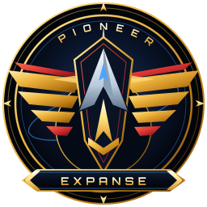

[](https://github.com/austeregrim/pioneer-expanse/actions)
[](http://www.gnu.org/licenses/gpl-3.0.html)

# Pioneer: Expanse

<p align="center">
  
</p>

[](http://www.gnu.org/licenses/gpl-3.0.html)

**Pioneer: Expanse** is an independent single-player fork of the open-source space simulation game [Pioneer](https://github.com/pioneerspacesim/pioneer) (originally inspired by *Frontier: Elite II*).

This fork reimagines Pioneer with core flight mechanics, pacing, graphics, fleet management, and systemic gameplay inspired by *Elite: Dangerous* and *X4: Foundations*—replacing Newtonian time acceleration with real-time in-system **FTL Supercruise** flight, a multi-layered **Macro Galactic View** ($100,000\text{ ly}$ Milky Way disc and 3D faction territorial spheres), **Living NPC Supercruise Traffic & FSD Interdictions**, **Volumetric Planetary Rings & 3D Asteroid Mining**, **Multi-Ship Ownership & Autonomous Fleet Logistics**, high-density cockpit and station UI scaling, corporate and faction SVG heraldry, dynamic crisis-driven galactic events (**InterCast News**), an interstellar equity exchange, and an emergency escape pod search-and-rescue rebuy loop.

---

## Major Differences: Pioneer: Expanse vs. Original Pioneer

| Gameplay System | Original Pioneer Baseline | Pioneer: Expanse |
| :--- | :--- | :--- |
| **In-System Travel** | Newtonian flight accelerated via manual time-warp buttons ($1\times$ to $10,000\times$). | **FTL Supercruise (Frame Shift Drive)** from $30\text{ km/s}$ to $2,001c$ with real-time gravity well drag, 75% blue-zone regulation, and orbital safe dropouts. |
| **Flight Pacing & Clock** | Time compression during active flight; offline time can invalidate missions. | **1:1 Real-Time Flight Pacing**; simulation halts when game closes so deadlines guarantee active play time; docked starport "Pass Time" service. |
| **System NPC Traffic** | Local station-bound NPC spawns; static flight trajectories. | **Living Supercruise NPC Traffic**; ambient police patrols, pirate lanes, low wake signals, and active **FSD Interdictor** tether & evasion gameplay. |
| **Planetary Rings & Mining** | Flat 2D billboard ring textures with no physical depth or close-range interaction. | **Volumetric 3D Planetary Rings** with multi-band compositions, planetary self-shadowing, 3-tier LOD asteroid fields (up to 2,800 physical rocks), and laser mining. |
| **Ship Ownership & Fleet** | Single active ship only; buying a new vessel discards your previous ship. | **Multi-Ship Ownership & Station Hangars** (`PlayerFleet.lua`); hire NPC Captains, level skills, delegate missions, and issue autonomous X4-style trade/mine/patrol orders. |
| **Galactic & Sector Map** | Local sector grid views; camera cannot pull back to view the galaxy. | **Macro Galactic View ($100,000\text{ ly}$)** with continuous zoom, 45k-particle 3D star cloud, polar coordinates, 3D Fresnel faction territorial spheres & Voronoi borders. |
| **Galaxy State & News** | Static system economies; generic BBS boards with static text. | **Living Galaxy Crisis Engine**; hyperjumps tick dynamic events (blockades, outbreaks, booms, strikes), 3D conflict map overlays, and live **InterCast News** broadcasts. |
| **Financial Markets** | Static commodity trading between ports. | **Interstellar Stock Exchange (ISX)**; trade 8 megacorporation stocks, 4 faction indices, and local starport ventures; high-stakes Nav-Locus Sweepstakes. |
| **Ship Destruction & Death** | Sudden game over and forced reload of previous save. | **Search & Rescue (SAR) & Insurance Rebuy**; escape pod ejection, distance-scaled cryogenic rescue, starport clinic recovery, and 5% insurance hull/module rebuy. |
| **Hyperspace & Fuel** | Manual single-jump fuel transfers; artificial single-jump locks. | **Hyperdrive Auto-Feed & Dual-Tank Routing**; multi-jump route navigation calculating across total hydrogen capacity (5–8 jumps per full tank). |
| **Visuals & UI Density** | $1600\times 900$ baseline UI; procedural composite facegen sliders. | Native **$1920\times 1080$ UI density**, expanding folder tabs, crisp SVG corporate/faction crests, and automated Linux dedicated GPU offload (NVIDIA/AMD). |

---

## Key Implemented Features

* **In-System FTL Supercruise (Frame Shift Drive)**:
  * Cruise within star systems seamlessly from $30\text{ km/s}$ ($0.0001c$) up to $2,001c$ in deep space.
  * Planetary and stellar gravity wells actively impose drag and throttle limits.
  * Authentic $75\%$ throttle "Blue Zone" dynamics and the 6-second approach rule ("loop of shame" avoidance).
  * Safe disengage dropouts at orbital stations ($12\text{ km}$ facing station with zero relative velocity) and surface starports ($10\text{ km}$ altitude, $8\text{ km}$ standoff).
  * Dangerous exclusion zones with emergency dropouts, total shield collapse, and severe heat spikes.
  * Supercruise Assist (Autopilot Mk 2) for automated target alignment, throttle lock, and safe drop.
  * Projected orbital path ellipses, spherical exclusion zone rings, and double-precision FTL speed lines.

* **Living NPC Supercruise Traffic & Active FSD Interdiction**:
  * Dense NPC traffic cruising in Supercruise lanes between planetary bodies and stations.
  * Ambient pirate and security patrols; dropouts generate scanable Low Wake telemetry signatures.
  * FSD Interdictor module with rear-cone tether locking, dynamic Escape Vector HUD minigame / tug-of-war, and NPC evasion AI.
  * Security-scaled interdiction pacing (frequent challenges in anarchies; rare, rapid security response in high-security hubs).

* **Volumetric Planetary Rings & Ring Asteroid Mining**:
  * Multi-band Roche and frost-line planetary rings (icy, silicate, metallic) with realistic planetary self-shadowing shaders.
  * Planar Supercruise drop-in directly into planetary ring planes.
  * 3-tier volumetric `RingField` with instanced 3D asteroid boulder fields (up to 2,800 physical rocks), close-range 2D ring plane fade, and physical ship-asteroid collisions.
  * Ring laser mining spawning resource chunks and mineral fragments for cargo scooping.

* **Multi-Ship Ownership, Station Hangars & Fleet Autonomy**:
  * Persistent player fleet storage (`PlayerFleet.lua`); purchase new vessels directly into station hangars or store your current flagship.
  * Dedicated Station Hangar & Fleet Bay interface (`13-hangar.lua`) for vessel inspection, renaming, flagship swapping, maintenance, cargo transfers, selling, and remote ferry recalls across starports.
  * Captain and crew recruitment (`06-crew.lua`) with combat, trading, and mining skill progression.
  * Fleet Command interface (`05-fleet.lua`) supporting autonomous standing orders: Escort Flagship, Dock at Station, Autonomous Free Trade & Cargo Liquidation, Autonomous Ring Mining, and Sector Patrol.
  * Fleet Mission Delegation (`02-missions.lua`) across passenger transport, cargo delivery, courier, and bounty hunting contracts.
  * Dual-tier simulation: physical in-system flight transit and out-of-system (OOS) simulation with direct bank credit integration.

* **1:1 Real-Time Flight Pacing & Offline Preservation**:
  * Flight simulation progresses in 1:1 real-time—no artificial time-acceleration warp buttons needed during flight.
  * The simulation clock freezes when the game is closed; missions with deadlines guarantee actual active gameplay hours.
  * Starport lounge services provide docked "Pass Time / Wait" capabilities for scheduled rendezvous.

* **Macro Galactic View ($100,000\text{ ly}$ Milky Way)**:
  * Smooth, continuous 3D camera zoom out to the entire $100,000\text{ ly}$ Milky Way disc without sector generation stalls.
  * 9-layer vertically stratified galactic disc with 45,000-particle volumetric star cloud and Sagittarius A* central bulge glow.
  * Galactic polar coordinate rings, Sol bubble distance markers, 3D Fresnel faction territorial spheres, Voronoi intersection boundaries, and interactive 3D raycast panning with a contextual faction dossier.

* **Living Galaxy, Dynamic Crises & InterCast News**:
  * Hyperjumps trigger macro simulation ticks that drive dynamic crises (Frontline blockades, Humanitarian outbreaks, Market rushes, Political strikes) across populated systems.
  * Player catalyst mechanics: commodity deliveries and combat interventions actively resolve regional crises.
  * 3D Sector Map tactical conflict overlay highlighting crisis systems.
  * In-flight cockpit sidebar ticker and station terminals broadcasting live Interstellar News dispatches.

* **Interstellar Stock Exchange (ISX) & Nav-Locus Sweepstakes**:
  * Trade shares in 8 megaconglomerates, 4 faction composite indices, and procedurally generated local starport ventures whose stock prices actively react to galactic crises.
  * Full player stock portfolio tracking, buy/sell order execution, and quarterly dividend payouts.
  * High-stakes $90.7$-trillion-to-1 astrolabe sweepstakes with compounding multi-billion credit jackpots.

* **Search & Rescue (SAR), Insurance Rebuy & Hardcore Mode**:
  * Fatal ship destruction triggers an emergency escape pod ejection sequence followed by a distance-scaled cryogenic stasis jump (hours in-system to days/years across light-years) and medical recovery at the nearest starport.
  * Comprehensive Starport Insurance Terminal offering a 5% hull and module rebuy settlement (or starter loaner) with deep-space cargo flotsam coordinates.
  * Crew roster preservation and automatic recovery protection.
  * Dedicated Hardcore Ironman charter mode with fatal permadeath.

* **Hyperdrive Auto-Feed & Dual-Tank Fuel Management**:
  * Hyperspace jumps automatically draw hydrogen from the main propellant tank into the hyperdrive reservoir, eliminating artificial single-jump fuel locks.
  * Dual-tank hyperspace route calculations across the player's full fuel capacity (5–8 consecutive jumps on a single tank).

* **Curated Starts, Aesthetic Polish & Hardware Offload**:
  * Native $1920\times 1080$ UI density baseline, tightened typography, and expanding folder tabs in station interfaces.
  * Procedural composite faces replaced with crisp SVG corporate logos, faction crests, authority seals, and syndicate insignias.
  * Allegiance + Career Role new game start profiles (Solar Federation, Commonwealth, Haber Corp, Independent; Trader, Miner, Explorer, Mercenary) equipped with working Class 2 Hyperdrives.
  * Automatic dedicated GPU detection on Linux (NVIDIA Optimus and AMD PRIME hardware offload automatically enabled without manual wrapper scripts).

---

## Strategic Roadmap: Remaining Expansions (Pillars B–H)

Our strategic long-term development roadmap is documented in detail in the [`plans/`](plans/) directory. The foundation and core systemic mechanics are completed; the remaining lettered expansion pillars focus on surface exploration, engineering depth, covert operations, sensory overhauls, specialized manufacturers, deep-space alien expeditions, and capital-scale empire building:

* **[Plan B: Surface Reconnaissance Vehicles (SRVs) & Planetary Surface Operations](plans/B_PLAN_SRV_SURFACE_OPERATIONS.md)**:
  * Multi-wheel spring-damper suspension physics on `GroundVehicle` (`DynamicBody` subclass), Ackermann steering, and low-gravity vernier thrusters.
  * Amphibious waterjet and pontoon buoyancy mode for liquid hydrocarbon/water oceans.
  * Procedural instanced surface boulder scatter fields with physical Bullet convex colliders.
  * Acoustic-Spectral Waterfall Wave Scanner (`±90°` sweep) for locating mineral outcrops, crashes, and distress beacons.
  * Landed ship hangar deployment, boarding ramp transfer, and autonomous ship dismissal (> 2.5 km) & recall landing.
* **[Plan C: Engineering, Salvage & Matter Synthesis](plans/C_PLAN_ENGINEERING_CRAFTING.md)**:
  * Zero-cargo-mass player materials bank (Raw Elements, Manufactured Components, Encoded Data).
  * Atomic Scrap Reclamation from ship debris and ring mining fragments.
  * On-the-fly field Matter Synthesis (FSD injection range boosts, emergency life-support $O_2$, munitions re-arm, hull limpets).
  * Deterministic Grade 1–5 Engineer blueprint progression and unique Experimental Effect overrides.
* **[Plan D: Electronic Warfare, Infiltration & Megaships](plans/D_PLAN_HACKING_INFILTRATION.md)**:
  * Non-dockable orbital Megaships, orbital installations, and penal colonies with sub-targetable cargo bays, data relays, and defense grids.
  * Datalink Scanner with two-phase interactive signal intrusion and frequency-bypass minigames.
  * Planetary settlement trespass security zones, alarm klaxons, and automated Skimmer defense drone patrols.
* **[Plan E: Graphics, Atmospheric Shaders & Vacuum Audio Overhaul](plans/E_PLAN_GRAPHICS_AUDIO_OVERHAUL.md)**:
  * PBR multi-splat terrain shaders (`albedo`, `normal`, `roughness`, `metallic`, `AO`) with slope-based triplanar projection.
  * Analytical Rayleigh & Mie atmospheric scattering with realistic sunset limb glow and planetary shadow projection.
  * Dynamic cockpit canopy glass shaders: micro-abrasions, star glare, heat shimmer, and cold-running frost (< 20% heat).
  * OpenAL vacuum low-pass acoustic filtering (distinguishing exterior vacuum-attenuated detonations from internal hull transducer vibrations).
  * Synthesized Cockpit AI Voice advisory priority queue ("FSD charging", "Warning: Temperature critical", "Shields offline").
* **[Plan F: Aerospace Megacorporations & Modular Slot Outfitting](plans/F_PLAN_FLEET_MANUFACTURERS.md)**:
  * Four major aerospace manufacturers with unique design languages and flight philosophies.
  * Four-tier outfitting architecture: Core Internals (Class 1–8), Weapon Hardpoints (Class 1–4 Fixed/Gimballed/Turreted) & Utility Mounts, Dedicated Avionics, and Flexible Internal Compartments.
* **[Plan G: Deep Exploration, Wing Missions & Alien Civilizations](plans/G_PLAN_EXPLORATION_ALIENS.md)**:
  * Full-Spectrum System (FSS) waveform scanner and orbital Detailed Surface Scanner (DSS) gravity-curved mapping probes.
  * Wing escort contracts, VIP luxury passenger transport, and burning-station refugee evacuations.
  * Non-human deep-space civilizations guarding outer nebulae and relics (*Hydrazine Swarm* and *Archon Automata*).
* **[Plan H: Capital Ships, Station Construction & Grand Strategy](plans/H_PLAN_CAPITAL_SHIPS_AND_EMPIRE_BUILDING.md)**:
  * Playable and AI-commanded Capital Ships & Fleet Carriers with multi-turret fire control networks.
  * Modular player starport and orbital station construction.
  * Closed-loop industrial factories, NPC Station Managers, and sector-wide territorial sovereignty.

---

## Open Source Licensing & AI Collaboration

### GNU General Public License v3 (GPLv3)
Pioneer: Expanse is free and open-source software distributed under the terms of the **[GNU General Public License version 3 (GPLv3)](http://www.gnu.org/licenses/gpl-3.0.html)** (or, at your option, any later version), maintaining complete licensing continuity with Pioneer.

The GPLv3 guarantees the four fundamental software freedoms: the freedom to run, study, modify, and redistribute the program. The GPLv3 governs the distribution of software and places zero restriction on the tools, compilers, editors, or artificial intelligence models utilized by developers to create or assist in authoring source code.

### AI Collaboration & Licensing Terms
This fork is developed in close human-AI architectural collaboration using Google DeepMind frontier models:
* **Google Argon / Gemini 4**
* **Gemini 3.8**

To ensure unambiguous legal clarity and full downstream open-source compliance:
1. **GPLv3 Licensing of All Contributions**: All modifications, architectures, algorithms, scripts, vector graphics, shaders, and assets introduced in Pioneer: Expanse are licensed under the GNU GPLv3.
2. **Public Domain Fallback**: To the extent that any legal jurisdiction deems machine-assisted or machine-generated expressions non-copyrightable, all such contributions are dedicated unconditionally to the **Public Domain** (or under the terms of the Creative Commons CC0 1.0 Universal Public Domain Dedication), which is fully permissive and 100% compatible with GPLv3 distribution.
3. **Freedom for All Downstream Users**: Anyone is free to fork, study, compile, modify, and redistribute Pioneer: Expanse under the terms of the GNU GPLv3.

---

## Community & Upstream Heritage

Pioneer: Expanse builds with deep appreciation upon the foundation created by the upstream Pioneer contributors over more than a decade:
* Upstream Pioneer Project: [https://pioneerspacesim.net/](https://pioneerspacesim.net/)
* Upstream Repository: [https://github.com/pioneerspacesim/pioneer](https://github.com/pioneerspacesim/pioneer)
* Original License: [GNU General Public License v3 (GPLv3)](http://www.gnu.org/licenses/gpl-3.0.html)

## Compiling from Source

Pioneer: Expanse builds using CMake and Ninja on modern Linux distributions:

```bash
# Install dependencies (Debian/Ubuntu)
sudo apt-get install cmake ninja-build libsdl2-dev libglew-dev libassimp-dev \
                     libvorbis-dev libsigc++-2.0-dev libfreetype-dev libopenal-dev

# Configure and compile
cmake -B build -G Ninja -DCMAKE_BUILD_TYPE=Release
cmake --build build --target pioneer unittest build-data -j $(nproc)

# Run unit tests
./build/unittest

# Launch game
./build/pioneer
```

For detailed platform compilation notes, see [COMPILING.txt](COMPILING.txt).

## Changelog

For the complete log of changes since the upstream baseline, please see [Changelog.txt](Changelog.txt).
