# Pioneer: Expanse — Long-Term Master Roadmap & Priority Index

Transforming **Pioneer: Expanse** into a deep single-player space simulation combining *Elite Dangerous*-grade Newtonian/FTL flight mechanics, fleet autonomy, planetary exploration, modular engineering, electronic infiltration, and a living procedural galaxy.

---

## 1. Strategic Vision & Architectural Principles

1. **Standalone Single-Player Depth**: Deliver interconnected systemic gameplay without MMO network latency, forced server wipes, or RNG progression treadmills.
2. **Deep Simulation with Meaningful Physicality**: Ground mechanics in astrophysics and rigid-body simulation—from planetary Roche rings, Supercruise gravity wells, and Keplerian local frames down to atmospheric weather and hull acoustics.
3. **Cohesive In-Universe Lore**: Anchor aerospace manufacturers, covert engineers, megastructures, and deep-space non-human encounters inside a serious **Pioneer: Expanse** setting using crisp SVG corporate iconography (`data/icons/logos/`).
4. **Asset-Smart Sequenced Pillars**: Complete code/audio/shader systems (`Plan J` Frontline Support, `Plan C`/`F`/`G` code pillars) ahead of 3D-asset-gated milestones (`Plan B` SRVs, `Plan E` M8 Cockpits, `Plan D` Megaships, `Plan G` M4 Aliens).

---

## 2. Master Architecture & Dependency Graph

```mermaid
graph TD
    subgraph Completed["Completed Core & Systems (Plans 02-04, A, I, E M1-7)"]
        F1["FSD Supercruise, Autopilot Mk 2-4 & Dual-Tank Routing"]
        F2["Macro 3D Galactic Map (100k ly), Cross-System Targets & Panning"]
        F3["NPC Supercruise Traffic, ShipRegistry & FSD Interdiction"]
        F4["Volumetric Rings, 3D Asteroid Field & Ring Mining"]
        F5["Dynamic Crises, InterCast, ISX Stocks, Lottery, Taxes & Penal"]
        F6["Plan A: Multi-Ship Hangars, Resident Vaults, Captains & Fleet Autonomy"]
        F7["Plan I: Transponder, Dark Running, Licences & Warrant Scanner"]
        F8["Plan E (M1-7): PBR, Weather, Terrain, Quality Presets, Vacuum Audio & Aria Voice"]
    end

    subgraph NextSequence["Active Priority Sequence"]
        S3["1. Plan J (Next Up): Military Enlistment, Non-Combat Frontline Support & Deputy Charter"]
    end

    subgraph Discussion["Design Discussion Queue (Code-First)"]
        PC["Plan C: Engineering, Salvage & Matter Synthesis"]
        PF["Plan F (Core): Turrets, Hardpoints & Countermeasures (No Pips)"]
        PG["Plan G (M1-M3): FSS/DSS Probes & Crisis Evacuations"]
    end

    subgraph AssetGated["3D-Asset & Endgame Pillars"]
        PB["Plan B: SRV Surface Operations & Wave Scanner"]
        PE8["Plan E (M8): 3D Cockpits & Canopy Glass"]
        PD["Plan D: Megaships, Hacking & Trespass"]
        PGA["Plan G (M4): Alien Fleets"]
        PH["Plan H: Capital Ships, Fleet Carriers & Station Building"]
    end

    Completed --> S3 --> Discussion
    Discussion --> AssetGated
```

---

## 3. Master Plan Index & Priority Matrix

| Order | Plan Document | Scope & Core Deliverables | Dependencies | Status |
| :--- | :--- | :--- | :--- | :--- |
| **Core** | **[`02_PIONEER_EXPANSE_FOUNDATION_PLAN.md`](./02_PIONEER_EXPANSE_FOUNDATION_PLAN.md)** | Native build, 1080p UI, SVG logos, allegiance starts, 100k ly galaxy map, Cross-System Target Memory & F2 targeting, Supercruise, real-time economy (docked time dilation), Crises, InterCast, ISX, Lottery, Taxes, Penal, SAR Rebuy | None | **Completed** |
| **Core** | **[`03_VOLUMETRIC_RINGS_AND_MINING_PLAN.md`](./03_VOLUMETRIC_RINGS_AND_MINING_PLAN.md)** | Multi-band Roche rings, planetary ring shadows, planar Supercruise drop, 3-tier LOD 3D asteroid field, close-range 2D fade, collisions & laser mining | Plan 02 | **Completed** |
| **Core** | **[`04_NPC_SUPERCRUISE_INTERDICTION_PLAN.md`](./04_NPC_SUPERCRUISE_INTERDICTION_PLAN.md)** | Universal NPC Supercruise traffic, station occlusion, ambient patrol/pirate spawns, Low Wakes, FSD Interdictor tug-of-war, NPC evasion & security pacing | Plan 02 | **Completed** |
| **Plan A** | **[`A_PLAN_MULTI_SHIP_AND_CREW_AUTONOMY.md`](./A_PLAN_MULTI_SHIP_AND_CREW_AUTONOMY.md)** | Multi-ship ownership, hangars, ship swap, cargo/module transfer, Resident Station Storage Vaults (500t/50 modules), captains/5 skills/payroll, `FOLLOW`/`DOCK`/`AUTO_TRADE` Cr/hr/`AUTO_MINE`/`PATROL`/piracy, mission delegation, IS/OOS sim | Plans 02–04 | **Completed** |
| **Plan I** | **[`I_PLAN_TRANSPONDER_AND_STEALTH.md`](./I_PLAN_TRANSPONDER_AND_STEALTH.md)** | Transponder on/off, dark running `<1c`, persistent locks, police witness FOV + occlusion, bounty licences, Warrant Scanner, sub-light sensors & smugglers | Plan 04 | **Completed** |
| **Plan E** | **[`E_PLAN_GRAPHICS_AUDIO_OVERHAUL.md`](./E_PLAN_GRAPHICS_AUDIO_OVERHAUL.md)** | **Completed (M1–7)**: Enhanced Graphics toggle, Low–Extreme quality presets, PBR, terrain-occluded flares, plumes, gas giants, dual clouds, ocean waves, chemistry/weather Rayleigh/Mie, galactic skybox/starfield, dwarf planets, 20m tri-planar terrain, bump-mapped 3D `SurfaceScatter` & ring boulders, volcanic magma/plumes, 3D weather/lightning, ship lights, 4-tier chimes, situational hull/weather soundscapes, OpenAL EFX vacuum low-pass & **Aria** Cockpit AI voice. **Asset-Gated**: **M8** (3D cockpits & canopy glass). | Plan 02 | **Completed (M1–7; M8 Asset-Gated)** |
| **Plan J** | **[`J_PLAN_MILITARY_FRONTLINE_AND_DEPUTY.md`](./J_PLAN_MILITARY_FRONTLINE_AND_DEPUTY.md)** | Military enlistment, non-combat frontline support (blockade running, supply convoys, evacuations, recon, Plan A fleet support), optional combat zones, and high-standing **Faction Deputy Charter** | Plan I & Crises | **Next Up (Design / Implementation)** |
| **Plan C** | **[`C_PLAN_ENGINEERING_CRAFTING.md`](./C_PLAN_ENGINEERING_CRAFTING.md)** | Zero-mass raw/manufactured/encoded material ledger, Scrap Reclamation, in-field matter synthesis (boosts/O2/ammo) & deterministic G1–G5 Engineers with Experimental overrides | Plan 03 & Plan I | **Queued (Design Discussion)** |
| **Plan F** | **[`F_PLAN_FLEET_MANUFACTURERS.md`](./F_PLAN_FLEET_MANUFACTURERS.md)** | **Completed**: 6 Manufacturer franchise dealerships (`corp_*.svg`) & 8 station profiles. **Queued**: Modular slot cleanup, Fixed/Gimballed/Turreted weapons, deployable hardpoints & countermeasures *(no `SYS/ENG/WEP` pips)*; **Asset-Gated**: `.gltf` fleet | Plan 02 | **Partially Done (Combat/Slots Queued)** |
| **Plan G** | **[`G_PLAN_EXPLORATION_ALIENS.md`](./G_PLAN_EXPLORATION_ALIENS.md)** | **Completed**: Universal Cartographics, Discovery Scanner & Scan Manager. **Queued**: FSS waveform tuning, DSS orbital probes (surface POIs & ring hotspots), VIP liners & burning-station evacs; **Asset-Gated**: Alien fleets | Plan 03, C, D | **Partially Done (FSS/DSS/Evacs Queued)** |
| **Plan B** | **[`B_PLAN_SRV_SURFACE_OPERATIONS.md`](./B_PLAN_SRV_SURFACE_OPERATIONS.md)** | `GroundVehicle` suspension physics, amphibious sea mode, SRV vehicle bay deploy/dismiss/recall, boulder colliders & acoustic-spectral wave scanner *(requires Blender/AI SRV 3D model)* | Plan E | **Asset-Gated (Needs SRV Model)** |
| **Plan D** | **[`D_PLAN_HACKING_INFILTRATION.md`](./D_PLAN_HACKING_INFILTRATION.md)** | Datalink Scanner & two-phase frequency-bypass puzzle, non-dockable orbital Megaships (cargo hatches/uplinks/relays), settlement trespass & Skimmer drones | Plan B & Plan F | **Queued / Asset-Gated** |
| **Plan H** | **[`H_PLAN_CAPITAL_SHIPS_AND_EMPIRE_BUILDING.md`](./H_PLAN_CAPITAL_SHIPS_AND_EMPIRE_BUILDING.md)** | Playable/AI Capital Ships & Fleet Carriers, multi-turret fire control, modular player station construction, NPC Station Managers, closed-loop industry & sector sovereignty | Plan A, Plan F, Plan G | **Queued (Endgame)** |

---

## 4. Confirmed Sequenced Rollout

1. **Step 1 — Enact Plan J (Military Frontline Support & Deputy Charter) (Next Up)**:
   * Build non-combat frontline logistics/recon/extraction, fleet support, optional combat zones, and high-standing Deputy authority on top of Plan I licences and `MacroGalaxyEngine`.
2. **Step 2 — Design Discussions & Code-First Pillars**:
   * Discuss and scope **Plan C** (materials & synthesis boosts), **Plan F** (turrets, hardpoints, countermeasures—without `SYS/ENG/WEP` pips), and **Plan G M1–M3** (FSS/DSS probes & crisis evacuations).
3. **Step 3 — 3D-Asset & Endgame Pillars**:
   * Prepare Blender/AI-assisted `.glb` assets for **Plan B** (SRVs), **Plan E M8** (3D Cockpits), **Plan D** (Megaships), **Plan G M4** (Aliens), and **Plan H** (Capital Ships & Empire Building).

---

*This document serves as the executive charter and priority index for Pioneer: Expanse. Inspect the linked plan files above for C++/Lua interfaces, shader designs, milestones, and verification plans.*
