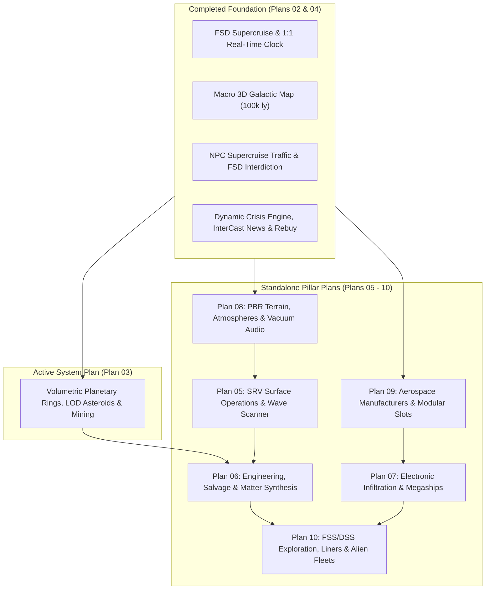

# Pioneer: Expanse — Long-Term Master Roadmap & Priority Index

Transforming **Pioneer: Expanse** into a deep single-player space simulation combining *Elite Dangerous*-grade Newtonian/FTL flight mechanics, planetary exploration, modular engineering, electronic infiltration, and a living procedural galaxy.

---

## 1. Strategic Vision & Architectural Principles

1. **Standalone Single-Player Depth**: Deliver interconnected systemic gameplay without MMO network latency, forced server wipes, or RNG progression treadmills.
2. **Deep Simulation with Meaningful Physicality**: Ground mechanics in astrophysics and rigid-body simulation—from planetary Roche rings, Supercruise gravity wells, and Keplerian local frames down to wheel suspension and liquid sea buoyancy.
3. **Cohesive In-Universe Lore**: Anchor aerospace manufacturers, covert engineers, megastructures, and deep-space non-human encounters inside a serious **Pioneer: Expanse** setting using crisp SVG corporate iconography (`data/icons/logos/`).
4. **Pillar-Driven Execution**: Detailed class designs, file targets, milestones, and verification criteria now live in dedicated standalone plan documents (`02`–`10`) indexed below for clean sprint prioritization.

---

## 2. Master Architecture & Dependency Graph

---

## 3. Master Plan Index & Priority Matrix

| Priority | Plan Document | Scope & Core Deliverables | Dependencies | Status |
| :--- | :--- | :--- | :--- | :--- |
| **Core** | **[`02_PIONEER_EXPANSE_FOUNDATION_PLAN.md`](./02_PIONEER_EXPANSE_FOUNDATION_PLAN.md)** | Dev build, 1080p UI density, SVG logos, allegiance starts, 100k ly galaxy map, player Supercruise, Dynamic Crises, InterCast News, Rebuy *(Phase 6 station Pass Time queued)* | None | **Phases 1–5, 7–8 Completed** |
| **Core** | **[`04_NPC_SUPERCRUISE_INTERDICTION_PLAN.md`](./04_NPC_SUPERCRUISE_INTERDICTION_PLAN.md)** | Universal NPC Supercruise traffic, station occlusion, ambient patrol/pirate spawns, Low Wakes, FSD Interdictor minigame & mass lock | Plan 02 | **Completed** |
| **P0** | **[`03_VOLUMETRIC_RINGS_AND_MINING_PLAN.md`](./03_VOLUMETRIC_RINGS_AND_MINING_PLAN.md)** | Multi-band Roche rings, planetary ring shadows, planar Supercruise drop, 3-tier LOD asteroid field, ship collisions & composition-driven mining | Plan 02 | **In Execution Queue** |
| **P1** | **[`09_PLAN_FLEET_MANUFACTURERS.md`](./09_PLAN_FLEET_MANUFACTURERS.md)** | Four aerospace corporations (SDA, Aethelgard, Guan-Haber, Frontier), 4-tier modular slot refactor, Fixed/Gimballed/Turreted Class 1–4 mounts & `.gltf` pipeline | Plan 02 | **Queued** |
| **P2** | **[`08_PLAN_GRAPHICS_AUDIO_OVERHAUL.md`](./08_PLAN_GRAPHICS_AUDIO_OVERHAUL.md)** | PBR multi-splat terrain, Rayleigh/Mie atmosphere shaders, canopy scratch/frost glass shader, OpenAL vacuum low-pass audio & cockpit AI voice | Plan 02 | **Queued** |
| **P3** | **[`05_PLAN_SRV_SURFACE_OPERATIONS.md`](./05_PLAN_SRV_SURFACE_OPERATIONS.md)** | `GroundVehicle` suspension physics, amphibious sea mode, SRV vehicle bay deploy/dismiss/recall, boulder colliders & acoustic-spectral wave scanner | Plan 08 *(terrain shaders)* | **Ready to Plan** |
| **P4** | **[`06_PLAN_ENGINEERING_CRAFTING.md`](./06_PLAN_ENGINEERING_CRAFTING.md)** | Zero-mass raw/manufactured/encoded material ledger, Scrap Reclamation, in-field matter synthesis & deterministic G1–G5 Engineers with Experimental overrides | Plan 03 & Plan 05 | **Queued** |
| **P5** | **[`07_PLAN_HACKING_INFILTRATION.md`](./07_PLAN_HACKING_INFILTRATION.md)** | Datalink Scanner & two-phase frequency-bypass puzzle, non-dockable orbital Megaships (cargo hatches/uplinks/relays), settlement trespass & Skimmer drones | Plan 05 & Plan 09 | **Queued** |
| **P6** | **[`10_PLAN_EXPLORATION_ALIENS.md`](./10_PLAN_EXPLORATION_ALIENS.md)** | Waveform FSS system scanner, ballistic DSS surface/ring probes, wing escorts, burning-station evacs, and *Hydrazine Swarm* / *Archon Automata* fleets | Plan 03, Plan 06, Plan 07 | **Queued** |

---

## 4. Recommended Sequenced Rollout

1. **Immediate Core Completion**: Finish Plan **03** (*Volumetric Rings & Asteroid Mining*) alongside remaining Phase 6 (*Real-Time Mission Economy & Station Wait Service*) in Plan **02**.
2. **Ship & World Immersion Layer**: Enact Plan **09** (*Modular Slots & Manufacturers*) and Plan **08** (*PBR Terrain, Atmospheres & Vacuum Audio*) to establish modern vessel outfitting and planetary visuals ahead of surface exploration.
3. **Surface & Progression Loops**: Enact Plan **05** (*SRV Surface Operations*) followed immediately by Plan **06** (*Engineering & Matter Synthesis*), giving mining, planetary prospecting, and combat salvage unified long-term rewards.
4. **Covert Ops & Deep-Space Endgame**: Enact Plan **07** (*Hacking, Megaships & Trespass Security*) and finish with Plan **10** (*FSS/DSS Exploration, Crisis Liners & Alien Civilizations*).

---

*This document serves as the executive charter and priority index for Pioneer: Expanse. Inspect the linked plan files above for C++/Lua interfaces, shader designs, milestones, and verification plans.*
