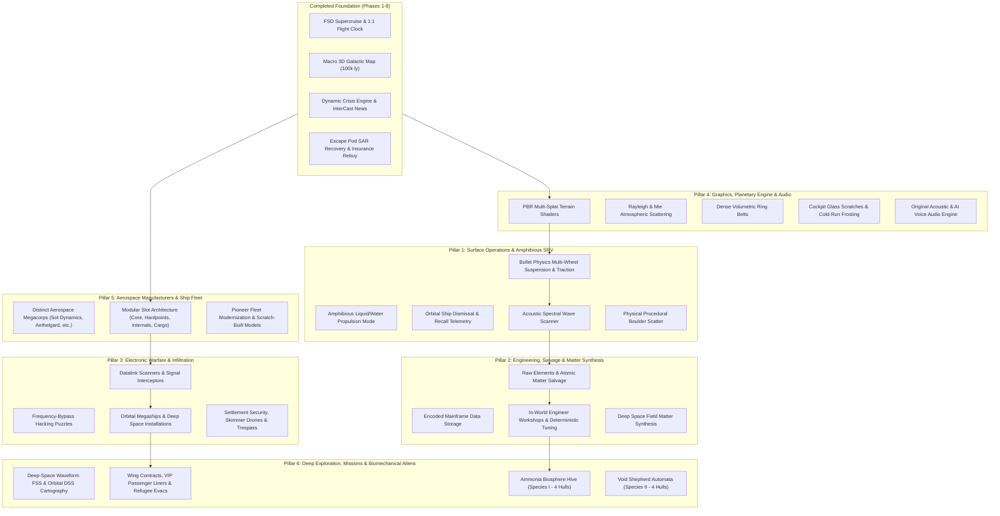

# Pioneer: Expanse — Long-Term Master Roadmap

Transforming **Pioneer: Expanse** into the definitive single-player space simulation combining Newtonian/FTL flight mechanics, deep planetary exploration, modular engineering, covert electronic infiltration, and an evolving galaxy.

---

## Strategic Vision & Architectural Principles

1. **Standalone Single-Player Depth**: Build rich, interconnected mechanics without the grind, network latency, or server dependencies of MMOs, while retaining the depth and polish of *Elite Dangerous*.
2. **Deep Simulation with Meaningful Physicality**: From orbital mechanics and FSD Supercruise to ground vehicle suspension, wheel traction, and buoyancy on exotic liquid seas.
3. **Cohesive In-Universe Lore**: Ground every ship manufacturer, engineer, corporation, and alien encounter in an expanded, serious **Pioneer Expanse** setting with distinct visual identities and industrial philosophies.
4. **Pillar-Driven Staged Execution**: This roadmap establishes the architectural blueprints for the 6 core pillars. As each pillar advances, dedicated sub-plan files will be stood up to drive sprint implementations.

---

## High-Level Roadmap Overview



---

## Pillar 1: Surface Reconnaissance Vehicles (SRV) & Planetary Driving

### 1.1 Multi-Wheel Physics & Suspension Model
* **Bullet Rigid-Body Integration**:
  * Build `GroundVehicle` subclass of `DynamicBody` leveraging Bullet's `btRaycastVehicle` / multi-link spring-damper suspension.
  * Real-time chassis reaction to terrain slope, obstacles, gravity ($0.05g$ to $3.5g$), and centrifugal forces.
  * Progressive tire traction curves: grip dynamically shifts across surface types (fine basalt regolith, slippery water ice, crusted hydrocarbon sludge, iron-rich sand).
* **Vertical Vernier Thrusters & Hop Dynamics**:
  * Dual-mode directional RCS thrusters powered by vehicle distributor capacitor.
  * Allows vertical obstacle jumps, orientation stabilization in mid-air, and controlled descents on low-gravity moons.

### 1.2 Amphibious Marine Transformation Mode
* **Liquid Interaction**:
  * Detect planetary surface ocean bodies (liquid water, methane, ethane, liquid ammonia).
  * Smooth transition upon water entry: deploy pontoon buoyancy collars, disengage wheel drive, and activate directional ducted waterjets/propellers.
  * Hydrodynamic drag model allowing surface lake/sea navigation, shoreline prospecting, and amphibious island landings.

### 1.3 Ship Logistics, Dismissal & Recall Protocol
* **Physical Hangar Ramp**:
  * Ships equipped with an **SRV Vehicle Bay** deploy the rover directly underneath or down the rear landing ramp.
  * Player controls shift seamlessly to the rover cockpit; the parent ship locks thrusters, powers down non-essential systems, and activates automated point defense.
* **Autonomous Orbital Departure & Recall**:
  * If the player travels $>2.5\text{ km}$ from the landed ship (or triggers manual dismissal via the SRV Comms panel), the ship launches autonomously, enters sub-orbital flight, and jumps to low orbit safety.
  * "Recall Ship" button scans the local terrain within $500\text{m}$, computes the flattest terrain patch, guides the ship in for automated vertical landing, and lowers the boarding bay.

### 1.4 Spectral Directional Wave Scanner
* **Custom Acoustic-Spectral Concept**:
  * Replace static radar with an integrated **Acoustic-Spectral Waterfall Display** mounted above the SRV dashboard.
  * Passive directional sensor that translates ambient radio/seismic resonance into horizontal sweep bands and distinct audio frequencies:
    * *Low hollow rumble + bottom-band trace*: Dense metallic meteorites and nickel-iron outcrops.
    * *High sharp chirp + top-band trace*: Artificial electronic signals (derelict shipwrecks, distress transponders, cargo canisters).
    * *Mid-range crackle + split bands*: Volcanic fumaroles, geysers, and mineral formations.

### 1.5 Surface Detail, Physical Scatter & Terrain Collision
* **Procedural Rock & Boulder Scatter**:
  * Procedurally generate instanced rock fields aligned with the terrain heightmap and local geological biome.
  * Generate physical Bullet collision hulls for medium and large boulders; small gravel handled via suspension perturbation and particle kickup.
  * Dynamic tire-track decals and dust volume plumes varying by atmospheric density and surface dryness.

---

## Pillar 2: Crafting, Engineering & Matter Synthesis

### 2.1 The Material Economy
* **Raw Elemental Materials**:
  * Chemical elements categorized by abundance tiers (Grade 1 Common: *Iron, Nickel, Carbon, Sulphur* to Grade 5 Very Rare: *Polonium, Ruthenium, Tellurium*).
  * Harvested from surface outcrops with the SRV plasma repeater, mining lasers, or deep-space asteroid core explosions.
* **Deconstructed Atomic Matter (Salvage System)**:
  * Deconstruct damaged wreckage, scrap metal, pirated module debris, and orbital flotsam into high-purity synthesized components (*Refined Conductors, Phase Alloys, Polymer Matrices, Biomorphic Shield Fragments*).
  * Scrap Reclamation Unit installed on ships or accessed at industrial starports.
* **Encoded Telemetry & Cryptographic Data**:
  * Acquired via passive radar surveillance, scanning anomalous celestial phenomena, decrypting distress black boxes, and hacking orbital data beacons.
  * Stored directly in the ship's mainframe memory banks (occupies no physical cargo space).

### 2.2 Deep Space Field Matter Synthesis
* **On-the-Fly Crafting**:
  * **FSD Injection Boost**: +25%, +50%, or +100% single-jump hyperdrive range using exotic raw elements.
  * **Emergency Atmospheric Replenishment**: Synthesize O2/N2 gas canisters when life support is compromised.
  * **Munitions & Consumables**: Re-arm kinetic multi-cannons, replenish heat sink cartridges, assemble ECM chaff canisters, and repair SRV chassis armor without docking.

### 2.3 Covert In-World Engineers
* **Specialist Recluse Contacts**:
  * Isolated planetary workshops hidden on remote moons, revealed only when meeting discovery prerequisites (e.g. *Travel 5,000 ly from Sol*, *Reach Elite Combat rank*, *Smuggle 50 tonnes of illicit narcotics*).
* **Deterministic Upgrade Paths (No RNG Roulette)**:
  * Clear, transparent progression from Grade 1 to Grade 5 with guaranteed stat improvements per material delivery.
  * **Experimental Overrides**: Custom modifications providing unique tactical trade-offs (e.g., *Thermal Vent* — beam lasers vent ship heat into the target; *Mass Manager* — optimized FSD fuel curves; *Corrosive Shell* — debuffs enemy armor hardness).

---

## Pillar 3: Electronic Infiltration, Hacking & Infrastructure

### 3.1 Electronic Intrusion & Hacking Mechanics
* **Datalink & Ranged Interception**:
  * Target sub-components within line of sight ($200\text{m}$ ship range, $50\text{m}$ SRV range) and fire a sustained datalink beam to establish a handshake.
* **Interactive Frequency-Bypass Puzzle**:
  * Two-phase approach:
    * *Phase 1 (Immediate implementation)*: Range-held decryption countdown with security counter-traces.
    * *Phase 2 (Full minigame)*: Dynamic waveform alignment and node routing puzzle. Match carrier frequency, bypass rotating logic gates, and sever firewalls before security intrusion alarms trip.

### 3.2 Megaships, Communications Arrays & Deep-Space Installations
* **Non-Dockable Massive Structures**:
  * Superstructures (bulk cargo freighters, scientific communications arrays, orbital penal colonies, automated mining rigs).
  * Sub-targetable interactive components:
    * **Cargo Bay Hatches**: Hack with electronic limpets to force-vent valuable industrial payloads.
    * **Telemetry Uplinks**: Decrypt classified corporate transmissions and high-value system trade data.
    * **Defense Grid Relays**: Disable regional turrets and radar domes before salvage operations.

### 3.3 Settlement Infiltration & Trespass Security
* **Restricted Airspace & Perimeter Zones**:
  * Trespass warning timer (30-second grace window to vacate unauthorized landing zones or secure compounds).
  * Automated defense escalation:
    1. Warning klaxons and spotlights track the intruder.
    2. Automated point-defense cannons and surface-to-air missile batteries lock on.
    3. Automated Skimmer Patrol Drones deploy to engage ground rovers.
    4. Local jurisdiction issues an immediate bountied warrant.

---

## Pillar 4: Graphics, Planetary Engine & Audio Overhaul

### 4.1 Phased Visual Roadmap
1. **PBR Multi-Splat Terrain Shaders (Priority 1)**:
   * Multi-material surface splatting based on terrain slope, elevation, and mineral presence.
   * Physically based rendering: true normal maps, roughness variation, and ambient occlusion across planetary crusts.
2. **Atmospheric Rayleigh & Mie Scattering (Priority 2)**:
   * Physically modeled light scattering simulating blue sky Rayleigh diffusion, sunset/twilight red shifts, and dusty hazes on thin or thick atmospheres.
   * Realistic shadow casting through atmospheres and onto rings.
3. **Physical Procedural Surface Scatter (Priority 3)**:
   * Dynamic GPU-instanced boulder and rock fields with physics collision models.
4. **Volumetric Planetary Ring Systems (Priority 4)**:
   * High-density asteroid belts with micro-particulate dust fog, localized shadows from the parent planet, and dense rock fields visible during Supercruise drop-ins.
5. **Cockpit & Canopy Detail Shaders (Priority 5)**:
   * Dynamic canopy glass shader featuring micro-abrasions, glare reflection, heat distortion ripples near stars, and frost crystallization across the glass during stealth/cold-running ($<20\%$ heat).

### 4.2 Modernized Audio Engine & Original Soundscape
* **Original Acoustic Identity**:
  * Dedicated sound design for FSD spooling, witch-space transit thrum, thruster boost rumble, and dynamic cockpit strain under high G-forces.
  * **Vacuum Acoustics Model**: Realistic muffled low-frequency dampening for exterior explosions and impacts, simulating ship acoustic sensors translating vibrations into pilot audio cues.
* **Synthesized Cockpit AI Voice System**:
  * Clean, customizable voice advisories (*"Frame Shift Drive charging", "Warning: Temperature critical", "Landing gear deployed", "Under attack"*).

---

## Pillar 5: Aerospace Manufacturers & Ship Fleet

### 5.1 Distinct Aerospace Corporations & Design Languages
Rather than generic hulls, the Pioneer Expanse universe is powered by competing industrial giants with distinct manufacturing philosophies:

```
+------------------------------------+------------------------------------+
| Sol-Dynamics Aerospace (SDA)       | Aethelgard Starworks               |
| - Affiliation: Solar Federation    | - Affiliation: Commonwealth        |
| - Design: Brutalist, angular,      | - Design: Flowing aerodynamic      |
|   heavy armor, exposed conduits    |   lines, pristine composites       |
| - Roles: Military Gunships &       | - Roles: Luxury Transport & High-  |
|   Heavy Armored Freighters         |   Speed Interceptors               |
+------------------------------------+------------------------------------+
| Guan-Haber Industrial Heavyworks   | Frontier Voidcraft Cooperative     |
| - Affiliation: Haber Corporation   | - Affiliation: Independents / Rim  |
| - Design: Industrial lattice       | - Design: Asymmetric, modular kit- |
|   frameworks, raw metal plating    |   bashed rugged hulls              |
| - Roles: Deep-Core Mining & Heavy  | - Roles: Multi-Role Exploration &  |
|   Bulk Transport                   |   Mercenary Gunboats               |
+------------------------------------+------------------------------------+
```

### 5.2 Streamlined Modular Slot Architecture
Replace clutter with four cleanly organized module tiers:

1. **Dedicated Core Internals** (Fixed size/grade slots per hull):
   * Power Plant (Generates MW power output).
   * Thruster Array (Determines sub-light agility, max speed, and hover capacity).
   * Frame Shift Drive (Controls hyperjump range and Supercruise acceleration).
   * Life Support System (Atmospheric scrubbers and emergency reserve timer).
   * Power Distributor (Allocates energy between SYS, ENG, and WEP capacitors).
   * Sensors & Avionics (Target acquisition range and scanner resolution).
   * Shield Generator (Thermal and kinetic protection).
2. **External Hardpoints & Utilities**:
   * Weapon Hardpoints rated by class (Class 1 Small, Class 2 Medium, Class 3 Large, Class 4 Huge) supporting **Fixed**, **Gimballed**, and **Turreted** mounts.
   * Utility Mounts: Chaff Launchers, Heat Sink Launchers, Point Defense Turrets, Electronic Countermeasure (ECM) pods.
3. **Internal Systems & Avionics**:
   * Computer Mainframes, Planetary Landing Computer, Supercruise Assist Mk 2, Advanced Surface Scanners.
4. **Flexible Cargo & Utility Bays (Modular Capacity)**:
   * Modular internal bays partitioned freely by the player into:
     * Cargo Racks (tonnage storage).
     * Passenger Berths (Economy, Business, First Class, Luxury).
     * Auxiliary Fuel Bladders.
     * Vehicle Hangars (SRV Planetary Rover Bays).
     * Hull & Module Reinforcement Packages.

### 5.3 3D Asset Pipeline & Fleet Modernization
* **Legacy Ship Vintage Aging**:
  * Heritage vessels (e.g. classic *Sinonatrix*, *Nerodia*) remain in the game lore as respected, venerable hulls ("Classic Generation" models) with weathered cockpits and affordable prices.
* **High-Fidelity Scratch-Built Fleet**:
  * Modernize the roster with high-poly `.gltf`/`.glb` models featuring functional landing gear animations, articulated thruster gimbals, hardpoint deployment doors, and detailed interior cockpits.

---

## Pillar 6: Deep Exploration, Missions & Alien Civilizations

### 6.1 Exploration Systems: Waveform FSS & Orbital DSS
* **Deep Space System Cartography**:
  * Move away from instantaneous system discovery.
  * **System Waveform Scanner**: Align broad-band antenna across radio frequency bands (gas giants, icy moons, rocky bodies, artificial stations) to detect and resolve unidentified planetary bodies without flying to them directly.
  * **Orbital Surface Probe Launcher**: Launch gravity-curving mapping probes in high orbit to map planetary terrain, discover surface points of interest (crashed ships, volcanic vents, alien biomes), and locate mineral hotspots in asteroid rings.

### 6.2 Expanded Mission Ecosystem
* **Escort & Wing Contracts**:
  * Deep-space escort assignments: protect commercial convoys through hostile anarchy systems, playable solo or with hired NPC wingmen.
* **Passenger Liner Operations**:
  * VIP Sightseeing expeditions to distant planetary nebulae and historic landmarks.
  * Time-sensitive refugee evacuations from burning starports during regional frontline blockades and epidemic crises.
* **Planetary Covert Operations**:
  * Ground base data extraction, sabotage of orbital power relays, and retrieval of contraband from guarded surface bunkers.

### 6.3 Two Distinct Alien Civilizations
Two non-human presences lurking in the uncharted outer sectors:

```
+------------------------------------+------------------------------------+
| Species I: The Hydrazine Swarm     | Species II: The Archon Automata    |
| (Ammonia-Breathing Biomorphic Hive)| (Ancient Machine Shepherds)        |
+------------------------------------+------------------------------------+
| - Origin: Deep ammonia gas worlds  | - Origin: Dormant megastructures & |
|   in distant nebulae.              |   deep-void Dyson spheres.         |
| - Technology: Organic bio-metallic | - Technology: Geometric crystalline|
|   hulls, caustic acid weapons,     |   hulls, phased energy beams, zero-|
|   bioluminescent sensory organs.   |   inertia gravity drives.          |
| - Behavior: Aggressively territorial| - Behavior: Enigmatic guardians;   |
|   swarms defending ammonia cradles.|   dormant until ancient relics are |
|                                    |   tampered with.                   |
+------------------------------------+------------------------------------+
```

#### Fleet Hierarchy (4 Ship Types per Civilization)
Each civilization fields 4 distinct hull tiers:
1. **Tier 1 (Scout / Probe)**: Light, hyper-agile reconnaissance craft. Encountered as lone surveyors in deep space.
2. **Tier 2 (Interceptor)**: Fast, deadly combat craft with unique offensive weaponry (caustic spittle vs. phased laser bursts).
3. **Tier 3 (Cruiser / Carrier)**: Massive tactical combatants capable of deploying swarm drones and disrupting ship FSD drives.
4. **Tier 4 (Titan / Dreadnought)**: Colossal biomechanical motherships anchored near home sectors, serving as end-game raid targets and mystery centers.

---

## Pillar Staging & Execution Strategy

To execute this roadmap cleanly without overwhelming the codebase, work will proceed by extracting each pillar into its own dedicated plan file when ready for active development:

| Pillar | Focus | Target Plan File | Status |
| :--- | :--- | :--- | :--- |
| **System Plan** | **Volumetric Rings, LOD Pipeline & Mining** | [`03_VOLUMETRIC_RINGS_AND_MINING_PLAN.md`](./03_VOLUMETRIC_RINGS_AND_MINING_PLAN.md) | **Ready for Dev** |
| **Pillar 1** | Planetary SRV Driving & Amphibious Rover | `PLAN_SRV_SURFACE_OPERATIONS.md` | Ready to Plan |
| **Pillar 2** | Crafting, Salvage & Matter Synthesis | `PLAN_ENGINEERING_CRAFTING.md` | Queued |
| **Pillar 3** | Electronic Infiltration & Megaships | `PLAN_HACKING_INFILTRATION.md` | Queued |
| **Pillar 4** | Graphics, PBR Shaders & Audio Engine | `PLAN_GRAPHICS_AUDIO_OVERHAUL.md` | Queued |
| **Pillar 5** | Manufacturers, Slots & Ship Fleet | `PLAN_FLEET_MANUFACTURERS.md` | Queued |
| **Pillar 6** | Exploration, Missions & Alien Incursions | `PLAN_EXPLORATION_ALIENS.md` | Queued |

---

*This roadmap serves as the long-term architectural charter for Pioneer: Expanse. Individual pillar design interviews and technical implementation plans will branch from this document.*

