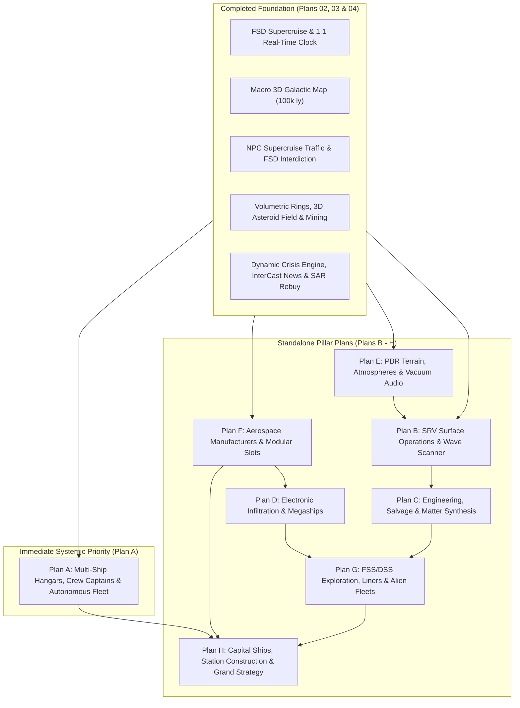

# Pioneer: Expanse — Long-Term Master Roadmap & Priority Index

Transforming **Pioneer: Expanse** into a deep single-player space simulation combining *Elite Dangerous*-grade Newtonian/FTL flight mechanics, fleet autonomy, planetary exploration, modular engineering, electronic infiltration, and a living procedural galaxy.

---

## 1. Strategic Vision & Architectural Principles

1. **Standalone Single-Player Depth**: Deliver interconnected systemic gameplay without MMO network latency, forced server wipes, or RNG progression treadmills.
2. **Deep Simulation with Meaningful Physicality**: Ground mechanics in astrophysics and rigid-body simulation—from planetary Roche rings, Supercruise gravity wells, and Keplerian local frames down to wheel suspension and liquid sea buoyancy.
3. **Cohesive In-Universe Lore**: Anchor aerospace manufacturers, covert engineers, megastructures, and deep-space non-human encounters inside a serious **Pioneer: Expanse** setting using crisp SVG corporate iconography (`data/icons/logos/`).
4. **Asset-Smart Sequenced Pillars**: Prioritize high-impact systemic gameplay that builds on existing ships and world systems (`Plan A`: Multi-Ship Ownership & X4-Style Crew Autonomy) immediately ahead of bespoke 3D asset / shader milestones (`Plans B–H`).

---

## 2. Master Architecture & Dependency Graph

---

## 3. Master Plan Index & Priority Matrix

| Order | Plan Document | Scope & Core Deliverables | Dependencies | Status |
| :--- | :--- | :--- | :--- | :--- |
| **Core** | **[`02_PIONEER_EXPANSE_FOUNDATION_PLAN.md`](./02_PIONEER_EXPANSE_FOUNDATION_PLAN.md)** | Dev build, 1080p UI density, SVG logos, allegiance starts, 100k ly galaxy map, player Supercruise, Dynamic Crises, InterCast News, SAR Rebuy *(Phase 6 station Pass Time queued)* | None | **Phases 1–5, 7–8 Completed** |
| **Core** | **[`03_VOLUMETRIC_RINGS_AND_MINING_PLAN.md`](./03_VOLUMETRIC_RINGS_AND_MINING_PLAN.md)** | Multi-band Roche rings, planetary ring shadows, planar Supercruise drop, 3-tier LOD 3D asteroid field, close-range 2D fade, collisions & laser mining | Plan 02 | **Completed** |
| **Core** | **[`04_NPC_SUPERCRUISE_INTERDICTION_PLAN.md`](./04_NPC_SUPERCRUISE_INTERDICTION_PLAN.md)** | Universal NPC Supercruise traffic, station occlusion, ambient patrol/pirate spawns, Low Wakes, FSD Interdictor tug-of-war, NPC evasion & security pacing | Plan 02 | **Completed** |
| **Plan A** | **[`A_PLAN_MULTI_SHIP_AND_CREW_AUTONOMY.md`](./A_PLAN_MULTI_SHIP_AND_CREW_AUTONOMY.md)** | Multi-ship ownership, station hangar storage & ship swapping, NPC Captains & skill progression, X4-style autonomous Follow/Trade/Mine/Patrol orders, mission delegation & IS/OOS simulation *(zero new 3D assets)* | Plans 02–04 | **Next Up** |
| **Plan B** | **[`B_PLAN_SRV_SURFACE_OPERATIONS.md`](./B_PLAN_SRV_SURFACE_OPERATIONS.md)** | `GroundVehicle` suspension physics, amphibious sea mode, SRV vehicle bay deploy/dismiss/recall, boulder colliders & acoustic-spectral wave scanner *(requires SRV 3D model)* | Plan E *(terrain shaders helpful)* | **Ready for Assets** |
| **Plan C** | **[`C_PLAN_ENGINEERING_CRAFTING.md`](./C_PLAN_ENGINEERING_CRAFTING.md)** | Zero-mass raw/manufactured/encoded material ledger, Scrap Reclamation, in-field matter synthesis & deterministic G1–G5 Engineers with Experimental overrides | Plan 03 & Plan B | **Queued** |
| **Plan D** | **[`D_PLAN_HACKING_INFILTRATION.md`](./D_PLAN_HACKING_INFILTRATION.md)** | Datalink Scanner & two-phase frequency-bypass puzzle, non-dockable orbital Megaships (cargo hatches/uplinks/relays), settlement trespass & Skimmer drones | Plan B & Plan F | **Queued** |
| **Plan E** | **[`E_PLAN_GRAPHICS_AUDIO_OVERHAUL.md`](./E_PLAN_GRAPHICS_AUDIO_OVERHAUL.md)** | **Track 1 (Toggleable Enhanced Graphics, Classic Fallback)**: Ship/Station PBR metallic & reflective surfaces, glare/lens flare, stellar plumes, gas giant atmospheres, terrestrial cloud layers, water/ice reflections, upgraded Rayleigh/Mie atmospheres & canopy glass. **Track 2 (Always-On Terrain & World Gen)**: Dwarf planets, asteroid moons & drivable landable surface structure for SRVs. **Track 3**: Atmospheric weather & wind turbulence, plus OpenAL vacuum audio & cockpit voice | Plan 02 | **In Progress (Milestone 1)** |
| **Plan F** | **[`F_PLAN_FLEET_MANUFACTURERS.md`](./F_PLAN_FLEET_MANUFACTURERS.md)** | Four aerospace corporations (SDA, Aethelgard, Guan-Haber, Frontier), 4-tier modular slot refactor, Fixed/Gimballed/Turreted Class 1–4 mounts & `.gltf` pipeline | Plan 02 | **Queued** |
| **Plan G** | **[`G_PLAN_EXPLORATION_ALIENS.md`](./G_PLAN_EXPLORATION_ALIENS.md)** | Waveform FSS system scanner, ballistic DSS surface/ring probes, wing escorts, burning-station evacs, and *Hydrazine Swarm* / *Archon Automata* fleets | Plan 03, Plan C, Plan D | **Queued** |
| **Plan H** | **[`H_PLAN_CAPITAL_SHIPS_AND_EMPIRE_BUILDING.md`](./H_PLAN_CAPITAL_SHIPS_AND_EMPIRE_BUILDING.md)** | Playable/AI Capital Ships & Fleet Carriers, multi-turret fire control, modular player station construction, NPC Station Managers, closed-loop industry & sector sovereignty | Plan A, Plan F, Plan G | **Queued (Endgame)** |

---

## 4. Recommended Sequenced Rollout

1. **Multi-Ship Fleet & Crew Autonomy (Next Up)**: Enact **Plan A** (*Multi-Ship Ownership, Station Hangars, Crewed Fleet & Autonomy*) immediately alongside remaining Phase 6 (*Real-Time Mission Economy & Station Wait Service*) in **Plan 02**, requiring no new 3D models.
2. **Surface & Visual Layer**: Enact **Plan B** (*SRV Surface Operations* once the SRV 3D asset is prepared) alongside **Plan E** (*PBR Terrain, Atmospheres & Vacuum Audio*) and **Plan F** (*Aerospace Manufacturers & Modular Slots*).
3. **Progression & Covert Ops**: Enact **Plan C** (*Engineering & Matter Synthesis*) and **Plan D** (*Hacking, Megaships & Trespass Security*).
4. **Deep Space & Grand Strategy Endgame**: Enact **Plan G** (*FSS/DSS Exploration & Alien Civilizations*) followed by **Plan H** (*Capital Ships, Station Construction & Grand Strategy*).

---

*This document serves as the executive charter and priority index for Pioneer: Expanse. Inspect the linked plan files above for C++/Lua interfaces, shader designs, milestones, and verification plans.*
