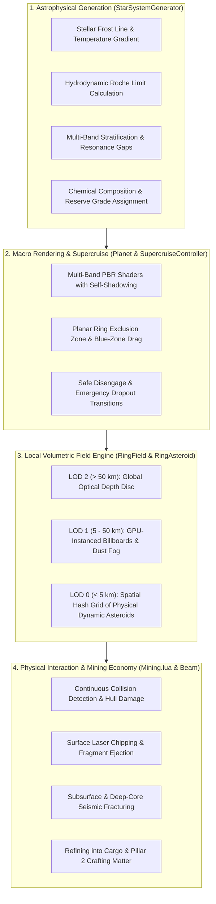
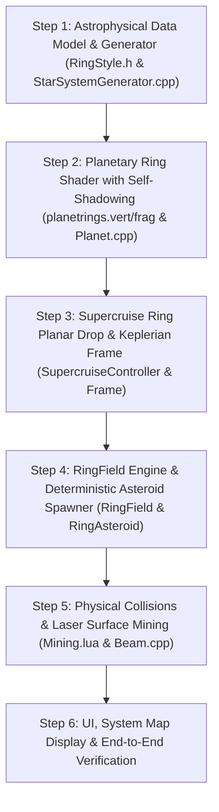

# Technical Implementation Plan: Planetary Ring Lifecycle, Volumetric LOD & Asteroid Mining

**Document Version**: 1.0  
**Status**: Ready for Implementation  
**Parent Roadmap**: [`01_EXPANSE_LONG_TERM_ROADMAP.md`](./01_EXPANSE_LONG_TERM_ROADMAP.md)  
**Target Files**:
* `src/galaxy/RingStyle.h`
* `src/galaxy/SystemBody.h`, `src/galaxy/SystemBody.cpp`
* `src/galaxy/StarSystemGenerator.cpp`
* `src/Planet.h`, `src/Planet.cpp`
* `src/ship/SupercruiseController.h`, `src/ship/SupercruiseController.cpp`
* `src/Body.cpp`, `src/Frame.h`, `src/Frame.cpp`
* `src/planet/RingField.h`, `src/planet/RingField.cpp` (NEW)
* `src/planet/RingAsteroid.h`, `src/planet/RingAsteroid.cpp` (NEW)
* `src/WorldView.cpp`
* `data/shaders/opengl/planetrings.vert`, `data/shaders/opengl/planetrings.frag`
* `data/modules/Mining.lua`, `data/economy/commodities/mining.json`

---

## 1. System Overview & Lifecycle Architecture

Currently, planetary rings in Pioneer are rendered as a zero-thickness flat 2D polygon strip with a procedural 1D noise texture (`Planet::GenerateRings`). They lack physical presence, collisions, chemical composition, and multi-band stratification.

This plan details the full **lifecycle of the planetary ring mechanic**: from astrophysical procedural generation based on stellar frost lines and Roche limits, through macro Supercruise transitions, down to an interactive, deterministic, minable 3-tier LOD asteroid field with realistic physics and resource extraction.



---

## 2. Astrophysical Generation & Ring Classification

### 2.1 Extended Ring Data Model (`src/galaxy/RingStyle.h`)
Replace the simplistic `RingStyle` struct with a multi-band data model:

```cpp
#ifndef _RINGSTYLE_H
#define _RINGSTYLE_H

#include "Color.h"
#include "fixed.h"
#include <string>
#include <vector>

enum class RingComposition : uint8_t {
    ICE_WATER,             // 99% Pure H2O Ice (High albedo ~0.65)
    ICE_AMMONIA_METHANE,   // Hydrocarbon/Ammonia/Methane Clathrates (Dark albedo ~0.05)
    ROCKY_SILICATE,        // Basalt, Pyroxene, Olivine
    METAL_RICH,            // High metal content (Bauxite, Rutile, Titanium)
    METALLIC_PRECIOUS      // Heavy native metals (Platinum, Palladium, Gold, Painite)
};

enum class RingReserveGrade : uint8_t {
    DEPLETED,
    LOW,
    COMMON,
    MAJOR,
    PRISTINE
};

struct RingBand {
    fixed minRadius;              // Inner radius as proportion of planet radius
    fixed maxRadius;              // Outer radius as proportion of planet radius
    fixed thickness;              // Vertical height in meters (e.g. 15m to 250m)
    fixed massDensity;            // kg/m^2 (drives optical depth and asteroid count)
    fixed opticalDepth;           // Tau (0.05 to 2.5)
    RingComposition composition;  // Primary mineral/ice makeup
    RingReserveGrade reserveGrade;// Yield multiplier (Pristine = 2.0x, Depleted = 0.3x)
    Color baseColor;              // Visible ambient tint
    uint32_t seedOffset;          // Band-specific procedural seed
};

struct RingSystem {
    std::vector<RingBand> bands;
    fixed totalMass;              // Total ring system mass in Earth masses
    bool HasRings() const { return !bands.empty(); }
    fixed GetOuterRadius() const {
        return bands.empty() ? fixed(0) : bands.back().maxRadius;
    }
    fixed GetInnerRadius() const {
        return bands.empty() ? fixed(0) : bands.front().minRadius;
    }
};

#endif /* _RINGSTYLE_H */
```

### 2.2 Astrophysical Rules (`src/galaxy/StarSystemGenerator.cpp`)
Update `PickRings` and `StarSystemLegacyGeneratorBase`:

1. **Stellar Frost Line (Volatile Condensation)**:
   * Calculate stellar frost line based on the primary star's bolometric luminosity $L$:
     $$D_{\text{ice}} = 4.85 \cdot \sqrt{\frac{L}{L_\odot}} \quad \text{(in AU)}$$
   * If a planet's semi-major axis $a < D_{\text{ice}}$, surface temperature prohibits stable water ice. Rings are restricted to **`ROCKY_SILICATE`** or **`METAL_RICH`**.
   * If $a \ge D_{\text{ice}}$:
     * Intermediate zone ($1.0 \le a/D_{\text{ice}} \le 2.5$): **`ICE_WATER`** rings (Saturn archetype).
     * Deep freeze zone ($a/D_{\text{ice}} > 2.5$): **`ICE_AMMONIA_METHANE`** rings with heavy tholin darkening (Uranus/Neptune archetype).

2. **Hydrodynamic & Rigid Roche Limits**:
   * Calculate the true Roche limit using primary density $\rho_M$ and material density $\rho_m$:
     $$r_{\text{Roche, fluid}} = 2.44 \cdot R_M \cdot \left(\frac{\rho_M}{\rho_m}\right)^{1/3}$$
     $$r_{\text{Roche, rigid}} = 1.44 \cdot R_M \cdot \left(\frac{\rho_M}{\rho_m}\right)^{1/3}$$
   * Density assumptions:
     * Water ice: $\rho_m = 920 \text{ kg/m}^3$
     * Ammonia/Methane ice: $\rho_m = 650 \text{ kg/m}^3$
     * Silicates: $\rho_m = 3,000 \text{ kg/m}^3$
     * Metallic: $\rho_m = 6,500 \text{ kg/m}^3$
   * Rings can only stably occupy the zone between the atmospheric boundary ($1.02 R_M$) and $r_{\text{Roche}}$.

3. **Multi-Band Stratification & Resonance Gaps**:
   * Generate 2 to 4 concentric bands.
   * Calculate orbital resonances with major inner moons (e.g. 2:1, 3:2, 4:3 Lindblad resonances) to insert physical gaps (such as the Cassini Division or Encke Gap).

4. **Reserve Grade Assignment**:
   * Independent systems and rim worlds roll higher probability of **`PRISTINE`** or **`MAJOR`** reserves.
   * Core systems with high population and industrial economies degrade to **`COMMON`** or **`DEPLETED`**.

---

## 3. Macro-Scale Rendering & Planetary Shadows

### 3.1 Shader Architecture (`data/shaders/opengl/planetrings.vert`, `planetrings.frag`)
1. **Dynamic Planetary Self-Shadowing**:
   * Pass the primary star's directional light vector $\vec{L}$ and the planet radius $R_{\text{planet}}$ into the ring shader uniforms.
   * In `planetrings.frag`, compute ray-sphere intersection between the ring vertex position in planet space and the planet sphere towards $\vec{L}$.
   * Pixels lying within the planet's shadow frustum receive zero direct stellar illumination, rendering a sharp, photorealistic elliptical shadow across the ring disc.
2. **Phase-Function Scattering**:
   * **Water Ice**: High forward scattering (Mie scattering parameter $g \approx 0.7$) causing icy rings to glow brilliantly when the camera looks towards the star through the rings.
   * **Rocky/Metallic**: Backscattering opposition surge (retro-reflective brightening when looking directly away from the star).
3. **Multi-Band Optical Depth Gradient**:
   * Procedural evaluation of radial optical depth $\tau(r)$ matching the generated `RingBand` properties.

---

## 4. Supercruise Flight Mechanics & Reference Frames

### 4.1 Planar Exclusion Zone & Mass-Lock Drag (`src/ship/SupercruiseController.cpp`)
1. **Planar Boundary Detection**:
   * In addition to spherical exclusion zones, `SupercruiseController::UpdateEnvironmentAndTarget` checks whether the ship's heading intersects any active ring plane:
     $$\text{Ring Disc Plane: } z = 0, \quad r_{\text{inner}} \le \sqrt{x^2 + y^2} \le r_{\text{outer}}, \quad |z| \le \frac{\text{thickness}}{2}$$
2. **Supercruise Drag & Blue-Zone Enforcement**:
   * As the ship approaches the ring plane, local maximum speed is suppressed by the ring's mass density.
   * Approaching at $75\%$ throttle ("blue zone") regulates speed down to safe dropout limits ($< 1,000\text{ km/s}$ at $< 1,000\text{ km}$ distance).
3. **Emergency Dropout vs. Safe Disengage**:
   * **Emergency Drop** ($v \ge 1,000\text{ km/s}$ within $|z| \le 50\text{ km}$):
     * Shields depleted instantly.
     * $10\%$ hull damage if shields down.
     * $92\%$ heat spike and 25s FSD cooldown.
     * Ship drops $15\text{ km}$ above the ring plane to prevent instantaneous high-speed collision with an asteroid.
   * **Safe Disengage** ($v \le 1,000\text{ km/s}$, $d \le 1,000\text{ km}$):
     * Pressing `J` or Auto-drop disengages Supercruise cleanly.
     * Spawns the ship directly at the entry coordinates inside the **Ring Local Reference Frame**.

### 4.2 Keplerian Ring Reference Frame (`src/Frame.h`, `src/Body.cpp`)
* Create a dynamic local rotating frame:
  ```cpp
  FrameId Frame::CreateRingFrame(FrameId planetFrame, double radius, double orbitSpeed);
  ```
* The frame orbits with the local Keplerian orbital velocity:
  $$v_K = \sqrt{\frac{G \cdot M_{\text{planet}}}{r}}$$
* This guarantees that when the player drops into the ring, adjacent asteroids are stationary relative to the player rather than hurtling past at $15\text{--}25\text{ km/s}$.

---

## 5. Local Volumetric Field Engine & Asteroid LOD

### 5.1 Architecture of `RingField` (`src/planet/RingField.h`, `RingField.cpp`)
Attached to `Planet` whenever the player's ship is within $50\text{ km}$ of a ring plane.

```cpp
class RingField {
public:
    RingField(Planet *planet, const RingBand &band);
    ~RingField();

    void Update(const vector3d &playerPosRelPlanet, double deltaTime);
    void Render(Graphics::Renderer *renderer, const matrix4x4d &viewTran, const vector3d &camPos);

private:
    Planet *m_planet;
    RingBand m_band;
    std::unordered_map<uint64_t, std::unique_ptr<RingAsteroid>> m_activePhysicalAsteroids; // LOD 0
    std::vector<matrix4x4f> m_instancedAsteroidTransforms;                                 // LOD 1
    std::unique_ptr<Graphics::VertexBuffer> m_instanceBuffer;

    void UpdateSpatialGrid(const vector3d &localPos);
    uint64_t ComputeCellHash(int64_t cx, int64_t cy, int64_t cz);
};
```

### 5.2 Three-Tier Distance LOD Pipeline

```
Distance to Player:
0 km ---------------- 3 km ---------------- 15 km ---------------- 50 km --------> Deep Space
[ LOD 0: Physical ]   [ LOD 1: GPU Instanced ]   [ LOD 1b: Dust Fog ]   [ LOD 2: Global Disc ]
Bullet/BVH Collision   Hardware Meshes            Particle Impostors      Planet.cpp Textured Quad
Chippable / Minable    Keplerian Drift            Volume Backscatter      Shadowed Ring Strip
```

1. **LOD 0: Physical Asteroids ($< 3\text{ km}$)**:
   * 15 to 40 nearby asteroids instantiated as full physical bodies (`RingAsteroid`, subclass of `DynamicBody`).
   * Registered in `CollisionSpace` with convex hull bounding geometry (`Geom`).
   * Rotational tumble vectors and physical mass based on composition density.
2. **LOD 1: Hardware Instanced Meshes ($3\text{ km}$ to $15\text{ km}$)**:
   * Up to 2,500 asteroids rendered via hardware instancing (`glDrawElementsInstanced`).
   * 4 base procedural geometry archetypes (Rocky, Icy Jagged, Smooth Glacial, Metallic Pitted).
   * Static transform buffer updated only when the camera crosses grid cell boundaries.
3. **Volumetric Dust & Micro-Particulate Fog ($15\text{ km}$ to $50\text{ km}$)**:
   * Radial alpha fade smoothly blending into the planet's global ring geometry.
   * Volumetric particle shader rendering forward-scattered dust motes illuminated by the primary star.

### 5.3 Deterministic Procedural Generation (`RingAsteroid`)
* The ring disc is divided into a 3D cylindrical spatial hash grid:
  $$\text{Cell Size}: \Delta r = 400\text{m}, \quad \Delta \theta = \frac{400\text{m}}{r}, \quad \Delta z = 100\text{m}$$
* **Deterministic Pseudo-Random Seeding**:
  $$\text{Seed} = \text{Hash64}(\text{PlanetSeed}, \text{BandIndex}, \text{CellIndex}_r, \text{CellIndex}_\theta, \text{CellIndex}_z)$$
* Ensures that leaving a ring sector and returning generates the exact same asteroids in the exact same positions with the exact same mineral deposits.
* **Procedural Asteroid Meshes**:
  * Generated from an icosahedron subdivided 2 times (80 triangles for LOD 1, 320 triangles for LOD 0).
  * Perturbed along vertex normals using 3-octave 3D simplex noise:
    * *Ice*: High-frequency sharp ridges and flat cleavage planes.
    * *Silicate*: Rounded crater depressions and basalt blocks.
    * *Metallic*: Deep pitted cavities and smooth regolith depressions.

---

## 6. Physical Asteroid Interaction & Mining Gameplay

### 6.1 Collision Damage & Physical Dynamics
* When a ship collides with an asteroid:
  1. Retrieve relative velocity $\vec{v}_{\text{rel}} = \vec{v}_{\text{ship}} - \vec{v}_{\text{asteroid}}$.
  2. Compute kinetic impact energy:
     $$E_k = \frac{1}{2} \cdot \left(\frac{m_{\text{ship}} \cdot m_{\text{asteroid}}}{m_{\text{ship}} + m_{\text{asteroid}}}\right) \cdot |\vec{v}_{\text{rel}}|^2$$
  3. Absorb damage through active shields. If shields fail, apply hull deformation, cockpit canopy cracking, and rotational tumble impulse to the ship.
  4. The asteroid receives reciprocal momentum and angular torque, tumbling realistically through the field.

### 6.2 Surface Laser Mining & Fragment Ejection (`Mining.lua`, `Beam.cpp`)
* **Mining Laser Beam Intersection**:
  * When a beam with `MINING` capability hits a `RingAsteroid`:
    1. Spawn localized particle sparks and incandescent thermal hotspot at the impact point.
    2. Deplete asteroid mineral reservoir ($0.0\%\text{ to }100.0\%$).
    3. Every $3.0\text{ seconds}$ of sustained mining, chip off a **Mineral Fragment** (`CargoBody` / `OreChunk`).
* **Ejection Vector**:
  * Fragment is ejected along the surface normal vector with a small random cone spread ($15^\circ$) at $10\text{ to }25\text{ m/s}$.
  * Contains a targetable beacon transponder and decay timer (despawns after 8 minutes if not scooped).

### 6.3 Resource Extraction Tables by Ring Type

```
+---------------------------+-------------------------------------------------------+
| Ring Composition          | Extractable Mineral Fragments & Commodity Yields       |
+---------------------------+-------------------------------------------------------+
| ICE_WATER                 | - Water Ice (Pure H2O)                                |
|                           | - Liquid Oxygen                                       |
|                           | - Hydrogen Fuel Precursors                            |
|                           | - Trace Silicates                                     |
+---------------------------+-------------------------------------------------------+
| ICE_AMMONIA_METHANE       | - Liquid Ammonia                                      |
|                           | - Methane Clathrate Hydrates                          |
|                           | - Liquid Nitrogen                                     |
|                           | - Organic Tholins (Industrial Polymers)               |
+---------------------------+-------------------------------------------------------+
| ROCKY_SILICATE            | - Basalt / Silicate Rock                              |
|                           | - Bauxite (Aluminium Ore)                             |
|                           | - Rutile (Titanium Precursor)                         |
|                           | - Carbonaceous Chondrites                             |
+---------------------------+-------------------------------------------------------+
| METAL_RICH                | - High-Grade Titanium Ore                             |
|                           | - Nickel-Iron Matrix                                  |
|                           | - Copper & Cobalt Concentrates                        |
|                           | - Rare Earth Elements                                 |
+---------------------------+-------------------------------------------------------+
| METALLIC_PRECIOUS         | - Platinum                                            |
|                           | - Palladium                                           |
|                           | - Gold Bullion Matrix                                 |
|                           | - Painite / Low-Temperature Diamonds (Rare Crystals)  |
+---------------------------+-------------------------------------------------------+
```

### 6.4 Deep-Core Seismic Cracking (Advanced Mining)
* High-yield asteroids contain structural fault fissures.
* **Seismic Charge Launcher**:
  * Pilot plants 2 to 4 timed seismic charges inside fissure pockets.
  * Cockpit UI displays a charge yield meter (Optimal Yield Zone).
  * Detonation splits the asteroid into 3–5 large tumbling fragments, creating a blinding flash, a shockwave pushing nearby ships back, and revealing high-purity core surface deposits accessible via abrasion blasters.

---

## 7. Step-by-Step Implementation Roadmap



### Step 1: Astrophysical Data Model & Generator
* **Tasks**:
  * Expand `src/galaxy/RingStyle.h` with `RingComposition`, `RingReserveGrade`, `RingBand`, and `RingSystem`.
  * Update `src/galaxy/SystemBody.h` and `src/galaxy/SystemBody.cpp` to serialize/deserialize `RingSystem`.
  * Refactor `StarSystemLegacyGeneratorBase::PickRings` in `src/galaxy/StarSystemGenerator.cpp` to calculate stellar frost lines, Roche limits, resonance gaps, and assign realistic multi-band chemical properties.
* **Verification**: Inspect generated systems via test binary and verify that cold gas giants generate icy rings, warm giants generate rocky/metallic rings, and reserve grades are populated.

### Step 2: Planetary Ring Shader with Self-Shadowing
* **Tasks**:
  * Update `Planet::GenerateRings` and `Planet::DrawGasGiantRings` in `src/Planet.cpp` to pass star light direction vector and planet radius into `planetrings` shader uniforms.
  * Modify `data/shaders/opengl/planetrings.vert` and `planetrings.frag` to calculate planet shadow projection and multi-band optical depth.
* **Verification**: Fly around a ringed planet in orbit; confirm the dark elliptical shadow of the planet is accurately projected onto the rings.

### Step 3: Supercruise Ring Planar Drop & Keplerian Frame
* **Tasks**:
  * Add planar disc boundary checks to `SupercruiseController::GetExclusionZoneRadius` and `SupercruiseController::UpdateEnvironmentAndTarget` in `src/ship/SupercruiseController.cpp`.
  * Enforce Supercruise deceleration near ring planes.
  * Add `Frame::CreateRingFrame` in `src/Frame.cpp` and wire safe/emergency drop transitions in `SupercruiseController::DropOut`.
* **Verification**: Approach a ring in Supercruise. Verify the 6-second rule slows the ship down, pressing disengage drops cleanly at zero relative speed, and hitting at high speed causes an emergency dropout.

### Step 4: `RingField` Engine & Deterministic Asteroid Spawner
* **Tasks**:
  * Implement `src/planet/RingField.h` and `src/planet/RingField.cpp`.
  * Implement `src/planet/RingAsteroid.h` and `src/planet/RingAsteroid.cpp` with procedural deformed icosahedron geometry.
  * Integrate 3-tier LOD: LOD 0 physical bodies, LOD 1 hardware-instanced meshes, and LOD 2 global disc transition.
* **Verification**: Drop into a ring field. Verify that asteroids surround the ship in 3D, retain stable positions, and tumble in Keplerian harmony.

### Step 5: Physical Collisions & Laser Surface Mining
* **Tasks**:
  * Register LOD 0 asteroids into `CollisionSpace` with `Geom`.
  * Wire `Beam.cpp` and `Projectile.cpp` to detect hits on `RingAsteroid` and call `Player:SpawnMiningContainer(body)` in `data/modules/Mining.lua`.
  * Add commodity fragments in `data/economy/commodities/mining.json` corresponding to ring composition.
* **Verification**: Collide with an asteroid and verify shield/hull impact physics. Fire mining lasers at an asteroid and verify mineral ore fragments chip off and can be scooped into the cargo hold.

### Step 6: UI, System Map Display & End-to-End Verification
* **Tasks**:
  * Update F2 System Map (`data/pigui/modules/system-view-ui.lua`) to display ring type, inner/outer radius, reserve grade, and primary minerals when selecting a ringed body.
  * Compile native build and run unit test suite:
    ```bash
    cmake --build build --target pioneer build-data -j 8
    cmake --build build --target unittest && ./build/unittest
    ```
* **Verification**: Complete an end-to-end flight test: select a ringed gas giant in the F2 map, travel in Supercruise, disengage safely into the ring, mine several ore chunks, and verify cargo inventory.

---

*This technical plan provides the complete specification for the planetary ring lifecycle. Implementation can begin immediately with Step 1.*

