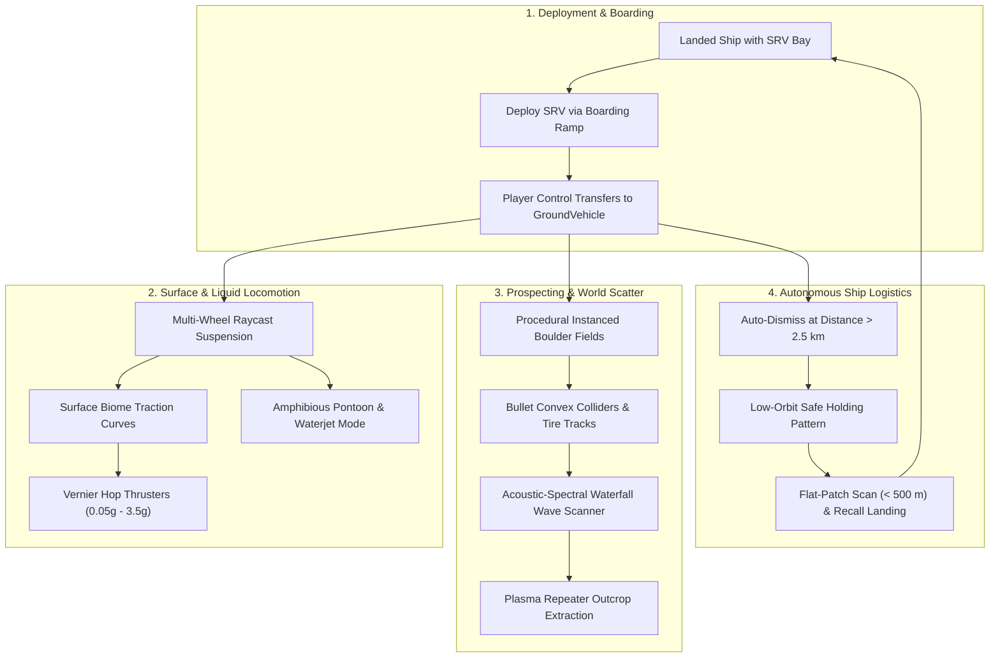

# Technical Implementation Plan: Surface Reconnaissance Vehicles (SRV) & Planetary Surface Operations

**Document Version**: 1.0  
**Status**: Ready to Plan / Queued  
**Priority Tier**: Pillar 1 (Priority 2 after Volumetric Rings & Terrain/Audio Foundations)  
**Parent Roadmap**: [`01_EXPANSE_LONG_TERM_ROADMAP.md`](./01_EXPANSE_LONG_TERM_ROADMAP.md)  
**Target Files**:
* `src/GroundVehicle.h`, `src/GroundVehicle.cpp` *(NEW — subclass of `DynamicBody`)*
* `src/VehicleBay.h`, `src/VehicleBay.cpp` *(NEW — SRV hangar component on `Ship`)*
* `src/TerrainScatter.h`, `src/TerrainScatter.cpp` *(NEW — procedural surface boulders & collision hulls)*
* `src/DynamicBody.h`, `src/DynamicBody.cpp` *(terrain normal contact / gravity integration)*
* `src/TerrainBody.h`, `src/Planet.h`, `src/Planet.cpp` *(high-resolution terrain height/normal & liquid ocean surface queries)*
* `src/Player.h`, `src/Player.cpp` *(active control handoff between `Player` ship and `GroundVehicle`)*
* `src/CameraController.h`, `src/WorldView.cpp` *(SRV turret/cockpit & third-person chase camera modes)*
* `data/modules/Equipment/Internal.lua` *(SRV Vehicle Bay modules, plasma repeater, wave scanner)*
* `data/modules/SurfaceOps.lua` *(NEW — ship dismiss/recall state machine, boarding, outpost prospecting)*
* `data/pigui/modules/flight-ui/` *(NEW/UPDATED — SRV dashboard HUD & Acoustic-Spectral Waterfall Display)*

---

## 1. System Overview & Operational Lifecycle

Pioneer currently supports planetary flight and surface starport docking, but once a ship touches down on an uncolonized world, the player cannot disembark or traverse the terrain physically. **Pillar 1** introduces **Surface Reconnaissance Vehicles (SRV)** equipped with multi-wheel Bullet spring-damper physics, amphibious hydrocarbon/water propulsion, orbital ship dismissal/recall automation, an acoustic-spectral wave scanner, and physical rocky terrain scatter.



---

## 2. Physics & Locomotion Architecture

### 2.1 `GroundVehicle` (`DynamicBody` Subclass) & Multi-Wheel Suspension
Implement `GroundVehicle` in `src/GroundVehicle.h` / `src/GroundVehicle.cpp` inheriting from `DynamicBody`:

```cpp
struct WheelSuspensionConfig {
    vector3d hardpointLocal;    // Chassis-space strut attachment point
    double restLength;          // Uncompressed suspension travel (m)
    double wheelRadius;         // Tire radius (m)
    double springStiffness;     // Hooke's law constant (N/m)
    double damperCompression;   // Bump damping coefficient
    double damperRebound;       // Rebound damping coefficient
    bool steerable;             // Front / all-wheel Ackermann steering
    bool powered;               // Drive torque distribution (6x6 AWD)
};

class GroundVehicle : public DynamicBody {
public:
    enum DriveMode : uint8_t {
        MODE_WHEELED = 0,       // Grounded 6x6 / 4x4 suspension drive
        MODE_AIRBORNE,          // Ballistic hop + attitude RCS + vertical verniers
        MODE_AMPHIBIOUS         // Pontoon buoyancy + ducted waterjets
    };

    void TimeStepUpdate(float timeStep) override;
    void SetThrottleInput(double forward, double steer, bool handbrake, bool boostUp);
    DriveMode GetDriveMode() const { return m_driveMode; }
    Ship *GetParentShip() const;
};
```

1. **Terrain Raycast / Heightfield Sampling**:
   * Pioneer planets already expose deterministic `TerrainBody::GetTerrainHeight(normalizedDir)` and fractal surface data.
   * For each wheel hardpoint transformed to planet-frame coordinates, sample the planet surface along the local down vector (computing surface elevation, normal via finite-difference triangle tap, and biome slip index).
   * Apply vertical spring-damper force along local `+Y` plus lateral tire slip and longitudinal Pacejka-lite traction forces clipped by gravity-dependent normal force (`0.05g` to `3.5g` stability clamp with subtle low-gravity artificial downforce assist so light moons remain drivable).
2. **Progressive Biome Traction Curves**:
   * Derive friction factor $\mu$ and rolling resistance from `SystemBody` surface volatile/temperature properties and terrain slope:
     * **Basalt Regolith**: High grip ($\mu = 0.85$), moderate dust plume.
     * **Water / Nitrogen Ice**: Low lateral friction ($\mu = 0.32$), wide drift envelopes.
     * **Hydrocarbon Sludge / Cryo-Frost**: Moderate slip ($\mu = 0.48$) with dampened rebound.
     * **Iron-Rich Sand**: High rolling drag ($\mu = 0.72$), deep track decals.
3. **Vertical Vernier Thrusters & Hop Control**:
   * Dedicated vehicle capacitor (`ENG` / `THR`) fuels upward belly verniers and pitch/roll/yaw reaction wheels whenever the player holds Jump/Boost or becomes airborne over crater rims.

### 2.2 Amphibious Marine Mode (`MODE_AMPHIBIOUS`)
1. **Liquid Sea Detection**:
   * Check `SystemBody::GetVolatileLiquid()` and planet sea-level radius (`terrainHeight <= seaLevelRadius` where liquid ocean layer exists: water, liquid methane/ethane, or liquid ammonia).
2. **Buoyancy & Hydrodynamics**:
   * When chassis submerged depth $h_{\text{sub}} > 0$:
     * Automatically deploy pontoon collars (animated scene-graph state), retract/idle wheel drive torques, and activate stern ducted waterjets.
     * Apply Archimedes upward buoyancy force proportional to displaced fluid density ($\rho_{\text{water}} \approx 1000\text{ kg/m}^3$, $\rho_{\text{methane}} \approx 450\text{ kg/m}^3$, $\rho_{\text{ammonia}} \approx 680\text{ kg/m}^3$) minus quadratic hydrodynamic drag ($\vec{F}_d = -c_v |\vec{v}|\vec{v}$).
     * Support shoreline transitions cleanly so the SRV drives smoothly from rocky beaches into liquid seas and onto island outcrops.

---

## 3. Ship Logistics: Hangar Deployment, Dismissal & Recall

### 3.1 SRV Vehicle Bay (`data/modules/Equipment/Internal.lua`, `VehicleBay`)
* Add `misc.srv_bay_1` (single bay) and `misc.srv_bay_2` (dual bay, spares on destruction).
* Requires ship `LANDED` state (`Ship::LANDED`) with gear deployed and acceptable ground clearance beneath the belly/rear ramp.
* **Control Transfer**:
  * Parent ship enters low-power standby (`AI` disabled, shield idle/point-defense turret active, boarding beacon active under ramp).
  * `Pi::player` switches camera/input target to the spawned `GroundVehicle` while preserving full ship ownership, inventory link, and Lua telemetry.

### 3.2 Autonomous Orbital Dismissal & Terrain-Scanned Recall (`SurfaceOps.lua`)
1. **Dismissal**:
   * Triggered manually via the SRV Comms/Helm radial menu OR automatically when SRV separation exceeds `2,500 m`.
   * Parent ship raises landing gear, ignites vertical thrusters, climbs cleanly clear of surface terrain, and transitions to a persistent low-orbit holding state around the planet (`IDLE_ORBIT`).
2. **Recall**:
   * Player activates **Recall Ship** from the SRV UI.
   * Ship drops out of orbit `~4 km` overhead and scans a spiral sample grid within `500 m` of the SRV (`TerrainBody::GetTerrainHeight` gradient checks) to find the flattest slope (`< 12 deg` pitch/roll) with sufficient ship footprint clearance.
   * Ship descends vertically, deploys landing gear, touches down softly, illuminates its boarding beacon under the bay, and opens the cargo transfer / board-ship trigger when the SRV pulls under the hatch (`< 15 m`).

---

## 4. Acoustic-Spectral Wave Scanner & Surface Detail

### 4.1 Spectral Directional Waterfall Display
Implement a cockpit/HUD **Acoustic-Spectral Wave Scanner** in `data/pigui/modules/flight-ui/`:
* Scans a `±90 deg` forward arc up to `4.5 km` ahead of the SRV heading, classifying surface POIs (`Space` bodies / `TerrainScatter` outcrop nodes / wrecks):
  * **Lower frequency band + low hollow rumble**: Dense metallic meteorites, mesosiderites, nickel-iron outcrops (feeding Pillar 2 Raw Elements).
  * **Upper frequency band + high sharp chirp**: Artificial electronics, crashed satellites, distress transponders, guarded data terminals, salvageable cargo canisters.
  * **Mid-band crackle + split double trace**: Cryovolcanic geysers, silicate veins, geothermal fumaroles.
* Trace amplitude narrows and vertical harmonic stacks separate cleanly as the player steers toward the bearing, teaching players to read both audio and trace geometry without immersion-breaking map pins.

### 4.2 Procedural Surface Boulder Scatter & Tire Tracks
* **`TerrainScatter`** generates deterministic spatial-hash boulder patches around the active SRV (`0–400 m` radius) aligned to terrain elevation and surface slope normals.
* Medium and large boulders instantiate Bullet `CollisionSpace` convex shapes so the SRV physically climbs, scrapes, or bounces off rocks; small gravel triggers suspension micro-noise and dust particle trails modulated by local atmospheric density.
* Maintain a ring-buffer decal/trail strip behind each wheel recording tread marks on soft regolith/sand.

---

## 5. Implementation Milestones

### Milestone 1: `GroundVehicle` Rigid-Body & Multi-Wheel Physics
* [ ] Implement `GroundVehicle` class, Bullet suspension raycasts, Ackermann steering, gravity-scaled traction, and vernier hop thrusters.
* [ ] Add JSON save/load serialization (`SaveToJson` / constructor from `Json`) for `GroundVehicle` and parent-ship linkage.

### Milestone 2: Amphibious Mode & Terrain Scatter Colliders
* [ ] Implement liquid ocean height checks, Archimedes buoyancy, quadratic water drag, and jet propulsion (`MODE_AMPHIBIOUS`).
* [ ] Implement `TerrainScatter` deterministic cell boulders (`LOD 0` colliders `< 250 m`, `LOD 1` instanced meshes `< 1.2 km`) plus wheel dust particles.

### Milestone 3: Ship Hangar Deployment, Autonomous Dismissal & Recall
* [ ] Add `misc.srv_bay_1` / `misc.srv_bay_2` equipment items and ramp deploy/board sequence.
* [ ] Implement `SurfaceOps.lua` + C++ AI surface-scan flat-patch finder (`500 m` radius) and autonomous launch/landing sequence (`> 2.5 km` auto-dismiss).

### Milestone 4: Acoustic-Spectral Wave Scanner, SRV Turret & Resource Extraction
* [ ] Build the SRV turret gimbal camera mode, dual plasma repeater weapon (`mining` / `combat`), and mineral outcrop destructibles.
* [ ] Implement the PiGui Waterfall Spectral Display (`±90 deg` directional sweep) and matching procedural WebAudio/OpenAL frequency synthesis.

---

## 6. Verification Criteria
1. **Gravity & Slope Test**: Drive an SRV smoothly across a `0.08g` icy moon, `1.0g` terrestrial world, and `2.5g` super-Earth without physics explosions or infinite sliding.
2. **Amphibious Transition Test**: Drive off a shoreline into a liquid methane/water lake; verify smooth buoyancy flotation, jet steering, and return back onto dry land.
3. **Dismissal & Recall Test**: Drive `> 2.5 km` from the landed ship, verify autonomous liftoff into safe holding orbit, then trigger Recall and confirm the ship locates flat ground within `500 m` and lands safely for re-boarding.
4. **Build & Unit Tests**: `cmake --build build --target pioneer build-data unittest && ./build/unittest` passes with new `GroundVehicle` suspension unit tests.
