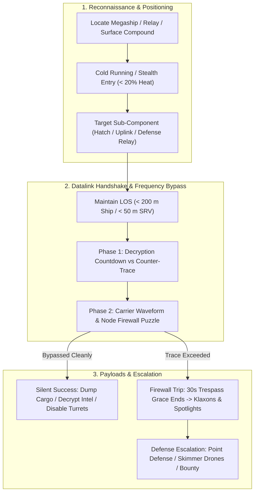

# Technical Implementation Plan: Electronic Warfare, Infiltration & Megaships

**Document Version**: 1.0  
**Status**: Queued  
**Priority Tier**: Pillar 3 (Stealth, Non-Combat Gameplay & Large-Scale Infrastructure)  
**Parent Roadmap**: [`01_EXPANSE_LONG_TERM_ROADMAP.md`](./01_EXPANSE_LONG_TERM_ROADMAP.md)  
**Target Files**:
* `src/DatalinkScanner.h`, `src/DatalinkScanner.cpp` *(NEW — line-of-sight beam handshake & sub-target intrusion)*
* `src/Megaship.h`, `src/Megaship.cpp` *(NEW — non-dockable superstructure `Body` with sub-targetable components)*
* `src/SecurityZone.h`, `src/SecurityZone.cpp` *(NEW — settlement trespass perimeters, klaxons & threat escalation)*
* `src/ship/Ship.h`, `src/SpaceStation.cpp` *(sub-targetable hatch/relay attachment points & trespass volumes)*
* `data/modules/Equipment/Internal.lua` *(Datalink Scanner, Recon Drone Controller)*
* `data/modules/Infiltration/Hacking.lua` *(NEW — Phase 1 countdown & Phase 2 frequency-bypass state machine)*
* `data/modules/Infiltration/Megaships.lua` *(NEW — bulk freighter, penal colony & relay array placement/loot tables)*
* `data/pigui/modules/hacking-ui.lua` *(NEW — oscilloscope carrier alignment & firewall node-routing minigame)*

---

## 1. System Overview & Covert Loop

Space simulations come alive when ships interact with structures beyond simple docking pads. **Pillar 3** introduces **Non-Dockable Orbital Megaships & Deep-Space Installations**, **Planetary Settlement Trespass Security & Skimmer Patrols**, and a **Datalink Scanner + Two-Phase Interactive Hacking Loop** usable from both ships and SRVs (Pillar 1).

---

## 2. Datalink Scanner & Two-Phase Hacking Mechanics

### 2.1 Hardware & Line-of-Sight Constraints (`DatalinkScanner`)
* **Ship Datalink Scanner** (`misc.datalink_scanner`, built-in or lightweight utility): Maximum active handshake range `200 m`, cone tolerance `±18 deg`.
* **SRV Datalink Scanner** (mounted on turret gimbal): Maximum range `50 m`, allowing covert surface infiltration under turret blind spots.
* Requires sustained target lock and unobstructed line of sight (`CollisionSpace::TraceRay` validates no hull/terrain occludes the beam). Moving out of range pauses/decays progress rather than bricking immediately (`3s` buffer).

### 2.2 Two-Phase Frequency-Bypass Model (`Hacking.lua`, `hacking-ui.lua`)
1. **Phase 1 (Immediate Implementation Foundation)**:
   * Establish directional datalink beam -> countdown bar (`6s` to `15s` depending on target security grade) races against a **Security Counter-Trace**.
   * Keeping heat low (`< 25%`) slows counter-trace detection rate.
2. **Phase 2 (Interactive Minigame UI)**:
   * **Carrier Alignment**: Tune frequency sliders (`A/D` or mouse drag) to phase-lock a noisy modulated sine waveform onto the target's encryption carrier.
   * **Logic-Gate Node Routing**: Click/rotate 3–5 concentric circuit rings before the firewall pulse closes, severing security alarm relays.
   * Optional **Silent Running Synergy**: Completing the puzzle before counter-trace reaches `100%` grants loot/intel *without* triggering jurisdictional bounties or station aggression.

---

## 3. Megaships, Communications Arrays & Deep-Space Installations

### 3.1 Non-Dockable Superstructures (`Megaship`)
Introduce monumental orbital complexes (`800 m`–`2,400 m` length) placed in busy industrial, prison, and frontier systems via `Megaships.lua`:
* **Bulk Cargo Freighters**: Slow-orbiting mega-haulers carrying industrial alloys, medicines, and high-value consumer holds.
* **Corporate Communications Arrays**: High-orbit sensor dishes holding encrypted trade manifests and Pillar 2 *Encoded Data*.
* **Orbital Penal Colonies & Automated Mining Rigs**: High-security installations yielding rare industrial data or prisoner-extraction mission targets.

### 3.2 Sub-Targetable Interactive Modules
Each `Megaship` exposes distinct targetable sub-entities on its hull mesh:
* **Cargo Bay Hatches**: Hacking unlocks magnetic clamps and vents `4–12` `CargoBody` canisters (`legal status = STOLEN` unless mission-sanctioned).
* **Telemetry Uplinks / Data Points**: Scanning yields Pillar 2 Encoded Firmware + trade network price updates + cash intel vouchers.
* **Defense Grid Relays / Power Conduits**: Compromising a relay temporarily takes regional point-defense turrets and radar domes offline (`90–120s` blackout window) to enable safe salvage or smuggling approaches.

---

## 4. Settlement Infiltration & Trespass Security

### 4.1 Perimeter Zones & Escalation Ladder (`SecurityZone`)
Armed planetary outposts, Engineer compounds (restricted zones), and surface bunkers define spherical/cylindrical trespass radii (`350 m` inner secured perimeter, `800 m` restricted airspace):
1. **Grace Window (`30s` Warning)**: HUD flashes `RESTRICTED AIRSPACE — VACATE PERIMETER (29s)` with audio klaxon chime; leaving before `0s` clears status with zero penalty.
2. **Stage 1 (Detection)**: Spotlights and tracking radar lock onto the intruder (`HOSTILE TRESPASS`).
3. **Stage 2 (Turret & SAM Activation)**: Automated point-defense cannons and surface-to-air missile batteries engage overhead ships, encouraging terrain-hugging low-altitude approaches or landing outside the `800 m` airspace ring to infiltrate by SRV.
4. **Stage 3 (Skimmer Patrol Drones)**: Hovering armored security drones launch from pad bays (`2–4` units) to intercept sneaking SRVs and ships.
5. **Stage 4 (Warrant)**: Local faction issues an immediate trespass/assault bounty via `CrimeTracking`.

---

## 5. Implementation Milestones

### Milestone 1: `DatalinkScanner` Core & Sub-Target Selection
* [ ] Implement `SubTarget` offsets on `Body`/`SpaceStation`/`Megaship` selectable via HUD sub-system cycling.
* [ ] Implement `DatalinkScanner` LOS raycast validation, beam VFX rendering, and Phase 1 countdown/counter-trace handshake.

### Milestone 2: Interactive Frequency-Bypass UI (`hacking-ui.lua`)
* [ ] Build PiGui waveform matching + rotating logic-gate puzzle overlay callable during active datalink handshakes.
* [ ] Tie stealth heat level (`< 20%` thermal signature) to slowed trace buildup and silent-bypass rewards.

### Milestone 3: `Megaship` Superstructures & Installations
* [ ] Implement `Megaship` body class, collision hull, slow patrol/stationary orbital behavior, and interactive hatches/uplinks/defense relays.
* [ ] Populate key inhabited systems in `Megaships.lua` with freighters, comm arrays, and automated rigs + covert hacking bulletin-board contracts.

### Milestone 4: Settlement Security Zones & Skimmer Patrols
* [ ] Implement `SecurityZone` trespass radii, 30s warning HUD + audio countdown, spotlight tracking, SAM/turret defense AI, and hovering **Skimmer Drone** NPC behavior.

---

## 6. Verification Criteria
1. **Stealth Approach & Silent Hack**: Approach a Corporate Comm Array running cold (`< 20%` heat), hold within `200 m`, complete the frequency-bypass puzzle before counter-trace reaches `100%`, and verify encoded data + credit voucher reward with *zero* bounty incurred.
2. **Cargo Hatch Venting**: Hack a Bulk Freighter's cargo hatch relay and confirm `CargoBody` containers physically eject clear of the hull for collection.
3. **Settlement Escalation**: Enter a surface compound's restricted zone, remain past `30s`, and confirm klaxons, automated turret lock-on, Skimmer launch, and faction trespass fine activate in sequence.
