# Technical Implementation Plan: Graphics, Planetary Engine & Audio Overhaul

**Document Version**: 1.0  
**Status**: Queued  
**Priority Tier**: Pillar 4 (Priority 1–5 Visual & Acoustic Immersion Upgrades)  
**Parent Roadmap**: [`01_EXPANSE_LONG_TERM_ROADMAP.md`](./01_EXPANSE_LONG_TERM_ROADMAP.md)  
**Target Files**:
* `data/shaders/opengl/geosphere_terrain.vert`, `data/shaders/opengl/geosphere_terrain.frag` *(PBR multi-splat terrain & atmosphere)*
* `data/shaders/opengl/atmosphere.glsl` *(NEW — Rayleigh/Mie scattering include shared across terrain, sky dome & rings)*
* `data/shaders/opengl/cockpit_glass.vert`, `data/shaders/opengl/cockpit_glass.frag` *(NEW — micro-abrasions, star glare & cold-run frost)*
* `src/GeoPatch.cpp`, `src/GeoSphere.cpp` *(biome slope/mineral vertex attributes & atmospheric LUT bindings)*
* `src/sound/Sound.h`, `src/sound/Sound.cpp`, `src/sound/AlAudioBackend.cpp` *(vacuum low-pass acoustic filter, FSD audio)*
* `src/sound/CockpitVoice.h`, `src/sound/CockpitVoice.cpp` *(NEW — synthesized advisory queue: gear, heat, FSD, attack)*
* `src/WorldView.cpp`, `src/ship/PlayerShipController.cpp` *(cockpit canopy heat/frost uniform feed & G-strain cues)*

---

## 1. System Overview & Visual/Audio Roadmap

While **Pioneer: Expanse**'s gameplay systems evolve toward *Elite Dangerous*-grade depth, **Pillar 4** modernizes the rendering and soundscape pipelines to match: replacing flat biome coloration with **PBR multi-splat terrain**, adding physically plausible **Rayleigh & Mie atmospheric scattering**, introducing dynamic **cockpit canopy weathering/frosting**, and crafting an **original vacuum acoustics & cockpit voice advisory engine**.

*(Note: Volumetric planetary rings, Priority 4 in the original charter, are covered in dedicated specification [`03_VOLUMETRIC_RINGS_AND_MINING_PLAN.md`](./03_VOLUMETRIC_RINGS_AND_MINING_PLAN.md).)*

```mermaid
graph TD
    subgraph Visuals["1. Graphics & Planetary Shaders"]
        V1["Priority 1: PBR Multi-Splat Terrain (Slope / Altitude / Mineral)"]
        V2["Priority 2: Rayleigh & Mie Atmospheric Scattering + Limb Glow"]
        V3["Priority 3: GPU-Instanced Surface Boulder & Regolith Scatter"]
        V4["Priority 4: Canopy Glass Scratches, Star Glare & Cold Frost (< 20% Heat)"]
    end

    subgraph Audio["2. Original Soundscape & Vacuum Acoustics"]
        A1["OpenAL Low-Pass Vacuum Filter for External Events"]
        A2["Ship Hull Transducer Vibration Mix (Explosions / Impacts)"]
        A3["FSD Spool / Witch-Space Thrum / Thruster Boost Signatures"]
        A4["Synthesized Cockpit Voice Advisory Priority Queue"]
    end

    V1 --> V2 --> V3 --> V4
    A1 --> A2 --> A3 --> A4
```

---

## 2. Graphics & Shader Modernization

### 2.1 Priority 1: PBR Multi-Splat Terrain Shaders (`geosphere_terrain.*`)
* Replace legacy diffuse-only surface blending with Cook-Torrance **Physically Based Rendering (PBR)** microfacet lighting (`albedo`, `normal`, `roughness`, `metallic`, `AO` packed atlas textures).
* Compute 4-channel splat weights dynamically from vertex/fractal terrain signals:
  * **Flat Plains ($\text{slope} < 18^\circ$)**: Fine regolith dust, sand ripples, or sedimentary basins.
  * **Steep Cliffs ($\text{slope} > 35^\circ$)**: Fractured exposed basalt bedrock with tri-planar UV projection (eliminating cliff texture stretching).
  * **High Elevation / Polar Caps**: High-albedo nitrogen/water frost and glacial ice (`roughness = 0.25`, crisp specular glint).
  * **Mineral Veins**: Exposed ferric/metallic striations driven by `SystemBody::GetMetallicity()`.

### 2.2 Priority 2: Rayleigh & Mie Atmospheric Scattering (`atmosphere.glsl`)
* Implement analytical optical-depth integration along camera view rays for atmospheres scaled by `Planet::GetAtmosphericState`:
  * **Rayleigh Wavelength Scattering**: Realistic blue daytime skies and amber/crimson twilight terminators on Earth-like worlds; alien green/violet sky shifts driven by `SystemBody::m_atmosColor` and oxidizing chemistry (`SO2`, `CH4`, `NH3`).
  * **Mie Aerosol Haze**: Sun halo forward scattering near the horizon and suspended surface dust hazes on arid/mars-like worlds.
  * **Orbital Rim & Shadow Projection**: Smooth transition from orbital vacuum blue-halo limb glow down through atmospheric entry without hard shader pops.

### 2.3 Priority 3: Canopy Glass Shaders (`cockpit_glass.*`)
* Render subtle cockpit canopy overlays driven by dynamic flight telemetry uniforms (`uShipHeat`, `uStarFlux`, `uCanopyHealth`, `uLightDir`):
  * **Micro-Abrasions & Star Glare**: Catch sharp specular highlights across fine scratches only when facing high-intensity starlight.
  * **Coronal Heat Shimmer**: Subtle screen-space refractive ripple when fuel scooping or thermal load exceeds `75%`.
  * **Cold-Running Frost Crystallization**: Procedural voronoi ice crystals creeping inward from canopy edges whenever ship heat falls below `20%` (e.g., silent running / heatsink stealth mode).

---

## 3. Modernized Audio Engine & Original Soundscape

### 3.1 Vacuum Acoustics Model (`AlAudioBackend.cpp`, `Sound.cpp`)
* In space vacuum, exterior explosions and weapon fire should not sound like open-air fireworks.
* Compute sound listener propagation:
  * **Inside Station Bay / Thick Atmosphere**: Full-spectrum unattenuated acoustic propagation.
  * **Vacuum / Near-Vacuum**: Route distant non-hull emitters through an OpenAL `AL_FILTER_LOWPASS` (`gainHF` attenuated proportionally to inverse atmospheric density + range), while **direct hull impacts, thruster firing, and frame stresses** bypass via crisp bone/transducer bass rumble.

### 3.2 Dedicated Ship Acoustics & Synthesized Cockpit Voice (`CockpitVoice`)
* Implement a priority-queued, non-overlapping **Cockpit AI Advisory System** (`data/sounds/voice/` or procedural formant/offline neural voice clips):
  * High-priority interruptible alerts: *"Frame Shift Drive charging"*, *"Friendship... Frame Shift Drive operating beyond safety limits"*, *"Warning: Temperature critical"*, *"Shields offline"*, *"Under attack"*, *"Eject, eject"*.
  * Informational toggles (user-mutable per category in Audio Settings): *"Landing gear deployed"*, *"Cargo scoop deployed"*, *"Supercruise Assist engaged"*.
* Pair with distinctive FSD spool sweeps, witch-space sub-bass thrum, and boost G-strain creaks.

---

## 4. Implementation Milestones

### Milestone 1: PBR Multi-Splat GeoSphere Shaders
* [ ] Create packed regolith/rock/ice/metallic PBR texture atlases and tri-planar normal mapping in `geosphere_terrain.frag`.
* [ ] Verify zero visible tiling seams across `1:100,000` orbital-to-ground zoom scales.

### Milestone 2: Unified Rayleigh/Mie Atmospheric Scattering
* [ ] Build `atmosphere.glsl` with scale-height integration, sunset terminator reddening, and atmospheric tint derivation from `SystemBody` gas composition.
* [ ] Integrate seamlessly into both sky-dome and terrain distance aerial perspective.

### Milestone 3: Dynamic Cockpit Canopy Shader
* [ ] Bind `uShipHeat`, `uCanopyDamage`, and primary star direction into cockpit windshield materials (`cockpit_glass.*`).
* [ ] Implement edge-to-center frost crystal growth `< 20%` heat and clearing blast as heat rises above `25%`.

### Milestone 4: Vacuum Low-Pass Audio & Cockpit Voice Engine
* [ ] Add OpenAL EFX low-pass filtering in `AlAudioBackend.cpp` driven by external vs hull-contact channels and local atmospheric density.
* [ ] Implement `CockpitVoice` non-overlapping priority queue and hook events in `SupercruiseController`, `Ship`, `PlayerShipController`, and `Heat` systems.

---

## 5. Verification Criteria
1. **Planetary Descent Visual Test**: Descend continuously from high orbit through the terminator onto a cliff-lined Earth-like world; confirm Rayleigh twilight reddening, smooth aerial perspective, and crisp tri-planar PBR cliff rock detail at `< 5 m` above surface.
2. **Cold-Run Frost Test**: Pop a Heat Sink or power down modules in deep space (`heat < 20%`); verify crystalline frost grows smoothly across canopy edges and melts away when boosting heat back past `25%`.
3. **Acoustic & Voice Queue Test**: Trigger landing gear, heat warning, and an exterior ship explosion simultaneously in vacuum; verify voice advisories serialize cleanly without overlapping and exterior explosion audio plays with vacuum low-pass attenuation.
