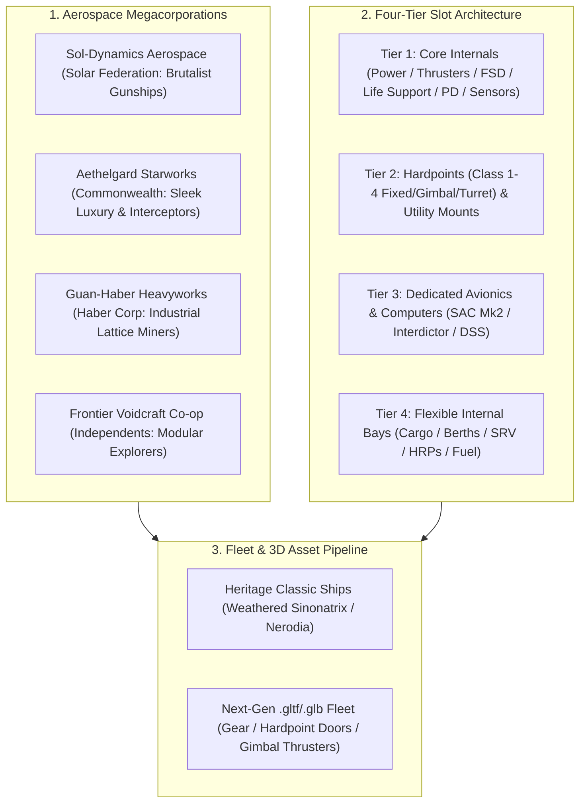

# Technical Implementation Plan: Aerospace Manufacturers, Modular Slots & Ship Fleet

**Document Version**: 1.0  
**Status**: Queued  
**Priority Tier**: Pillar 5 (Foundational Ship Outfitting & Manufacturer Identity Refactor)  
**Parent Roadmap**: [`01_EXPANSE_LONG_TERM_ROADMAP.md`](./01_EXPANSE_LONG_TERM_ROADMAP.md)  
**Target Files**:
* `src/ship/ShipType.h`, `src/ship/ShipType.cpp` *(manufacturer ID, core slot class definitions, hardpoint mount constraints)*
* `src/ship/EquipSet.h`, `src/ship/EquipSet.cpp` *(partitionable internal compartments & gimballed/turreted mount logic)*
* `src/GunManager.h`, `src/GunManager.cpp` *(Fixed / Gimballed tracking cone / 360-deg Turreted fire-control modes)*
* `src/ShipAICmd.cpp` *(turret auto-track & hardpoint deployment animation states)*
* `data/ships/*.json` *(assign manufacturer, core slot sizes, optional compartment sizes, Class 1–4 hardpoints)*
* `data/modules/Equipment/*.lua` *(refactor equipment onto Core Internals, Utilities, Avionics, and Optional Bays)*
* `data/lang/` & `data/icons/logos/` *(aerospace corporate crests for Sol-Dynamics, Aethelgard, Guan-Haber, Frontier Voidcraft)*
* `data/models/ships/` *(modernized `.gltf`/`.glb` animated ship models & heritage classic variants)*

---

## 1. System Overview & Architectural Goals

Pioneer's original outfitting system mixes fixed equipment sizes, loose slot strings, and generic ship lore. **Pillar 5** restructures the fleet around four **Aerospace Megacorporations** with unmistakable visual and engineering identities, introduces a clean *Elite Dangerous*-style **Four-Tier Modular Slot Architecture**, supports **Fixed / Gimballed / Turreted** weapon mounts across Classes 1–4, and establishes the **3D Asset Pipeline** preserving iconic classic Pioneer hulls alongside next-generation `.gltf`/`.glb` animated ships.

---

## 2. Aerospace Megacorporations & Lore Identity

Every playable hull belongs to one of four manufacturers (plus **Classic Heritage** yards), represented in shipyard UIs via crisp SVG crests (`data/icons/logos/`):

| Manufacturer | Primary Allegiance | Aesthetic & Engineering Philosophy | Signature Ship Roles |
| :--- | :--- | :--- | :--- |
| **Sol-Dynamics Aerospace (SDA)** | Solar Federation | Angular faceted composite armor, exposed radiator ribs, heavy dorsal spines | Military gunships, dropships, armored courier freighters |
| **Aethelgard Starworks** | Commonwealth | Swept aerodynamic curves, pristine white/navy paneling, luxurious glass canopies | VIP passenger liners, high-speed blockade interceptors, imperial clippers |
| **Guan-Haber Industrial Heavyworks** | Haber Corporation | Industrial box-truss lattice frames, raw tungsten-steel plating, twin cargo booms | Deep-core ring miners, bulk hauler barges, mobile refinery ships |
| **Frontier Voidcraft Cooperative** | Independents / Rim | Asymmetric rugged hulls, kit-bashed external fuel pods, unmatched FSD efficiency | Long-range exploration vessels, multi-role mercenary gunboats |

---

## 3. Streamlined Modular Slot Architecture

### 3.1 Four-Tier Outfitting Model (`ShipType`, `EquipSet`, `Equipment/*.lua`)
Replace ambiguous legacy volume/mass checks with clear numbered size classes (Class 1..8 Internals, Class 1..4 Weapons):

1. **Tier 1 — Dedicated Core Internals** (Every ship has exactly 1 fixed max-class slot per system, undersizing allowed at performance trade-off):
   * **Power Plant** (MW capacity & thermal efficiency rating A–E).
   * **Thrusters** (Optimal mass thrust curves affecting sublight speed, vertical hover thrust on high-g worlds, and pitch/roll rates).
   * **Frame Shift Drive** (Optimal hull mass curve driving hyperspace jump range & fuel-per-jump).
   * **Life Support** (Emergency $O_2$ reserve timer: 5m E-rated -> 25m A-rated).
   * **Power Distributor** (`SYS / ENG / WEP` capacitor capacity & MW/s recharge rates; drives boost cooldown & shield regen).
   * **Sensors** (Normal-space resolution distance & Supercruise scan speed).
2. **Tier 2 — External Hardpoints & Utility Mounts**:
   * **Weapon Hardpoints** rated `Class 1 (Small)`, `Class 2 (Medium)`, `Class 3 (Large)`, `Class 4 (Huge)` supporting three mount architectures (`GunManager`):
     * **Fixed**: Highest DPS, immune to chaff, zero tracking offset.
     * **Gimballed**: `~20%` lower base DPS, auto-tracks target inside `±22 deg` forward cone, disrupted by Chaff launchers.
     * **Turreted**: `~40%` lower base DPS, upper/lower hemisphere `360 deg` tracking under Fire-At-Will / Target-Only AI modes, hardpoint-axis occluded by own hull.
   * **Utility Mounts** (Size 0 external slots): *Chaff Launcher*, *Heat Sink Launcher*, *Point Defense Turret*, *ECM Pod*, *Kill Warrant / Wake Scanner*.
3. **Tier 3 — Dedicated Avionics & Computers**:
   * Small standardized bays preventing autopilot/interdictor bloat from eating cargo slots: *Docking Computer*, *Supercruise Assist Mk 2*, *FSD Interdictor*, *Datalink Scanner*, *Surface Mapping Launcher*.
4. **Tier 4 — Flexible Internal Compartments**:
   * Numbered size bays (Size `1` to `8`, capacity $2^{\text{size}}$ tonnes equivalent) freely outfitted with:
     * *Cargo Racks*, *Shield Generators*, *Passenger Cabins* (Economy / Business / First / Luxury), *Auxiliary Fuel Tanks*, *SRV Hangars*, *Hull/Module Reinforcement Packages*, *Fuel Scoops*, *Scrap Reclaimers*, *Mining Refineries*.

---

## 4. 3D Asset Pipeline & Heritage Aging

1. **Heritage Classic Ships**:
   * Preserve beloved original Pioneer silhouettes (*Sinonatrix*, *Nerodia*, *Varanus*, *Natrix*) re-tagged as **Classic Generation** hulls—featuring worn cockpit textures, lower purchase cost, and enduring reliability for starter/frontier pilots.
2. **High-Fidelity `.gltf` / `.glb` Fleet Pipeline**:
   * Pioneer's Assimp loader already handles skeletal/node hierarchies cleanly; define standardized animation bone conventions for new hulls:
     * `gear_front`, `gear_left`, `gear_right`: Animated retraction synchronized with `Ship::GetWheelState()`.
     * `hardpoint_<idx>_door`, `hardpoint_<idx>_gimbal`: Deployed/retracted doors (`Weapons Deployed` toggle, required to fire guns & preventing FSD charge when deployed!).
     * `thruster_gimbal_<idx>`: Subtle vectoring tilt responding to rotational/lateral thruster input.
     * Detailed 3D cockpit interiors visible from `Cockpit` camera mode with holographic PiGui dashboard mount anchors.

---

## 5. Implementation Milestones

### Milestone 1: Core Slot & Class Refactor (`EquipSet`, `ShipType`, `Equipment/*.lua`)
* [ ] Migrate all `data/ships/*.json` definitions to explicit Core Internal slots (Power/Thrusters/FSD/LifeSupport/PD/Sensors), Avionics slots, Hardpoint Classes `1–4`, Utilities, and Optional Compartment sizes.
* [ ] Implement Power Distributor capacitor drain/recharge (`SYS`/`ENG`/`WEP`) and Power Plant priority brownout curve (`< 100%` power budget).

### Milestone 2: Fixed / Gimballed / Turreted Weapons & Utilities (`GunManager`)
* [ ] Add gimbal cone auto-aim (`±22 deg`), chaff dispersion noise, and hemisphere turret tracking in `GunManager.cpp` + hardpoint deployment state (`hardpointsDeployed` blocks FSD charge until retracted!).
* [ ] Implement *Chaff Launcher*, *Heat Sink Launcher*, *Point Defense* (shoots incoming missiles), and *ECM* utility active abilities.

### Milestone 3: Manufacturer Lore, Shipyard UI & SVG Logos
* [ ] Create aerospace corporate SVG crests (`sol_dynamics.svg`, `aethelgard.svg`, `guan_haber.svg`, `frontier_voidcraft.svg`) and integrate manufacturer lore/filtering into Station Shipyard & Outfitting PiGui views.

### Milestone 4: Modern `.gltf`/`.glb` Animated Fleet Rollout
* [ ] Author/import initial flagship hulls for each manufacturer (1 Starter/Multirole, 1 Miner, 1 Heavy Combat, 1 Explorer) with landing gear, hardpoint doors, and cockpit interiors while retaining Classic Heritage models.

---

## 6. Verification Criteria
1. **Outfitting Balance Test**: Outfit a Guan-Haber miner vs. Sol-Dynamics gunship; verify size constraints prevent fitting Class 3 weapons in Class 1 hardpoints, while undersizing Core FSD/Thrusters updates jump range and boost speeds in real time.
2. **Gimbal / Chaff / Turret Combat Test**: Fire gimballed lasers at an NPC deploying Chaff; confirm tracking jitters briefly during chaff cloud duration while Fixed weapons hold dead-center aim.
3. **Power Priority & Hardpoints Test**: Deploy hardpoints exceeding `100%` reactor MW capacity and confirm low-priority non-essential modules (Cargo Scoop, FSD) power down automatically until weapons retract.
