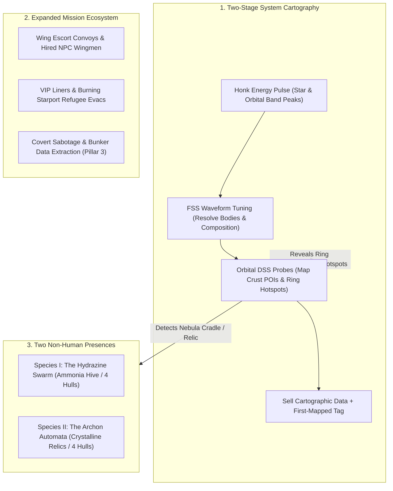

# Technical Implementation Plan: Deep Exploration, Wing Missions & Alien Civilizations

**Document Version**: 1.0  
**Status**: Queued  
**Priority Tier**: Pillar 6 (Late-Game Content, Cartography & Non-Human Threats)  
**Parent Roadmap**: [`01_EXPANSE_LONG_TERM_ROADMAP.md`](./01_EXPANSE_LONG_TERM_ROADMAP.md)  
**Target Files**:
* `src/exploration/SystemScanner.h`, `src/exploration/SystemScanner.cpp` *(NEW — FSS waveform discovery & body resolve state)*
* `src/exploration/SurfaceProbe.h`, `src/exploration/SurfaceProbe.cpp` *(NEW — gravity-curved orbital DSS mapping projectile)*
* `src/galaxy/SystemBody.h`, `src/galaxy/SystemBody.cpp` *(discovered/mapped bitflags & surface/ring hotspot persistence)*
* `src/ai/AlienBehavior.h`, `src/ai/AlienBehavior.cpp` *(NEW — Swarm pack & Archon zero-inertia flight/attack AI)*
* `data/modules/Exploration/Cartography.lua` *(NEW — discovery payout multipliers, first-discoverer credit, hotspot reveals)*
* `data/modules/Missions/WingContracts.lua` *(NEW — convoy escorts & wingman hiring)*
* `data/modules/Missions/PassengerOps.lua` *(NEW — VIP sightseeing & burning-station refugee evacuations)*
* `data/modules/Aliens/EncounterDirector.lua` *(NEW — outer-sector nebula/relic encounter triggers)*
* `data/pigui/modules/fss-scanner.lua` *(NEW — spectral waveform tuner & zoom resolve overlay)*

---

## 1. System Overview & Deep-Space Progression

At present, jumping into an uncharted star system reveals every planet, moon, and ring immediately in the F2 System Map. **Pillar 6** transforms exploration into an active scientific expedition through **System Waveform Scanning (FSS)** and **Orbital Surface Mapping Probes (DSS)**, expands mission variety with **Wing Escorts**, **Passenger Liners**, and **Crisis Refugee Evacuations**, and introduces **Two Distinct Alien Civilizations** guarding deep-space nebulae and ancient ruins.

---

## 2. Exploration Systems: Waveform FSS & Orbital DSS

### 2.1 Discovery State Persistence (`SystemBody`)
* Add `uint8_t explorationState` (`0 = UNKNOWN_ORBIT`, `1 = FSS_SCANNED`, `2 = DSS_MAPPED`) and `FirstDiscoveredBy` / `FirstMappedBy` metadata in system cache / save JSON (inhabited core systems default pre-mapped).
* Unvisited fringe systems reveal only the primary star(s) + uncalibrated gravity-band signals on arrival.

### 2.2 Full-Spectrum Waveform Scanner (`SystemScanner`, `fss-scanner.lua`)
* Operated safely at `0%` throttle in `SUPERCRUISE`:
  * An initial **Discovery Pulse** sweeps the system orbital plane, showing total body count and raw radio-energy peaks across a frequency spectrum bar:
    * *Low Frequency*: Rocky icy worlds & asteroid clusters.
    * *Mid Frequency*: Terrestrial / Earth-like / Water worlds.
    * *High Frequency*: Gas giants, stars, non-human signals, and artificial stations.
  * Player sweeps the antenna reticle across candidate orbital nodes and tunes the frequency filter slider to resolve high-resolution body cards, ring mineral composition, and atmospheric telemetry without spending 20 minutes flying to outer dwarf planets.

### 2.3 Orbital Surface Probe Launcher (`SurfaceProbe`)
* Mounted as an Avionics/Internal module (`misc.surface_probe_launcher`).
* Near a planet (`< 5 R_p`) in slow Supercruise (`< 1,500 km/s`) or normal space, launch micro-probes that curve realistically under the planet's gravity well to blanket surface latitudes (`100%` coverage in `3–6` well-aimed shots earns an Efficiency Bonus).
* **Payoffs**:
  * Reveals hidden **Surface Points of Interest** (crashed derelicts, cryovolcanoes, Engineer outposts, alien structures) directly on the navigation compass.
  * Shooting a probe into a **Planetary Ring** reveals localized glowing **Mineral Hotspots** (concentrated *Precious Metals*, *Low-Temp Diamonds*, *Painite* zones for `RingField` mining bonus yields!).

---

## 3. Expanded Mission Ecosystem

1. **Escort & Wing Contracts (`WingContracts.lua`)**:
   * Hire `1–2` NPC Wingmen at station lounges (paid a percentage share or flat mission retainer, using Supercruise wing-nav-lock follow AI).
   * Convoy defense missions through high-lawlessness systems against coordinated Supercruise pirate interdiction packs.
2. **Passenger Liner Operations & Crisis Evacuations (`PassengerOps.lua`)**:
   * **VIP Sightseeing**: Multi-hop itineraries visiting black holes, ringed giants, and geyser fields, with demanding passenger trait checks (*Secretive* fails on police scan, *Thrillseeker* requests hull-skim / fast docking).
   * **Burning Starport Refugee Evacuations**: Ties directly into Pioneer's Dynamic Crisis Engine (war zones, epidemics, reactor meltdowns)—fly heat-shielded liners into damaged rotating stations filled with thermal vents/debris to evacuate civilians to Rescue Megaships before bulkhead timers expire.
3. **Covert Operations**: Ground base sabotage, orbital relay blackouts, and contraband recovery chaining Pillar 1 SRVs and Pillar 3 Datalink Hacking.

---

## 4. Two Distinct Alien Civilizations

Anchored far from inhabited core bubbles (`> 300 ly` outer nebulae, ammonia worlds, and ancient megastructure anomalies) so core human commerce remains grounded and plausible until the player journeys outward:

### 4.1 Species I: The Hydrazine Swarm (Ammonia-Breathing Biomorphic Hive)
* **Ecology & Presence**: Bio-organic chitin/metallic carapaces, caustic acid spittle projectiles (slowly corroding armor past shields), bioluminescent vein pulses, eerie harmonic whale-like chitin acoustics. Found around high-pressure ammonia gas giants in outer nebulae.
* **Behavior**: Aggressively territorial pack hunters; intercept hyperspace conduits in swarm clouds and call reinforcements if a hive queen/nexus is threatened.

### 4.2 Species II: The Archon Automata (Ancient Machine Shepherds)
* **Ecology & Presence**: Crisp floating geometric crystalline polyhedra linked by zero-inertia gravity drives (capable of instantaneous lateral strafing and omni-directional hovering without thruster plumes) firing phased coherent beams.
* **Behavior**: Enigmatic guardians stationed around dormant void relics and ancient ring monoliths; completely neutral toward passive explorers—only awakening into coordinated lethal defense if a pilot harvests ancient cores or fires first.

### 4.3 Fleet Hierarchy (4 Distinct Hull Classes per Civilization)

| Tier | Role | Hydrazine Swarm Archetype | Archon Automata Archetype |
| :--- | :--- | :--- | :--- |
| **Tier 1** | *Scout / Probe* | Agile bio-pod surveyor scanning wrecks & wakes | Octahedral sentinel drone scanning relic perimeters |
| **Tier 2** | *Interceptor* | Fast caustic-spitter hunter stripping shields & heat | Tri-wing crystalline lancer with precision phased beams |
| **Tier 3** | *Cruiser / Carrier* | Swarm-mother deploying bio-drones + FSD mass-disruptor | Heavy geometric bastion projecting inter-linked shield pylons |
| **Tier 4** | *Titan / Dreadnought* | Colossal bio-hive leviathan anchoring nebula cradles | Kilometer-scale dormant monolith flagship (end-game raid / mystery center) |

---

## 5. Implementation Milestones

### Milestone 1: System Discovery Flags & FSS Waveform Scanner
* [ ] Persist exploration states per system/body and implement uncalibrated orbital signal generation for unexplored systems.
* [ ] Build `fss-scanner.lua` spectral waveform alignment UI + `Cartography.lua` discovery payout logic (Universal Cartographics desk).

### Milestone 2: Orbital DSS Surface Probes & Ring Hotspots
* [ ] Implement ballistic `SurfaceProbe` orbital arc simulation (`Planet` gravity trajectory), `100%` coverage tracker, and ring hotspot coordinate seeds read by `RingField` mining yields.

### Milestone 3: Wing Contracts, VIP Liners & Refugee Evacuations
* [ ] Add wingman follow/escort Supercruise & combat commands, Passenger Berth UI contracts, and thermal-hazard damaged station evacuation states.

### Milestone 4: Alien Fleets (8 Hulls, Weapons & AI) & Encounter Director
* [ ] Implement caustic DoT corrosion & zero-inertia omni-directional `AlienBehavior` AI states.
* [ ] Create/import 4 Hydrazine Swarm + 4 Archon Automata models, unique audio signatures, and outer-sector nebula/relic trigger logic in `EncounterDirector.lua`.

---

## 6. Verification Criteria
1. **FSS & DSS Loop**: Jump to an unvisited frontier system > 150 ly out; confirm planets initially appear as unidentified spectral signals, resolve a ringed gas giant via FSS waveform tuning, launch 4 DSS probes to reach `100%` ring & planet coverage, and sell the cartographic data for a First-Mapped bonus.
2. **Alien Trigger & Neutrality**: Approach an Archon relic peacefully and verify sentinel drones scan without attacking; fire on a monolith node and verify coordinated Tier 1–3 defense response; enter a Hydrazine ammonia sector and survive a Tier 1–2 Swarm interdiction.
3. **Burning Station Evac**: Accept a Crisis Evacuation contract at a crisis-struck station, manage rising heat while rescuing refugees, and deliver them safely to a nearby orbital Rescue Ship.
