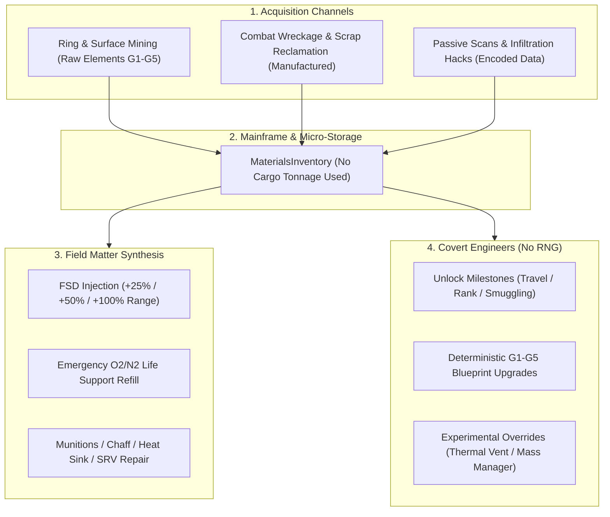

# Technical Implementation Plan: Engineering, Salvage & Matter Synthesis

**Document Version**: 1.1  
**Status**: Queued (Pending Design Discussion — Component Catalog, Recipes & Boosts)  
**Priority Tier**: Pillar 2 (Ready for Design Discussion; Feeds From Ring Mining, Combat Salvage & Scans)  
**Parent Roadmap**: [`01_EXPANSE_LONG_TERM_ROADMAP.md`](./01_EXPANSE_LONG_TERM_ROADMAP.md)  
**Target Files**:
* `src/MaterialsInventory.h`, `src/MaterialsInventory.cpp` *(NEW — zero-mass player material/data ledger)*
* `src/ShipTuning.h`, `src/ShipTuning.cpp` *(NEW — deterministic per-module stat modifiers & experimental overrides)*
* `src/ship/SupercruiseController.cpp`, `src/ship/Hyperspace.cpp` *(FSD boost injection & synthesized consumable hooks)*
* `src/EquipType.h`, `src/lua/LuaEquipType.cpp` *(engineered modifier serialization on installed `Equipment`)*
* `data/modules/Engineering/Materials.lua` *(NEW — Grade 1–5 raw, manufactured, and encoded catalog)*
* `data/modules/Engineering/Synthesis.lua` *(NEW — in-field crafting recipes for FSD boost, O2, ammo, repair)*
* `data/modules/Engineering/Engineers.lua` *(NEW — recluse engineer discovery unlocks, blueprints & experimental overrides)*
* `data/pigui/modules/engineering-view.lua` *(NEW — Ship Inventory Materials/Synthesis UI & Engineer Workshop screen)*

---

## 1. System Overview & Progression Philosophy

In **Pioneer: Expanse**, engineering rewards deep gameplay—mining planetary rings, prospecting surface outcrops in SRVs, salvaging combat debris, and infiltrating data uplinks—without punitive MMO RNG slot machines. **Pillar 2** establishes a zero-cargo-mass material storage bank, on-the-fly **Field Matter Synthesis**, **Atomic Salvage Reclamation**, and **Deterministic Grade 1–5 Engineer Modifications**.



---

## 2. The Material Economy & Micro-Storage

### 2.1 Zero-Mass Three-Tier Ledger (`MaterialsInventory`)
Materials reside in dedicated ship micro-containers and mainframe memory banks so players never lose progression materials when swapping ships:

| Category | Grade Caps | Examples | Acquisition |
| :--- | :--- | :--- | :--- |
| **Raw Elements** | G1: 300, G2: 250, G3: 200, G4: 150, G5: 100 | *G1 Iron/Nickel/Carbon/Sulphur*; *G3 Arsenic/Niobium*; *G5 Polonium/Ruthenium/Tellurium* | Ring asteroid laser chipping *(already live in Plan 03)*; expanded later by Plan B SRV outcrops |
| **Manufactured / Salvage** | Same G1–G5 caps | *Refined Conductors*, *Phase Alloys*, *Polymer Matrices*, *Biomorphic Shield Fragments* | Combat wreck drops (`CargoBody` salvage), Scrap Reclamation Unit *(already supported without SRVs)* |
| **Encoded Data** | Same G1–G5 caps | *Shield Cycle Recordings*, *FSD Wake Exceptions*, *Encrypted Corporate Firmware* | Target/wake scans (`ScanManager` / Plan I), Cartography scans, and future Plan D datalink hacking |

* **Dependency Note**: Because Ring Mining (Plan 03), Combat salvage, and Plan I / Cartography scans are already live, **Plan C does not require Plan B SRVs to start**—only a design pass defining the exact material catalog, crafting recipes, and boost mechanics.
* Include **Cross-Category Material Conversion** at major industrial starport Material Brokers (fair deterministic conversion ratios, never predatory) so rare drops remain accessible.

### 2.2 Atomic Matter Salvage (`ScrapReclamation`)
* Ships may mount an optional internal **Scrap Reclamation Unit** (`misc.scrap_reclaimer_1`) or use starport reclamation bays.
* Scooping damaged ship debris / *Salvage* canisters feeds the reclaimer, decomposing alloys into Grade 1–4 Manufactured Components with a telemetry toast in the HUD.

---

## 3. Deep-Space Field Matter Synthesis

Executed directly from the cockpit Inventory/Systems panel (`Synthesis.lua`) with a short `3.0s` fabricator progress bar:

1. **Frame Shift Drive Injection**:
   * *Basic (+25% next jump range)*: Common G1–G2 raw elements (*Carbon, Vanadium, Germanium*).
   * *Standard (+50% next jump range)*: G2–G4 elements (*Cadmium, Niobium*).
   * *Premium (+100% next jump range)*: G3–G5 rare elements (*Arsenic, Yttrium, Polonium*).
   * Enables explorers to cross wide inter-arm spiral voids cleanly (`Hyperspace.cpp` multiplies jump range cap for a single jump).
2. **Life Support Atmospheric Replenishment**:
   * Synthesizes emergency $O_2 / N_2$ gas canisters from *Iron* + *Nickel* / ice volatiles when canopy breach or oxygen timers run low.
3. **Ordnance, Countermeasures & SRV Field Maintenance**:
   * Re-arm multi-cannon / railgun slugs, refill Chaff/Heat Sink cartridges, synthesize Plasma/Limpet blocks, and refuel/repair SRV hull integrity in deep space.

---

## 4. Covert In-World Engineers (Deterministic Tuning)

### 4.1 Recluse Workshop Archetypes
Hide `6–8` specialist Engineers at bespoke planetary bases across the galaxy, initially locked behind lore-grounded invitations (`Engineers.lua`):
* **Dr. Elena Vance (Propulsion & FSD)** — *Unlock: Travel 2,500 ly from Sol & scan 50 systems.*
* **Kaelen "Weld" Marek (Hull & Shields)** — *Unlock: Reach Competent Combat rank & deliver 25t Phase Alloys.*
* **Sable-9 Syndicate Lab (Weapons & Stealth)** — *Unlock: Smuggle 50t restricted goods across 3 jurisdictions.*
* **Tarek Al-Mansoor (Power & Thrusters)** — *Unlock: Mine 200t metallic/precious ore from planetary rings.*

### 4.2 Deterministic Blueprints & Experimental Overrides (`ShipTuning`)
Every equipment item can carry an `AppliedModification` struct saved cleanly in JSON:

```cpp
struct AppliedModification {
    std::string blueprintId;     // e.g., "fsd_increased_range"
    uint8_t grade = 0;           // 1..5 (exact deterministic % bonus)
    std::string experimentalId;  // e.g., "mass_manager", "thermal_vent"
    std::unordered_map<std::string, double> statMultipliers;
};
```

* **Zero RNG**: Grade 1 gives exact Tier-1 improvement, rolling monotonically up to Grade 5 cap; each material delivery guarantees predictable progress toward completing the grade.
* **Signature Experimental Effects**:
  * **Thermal Vent** (*Beam Lasers*): Hits on an enemy vent ship heat into the target; misses increase weapon thermal load.
  * **Mass Manager** (*Frame Shift Drive*): `+4%` optimal mass multiplier at `+8%` module integrity trade-off.
  * **Corrosive Shell** (*Kinetic Cannons*): Reduces target hull hardness (`+25%` incoming kinetic damage for `5s`) at `-20%` total ammo capacity.
  * **Low Emissions / Monstered** (*Power Plant*), **Dirty Drag Drives** (*Thrusters*).

---

## 5. Implementation Milestones

### Milestone 1: `MaterialsInventory` C++ Storage & Lua API
* [ ] Implement zero-mass `MaterialsInventory` component on `Player`, persisted in save JSON and exposed via Lua bindings (`player:AddMaterial`, `player:GetMaterialCount`, `player:ConsumeMaterials`).
* [ ] Hook `Beam.cpp` / `Mining.lua` / `GroundVehicle` outcrops to award Grade 1–4 Raw Elements alongside `CargoBody` fragments.

### Milestone 2: Field Matter Synthesis
* [ ] Implement `Synthesis.lua` recipes, fabrication cooldown timers, and C++ integration (`Hyperdrive` next-jump multiplier, emergency O2 refill, projectile ammo top-up, heat-sink restock).
* [ ] Build the PiGui Synthesis modal (`engineering-view.lua`) accessible in-flight and inside the SRV.

### Milestone 3: Salvage Drops & Scrap Reclamation
* [ ] Spawn weighted Manufactured salvage debris when NPC ships explode cleanly in normal space.
* [ ] Implement `misc.scrap_reclaimer_1` internal module and station reclamation desk.

### Milestone 4: Deterministic Engineers & Experimental Effects
* [ ] Add `AppliedModification` storage onto `Equipment` instances, applying stat multipliers seamlessly to FSD range, thrust acceleration, weapon DPS/heat, and shield strength.
* [ ] Place hidden Engineer planetary workshops, invitation progression tracker, and Grade 1–5 + Experimental workshop UI.

---

## 6. Verification Criteria
1. **Persistence & Zero Mass**: Collect raw, manufactured, and encoded materials; verify zero impact on ship jump mass (`ship.freeCapacity` unchanged) and full persistence across save/load.
2. **Synthesis End-to-End**: Trigger `+100%` FSD Injection in deep space, confirm single-jump route range doubles in the Sector Map, jump, and confirm boost consumes after transit.
3. **Deterministic Engineering**: Upgrade a Class 4 FSD from Stock -> Grade 5 + *Mass Manager*; verify exact expected jump-range formula increase and zero variance across identical builds.
