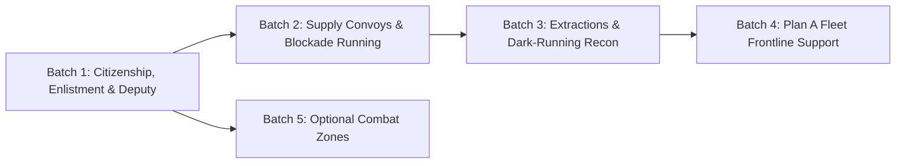

# Plan J: Military Enlistment, Frontline Support & Deputy Charter

**Document Version**: 1.1
**Status**: Completed (Batches 1–5 Implemented — [`PLAN_J_BATCH_1`](./PLAN_J_BATCH_1_CITIZENSHIP_ENLISTMENT_DEPUTY.md)–[`5`](./PLAN_J_BATCH_5_OPTIONAL_COMBAT_ZONES.md))
**Priority Tier**: Plan J (Active Systemic Gameplay Pillar)
**Parent Roadmap**: [`01_EXPANSE_LONG_TERM_ROADMAP.md`](../01_EXPANSE_LONG_TERM_ROADMAP.md)
**Depends On**: [`I_PLAN_TRANSPONDER_AND_STEALTH.md`](./I_PLAN_TRANSPONDER_AND_STEALTH.md) (per-faction licence/standing/warrant architecture) & `MacroGalaxyEngine` (`FRONTLINE` crises)

---

## 1. Strategic Objective

Build upon **Plan I**'s per-faction licence, standing, and warrant framework and **MacroGalaxyEngine**'s `FRONTLINE` conflict crises to give players and their **Plan A** fleets meaningful ways to participate in faction conflicts and law enforcement—prioritizing **non-combat logistics, reconnaissance, fleet delegation, and patrol authority** alongside optional direct combat zones.

> **Design Principle**: Combat is never mandatory for progression. Freight haulers, blockade runners, scouts, and fleet commanders can shape warfronts and earn military rank or Deputy status without forced dogfighting.

---

## 2. Core Pillars (For Design Discussion)

### 2.1 Non-Combat & Logistics Frontline Support (First-Class Loops)
* **Blockade Running & Supply Convoys**: Deliver high-priority munitions, reactive armor plates, fusion cells, and medical supplies into `FRONTLINE` crisis systems under active patrol/interdiction risk.
* **Troop & Refugee Extraction**: Evacuate wounded personnel, diplomatic envoys, and displaced civilians from contested stations to safe rear-line starports.
* **Frontline Recon & Telemetry Scans**: Scan contested beacons, orbital staging zones, and hostile logistics convoys (synergizing with Plan I dark-running and `ScanManager`) to supply intelligence that shifts frontline crisis progress.
* **Plan A Autonomous Fleet Support**: Delegate supply runs, recon routes, or defensive patrol/escort orders to crewed **PlayerFleet** vessels, letting player-built logistics wings sustain a warfront.

### 2.2 Military Enlistment & Rank Progression
* **Generic Per-Faction Role Record**: Extend Plan I's per-faction role/licence structure (explicitly left extensible in Plan I §10) to track military enlistment, service rank, and campaign commendations per major faction.
* **Frontline Contract Boards & Warfront Impact**: Enlisted pilots unlock dedicated faction logistics/recon/patrol assignments, military hazard pay bonuses, and preferential starport servicing—directly accelerating positive `FRONTLINE` crisis resolution in `MacroGalaxyEngine`.

### 2.3 Faction Deputy Charter (from Plan I §10)
* **Standing-Gated Deputization**: Pilots who reach high standing and clean service records with a controlling faction can earn **Deputy** status.
* **Privileges**: Waives ongoing bounty-hunter licence renewal fees for that faction, grants persistent faction-wide warrant visibility, and authorizes legal interdiction/detainment of `WANTED` targets within faction jurisdiction.

### 2.4 Optional Combat Zones
* **Contested Space Skirmishes**: Optional high-intensity naval conflict zones in `FRONTLINE` systems for combat-focused pilots or **Plan A** escort wings, paying combat bonds and rank progression without gating non-combat players out of the war effort.

---

## 3. Target Integration Points (Preliminary)
* `data/modules/CrimeTracking/` & `data/libs/Legal.lua` (per-faction role/deputy/enlistment records extending Plan I licences)
* `data/modules/MacroGalaxy/MacroGalaxyEngine.lua` (`FRONTLINE` crisis progression hooks from logistics/recon/combat deliveries)
* `data/modules/PlayerFleet/PlayerFleet.lua` (frontline logistics/patrol delegation compatibility)
* `data/pigui/modules/station-view/02-police.lua` & `05-bulletinBoard.lua` (Deputy charter status & frontline military assignments)

---

## 4. Confirmed Design Decisions

1. **Residency → Citizenship → Military Enlistment Chain & Permanent Rival Lockout**:
   * **Citizenship requires Residency**: A pilot must hold active civil residency (`TaxAuthority`) in a faction before claiming citizenship in that faction (`FactionRoles`).
   * **Enlisted Citizenship & Residency Lock**: Military enlistment requires holding citizenship in that faction. While actively enlisted, citizenship cannot be changed or renounced; once the 90-day residency term expires, residency may only be relocated to another station within the pilot's citizenship faction until the pilot resigns from military service.
   * **Permanent Rival Enlistment Lockout**: Having once enlisted with a faction permanently bars the pilot from ever enlisting in the military of any opposing/rival faction—even after resigning and later transferring residency and citizenship to that rival faction.
2. **Sequenced Milestone Scope**: Ship in 5 testable batches starting with Citizenship/Enlistment/Deputy (`Batch 1`), followed by Supply Convoys & Blockade Running (`Batch 2`), Extractions & Dark-Running Recon (`Batch 3`), Plan A Fleet Frontline Support (`Batch 4`), and Optional Combat Zones (`Batch 5`).
3. **Deputy Eligibility Threshold**: Requires **Allied** standing (`>= 75` in `FactionStanding`), clean criminal record (`0` outstanding fines / not wanted), and either an active/prior Bounty Hunter Licence or `>= 3` frontline commendations / military service.

---

## 5. Batched Execution Index & Parallelism Matrix

| Batch | Plan Document | Scope | Dependencies & Parallelism |
| :--- | :--- | :--- | :--- |
| **Batch 1** | [`PLAN_J_BATCH_1_CITIZENSHIP_ENLISTMENT_DEPUTY.md`](./PLAN_J_BATCH_1_CITIZENSHIP_ENLISTMENT_DEPUTY.md) | `FactionRoles` Citizenship/Enlistment/Rank/Rivalries/Deputy, `TaxAuthority` residency lock, `Legal`/`CrimeTracking` Deputy interdiction, Lobby & Police UI | **Run First** (blocks 2–5) |
| **Batch 2** | [`PLAN_J_BATCH_2_FRONTLINE_LOGISTICS_CONVOYS.md`](./PLAN_J_BATCH_2_FRONTLINE_LOGISTICS_CONVOYS.md) | `FrontlineCommon.lua`, `FrontlineLogistics.lua` (Supply Convoys & Blockade Runs), `Pirates.lua` convoy risk scaling | **After Batch 1** (parallel with Batch 5) |
| **Batch 3** | [`PLAN_J_BATCH_3_EXTRACTION_AND_RECON.md`](./PLAN_J_BATCH_3_EXTRACTION_AND_RECON.md) | `FrontlineExtraction.lua` (`Passengers` evacuations) & `FrontlineRecon.lua` (`ScanManager` + Plan I dark-running stealth bonus) | **After Batch 2** (parallel with Batch 5) |
| **Batch 4** | [`PLAN_J_BATCH_4_FLEET_FRONTLINE_SUPPORT.md`](./PLAN_J_BATCH_4_FLEET_FRONTLINE_SUPPORT.md) | `PlayerFleet.lua` delegation for `FrontlineSupply` & `FrontlineExtraction` + `PATROL`/`AUTO_TRADE` frontline contributions | **After Batch 3** (parallel with Batch 5) |
| **Batch 5** | [`PLAN_J_BATCH_5_OPTIONAL_COMBAT_ZONES.md`](./PLAN_J_BATCH_5_OPTIONAL_COMBAT_ZONES.md) | `FrontlineCombatZones.lua`, `CrimeTracking.lua` CZ exemption, `02-police.lua` Combat Bonds redemption | **After Batch 1** (parallel with Batches 2–4) |
