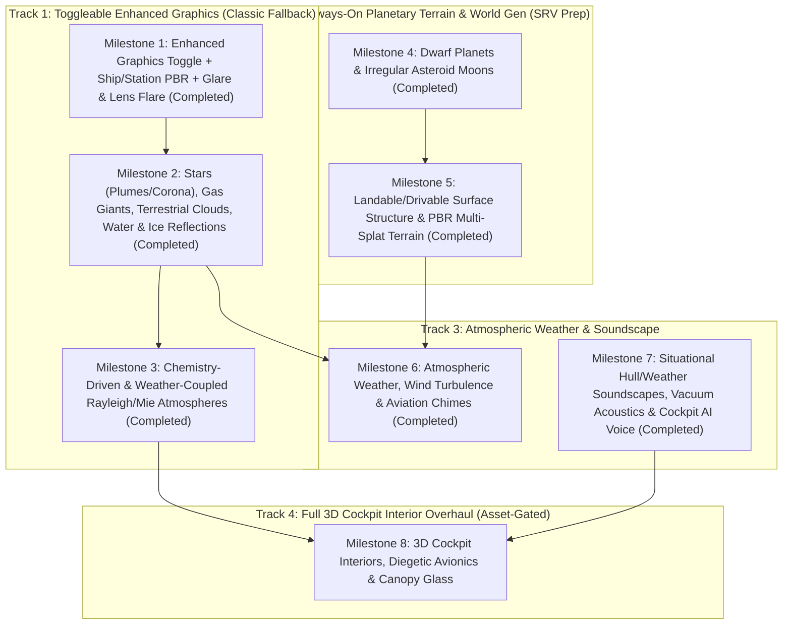

# Technical Implementation Plan: Graphics, Planetary Engine, Weather & Audio Overhaul

**Document Version**: 2.6  
**Status**: Code & Audio Completed (M1–7 Completed; M8 Asset-Gated)  
**Priority Tier**: Completed Code/Audio Pillar (M8 Asset-Gated)  
**Parent Roadmap**: [`01_EXPANSE_LONG_TERM_ROADMAP.md`](./01_EXPANSE_LONG_TERM_ROADMAP.md)  

---

## 1. Architectural Strategy: Three Clean Tracks

To preserve Pioneer's rock-solid playability and save/physics determinism while delivering a dramatic visual and planetary leap, this overhaul is split into three distinct tracks:

1. **Track 1 — Toggleable "Enhanced Graphics" (Settings Option, Classic Fallback Preserved)**
   * Controlled by a persistent **`EnhancedGraphics`** setting in Graphics Settings (toggles cleanly between **Enhanced** and **Classic Pioneer** rendering).
   * Purely visual/shader/post-processing upgrades that never alter hitboxes, terrain height, or gameplay determinism—so Classic remains a 100% playable fallback.
2. **Track 2 — Always-On Planetary Terrain & World Generation (Non-Toggleable, SRV Foundation)**
   * Heightfields, small-body generation (dwarf planets, irregular asteroid moons), and drivable/landable surface structure.
   * **Cannot be toggled off** because terrain geometry directly governs collisions, planetary starport placement, and future SRV suspension physics.
3. **Track 3 — Atmospheric Weather, Wind Turbulence & Soundscape**
   * Physically simulated atmospheric weather and wind/gust turbulence affecting atmospheric flight and planetary base approaches, paired with vacuum acoustics and cockpit voice advisories.

---

## 2. Track 1: Toggleable Enhanced Graphics (Settings Option)

### 2.1 Milestone 1 *(Completed)*: Settings Toggle, Ship & Station PBR, Glare & Lens Flare
* **Enhanced Graphics Toggle (`EnhancedGraphics`)**:
  * Added `EnhancedGraphics` config key in `GameConfig` (default `1` / enabled), wired to C++ renderer/shader uniforms and exposed in the PiGui Video/Graphics Settings panel.
  * When `EnhancedGraphics == 0`, shaders execute the exact Classic Pioneer Blinn-Phong and star/atmosphere rendering paths with zero visual regressions.
* **Ship & Station PBR Beautification (`data/shaders/opengl/multi.*`, `lib.glsl`)**:
  * Upgraded `multi.frag` with a **Cook-Torrance GGX PBR** lighting model when Enhanced Graphics is enabled, deriving physically plausible roughness and metallic response from existing diffuse, specular, shininess, and AO maps.
  * Added analytical environment reflections / Fresnel grazing rim lighting, hemisphere ambient bounce, ACES filmic tone-mapping, and warm exterior station window emissives.
* **Star Glare & Optical Lens Flare (`src/Star.cpp`, `src/WorldView.cpp`, `data/shaders/opengl/lens_flare.*`)**:
  * Added star glare, 6-point coronal diffraction spikes, and multi-element optical lens flare with 3D terrain, cloud, and station hull line-of-sight occlusion.

### 2.2 Milestone 2 *(Completed)*: Stars, Gas Giants, Terrestrial Clouds, Water & Ice Reflections
* **Stars (`geosphere_star.*`, `star_corona.frag`)**: Animated 3D cylindrical noise convective granulation, limb darkening, radiant corona, and arching stellar plumes / solar prominences.
* **Gas Giants (`gassphere_base.*`, `gen-gas-giant-colour.*`)**: Deterministic per-planet profiles (Jupiter/Saturn/Uranus/Neptune archetypes) with counter-drifting zonal bands, polar hoods, and cyclone vortices.
* **Terrestrial Cloud Layers (`planet_clouds.frag`)**: Dual-layer animated cloud shells (cumulus/stratus + high cirrus) with wind-drift parallax, storm darkening, and terrain cloud shadows.
* **Water & Ice Surface Shaders**: Animated ocean swell/chop normal detail with true atmospheric LUT sky reflections and coastal surf foam, plus crystalline specular glint on frozen worlds.

### 2.3 Milestone 3 *(Completed)*: Per-Planet Chemistry & Weather-Coupled Rayleigh/Mie Atmospheres
* **Implemented (`src/galaxy/AtmosphereParameters.h`, `src/galaxy/SystemBody.cpp`, `src/BaseSphere.cpp`, `src/GeoSphere.cpp`, `src/GameConfig.cpp`, `data/shaders/opengl/basesphere_uniforms.glsl`, `rayleigh-lib.glsl`, `geosphere_sky.frag`)**:
  * Enabled `RealisticScattering = 2` (Full Rayleigh/Mie) by default in `GameConfig`.
  * Computed per-planet `rayleighBeta`, `mieBeta`, `mieG`, and `ozoneStrength` across all 9 atmospheric chemistry classes (`O2/N2` + Chappuis ozone twilight, dusty `CO2` Mars vs. greenhouse `CO2` Venus, `CO`, photochemical `CH4` Titan vs. clear `CH4`, `H2`, `He`, `Ar`, `S/SO2`, `N2`), plus volcanicity ash aerosol blending and hand-authored `atmosCol` hue tinting.
  * Coupled live `WeatherSystem` storm intensity, overcast cover, and precipitation aerosols (`DUST`, `ASH`, `RAIN`, `SNOW`) into the `BaseSphereData` UBO each frame while preserving identical Classic fallback when `EnhancedGraphics == 0`.
  * Added solar-elevation daytime/twilight star suppression alongside the **Galactic Skybox & Starfield Overhaul** (`src/Background.cpp`, `data/shaders/opengl/skybox.frag`, `starfield.*`): aligned Milky Way disc, galactic core bulge, dust rifts, procedural nebulae, fine 1px pinpoints, radial open clusters, optical scroll-zoom scaling, and statically calibrated skybox.

---

## 3. Track 2: Always-On Planetary Terrain & World Generation (Non-Toggleable) *(Completed)*

* **Milestone 4 — Dwarf Planets & Asteroid Moons *(Completed)***:
  * Added true 3D spherical cellular impact craters (`cellular_crater_layer`, `multi_scale_craters`) with parabolic/flat-floor bowls, raised rims, outer ejecta aprons, and central rebound peaks (`src/terrain/TerrainFeature.*`).
  * Overhauled all four `TerrainHeightAsteroid*` generators + `TerrainColorAsteroid` for scale-accurate triaxial potato moons (Phobos/Deimos), cratered oblate protoplanets (Vesta), bilobed contact-binary bodies (67P), and shattered angular monoliths (Psyche/Eros) without modifying `StarSystemGenerator` body counts or RNG order.
  * Added dedicated `TerrainHeightDwarfPlanet` & `TerrainColorDwarfPlanet` generators for rocky and icy dwarf planets / small sub-satellites (`< 0.28 R_earth`), featuring smooth flooded maria / Sputnik Planitia cryo-plains, tectonic chasma/linea rifts, and dense multi-scale craters.
* **Milestone 5 — Landable & Drivable Surface Structure *(Completed)***:
  * Tightened `GeoSphere` close-range patch triangle target from `100m` to `20m` and fixed `CalculateMaxPatchDepth()` reset behavior (`src/GeoSphere.cpp`).
  * Overhauled `TerrainHeightBarrenRock*`, `TerrainHeightHillsCraters2`, and `TerrainHeightMountainsCraters2` to eliminate high-frequency noise-aliasing spikes and introduce smooth drivable basin floors (`smooth_basin_floor`), terraced mesas (`smooth_terrace`), navigable canyons, and true cellular craters.
  * Added seamless world-locked **Tri-Planar PBR Multi-Splat** shading (`PatchTileOffset` modulo 256m double-precision offset in `src/GeoPatch.cpp`, plus stratified cliff rock, talus/scree mid-slopes, flat regolith/soil, and per-layer GGX microfacet roughness/Fresnel in `geosphere_terrain.*` and `rayleigh_geosphere_terrain.*`).
  * **Surface Naturalization & 3D `SurfaceScatter`** (`src/planet/SurfaceScatter.*`, `src/GeoSphere.cpp`, `src/GeoPatch.cpp`, `geosphere_terrain.frag`, `rayleigh_geosphere_terrain.frag`): quintic 3-octave FBM micro-detail (removing BC1 strips), anisotropic filtering, finer mid-range cliff subdivision, and 3D procedural boulders/outcrops/cobbles with day/night/cloud & ship spotlight shading, plus procedural tangent-space rock bump mapping (`scripts/generate_rock_normal.py` -> `data/textures/rock_normal.png`) on `SurfaceScatter` and `RingField` boulders.
  * **Volcanic Surface & Plume Overhaul** (`src/terrain/TerrainColorVolcanic.cpp`, `src/planet/WeatherEffects.*`, `geosphere_terrain.frag`, `rayleigh_geosphere_terrain.frag`): smooth volcanic strata, organic shorelines, pulsing pahoehoe crust & HDR magma fissures, plus rising atmospheric steam/smoke/ember plumes.
  * **Low → Extreme Graphics Quality Presets & Controls (`GameConfig.cpp`, `LuaEngine.cpp`, `settings-window.lua`, `planet_clouds.frag`, `GeoSphere.cpp`, `WeatherEffects.cpp`)**: Added cohesive `Low`–`Extreme` overall graphics presets plus granular controls for `AtmosphereQuality` (cloud FBM octaves, domain warping, and single vs. dual altitude cloud decks), `SurfaceScatterQuality` (mesh subdivision, bump mapping, draw distance), `SurfaceScatterAmount` (density/budgets), `WeatherEffectsQuality` (precipitation/plume density), and `VolumetricRings`.
* **Future Follow-Up Note**: Add in-system procedural **asteroid fields / asteroid belts** as localized volumetric/navigable belts without altering existing `StarSystemGenerator` planetary seeds.

---

## 4. Track 3: Atmospheric Weather, Wind Turbulence & Soundscape

* **Milestone 6 — Atmospheric Weather, Wind Turbulence & Aviation Chime Overhaul *(Completed)***:
  * Implemented deterministic 3D spatiotemporal `WeatherSystem` (`src/planet/WeatherSystem.*`, `Planet::GetWeatherState`) deriving zonal/cyclonic wind vectors, gusts, vertical drafts, boundary-layer wind shear, storm intensity, cloud cover, precipitation type (`RAIN`/`SNOW`/`DUST`/`ASH`), and storm lightning windows from planetary pressure, temperature, rotation period, volatiles, and volcanicity without altering save-game schemas.
  * Applied balanced aviation-feel aerodynamic forces (`Ship::CalcAtmosphericForce`, `Ship::CalcAtmoTorque`, `Ship::SpawnThrusterExhaustParticles`, `Player::StaticUpdate` turbulence creak): relative-airspeed drag/lift/weathercocking, smooth 3-axis gust & turbulence buffeting attenuated for AI/docking and ground-pad proximity (`< 50 m` with gear down), and wind-driven thruster/dust plumes.
  * Added world-space weather visuals (`src/planet/WeatherEffects.*` in `WorldView`) rendering precipitation/dust/ash streaks and forked 3D storm lightning bolts, plus `planet_clouds.frag` / `GeoSphere.cpp` storm darkening, dust tinting, and internal sheet-lightning illumination.
  * Upgraded `AmbientSounds` (`src/sound/AmbientSounds.cpp`): fixed `NUM_SURFACE_DEAD_SOUNDS` array bounds (`12` -> `6`) and added continuous atmospheric wind, rain/storm loops, and distance-delayed thunder claps.
  * Added Lua `Body:GetWeatherState` (`src/lua/LuaBody.cpp`), adaptive `PlanetaryInfo` HUD wind/turbulence/shear telemetry (`data/pigui/modules/planetary-info.lua`), surface Starport ATC ATIS briefings (`data/modules/StationTrafficControl/StationTrafficControl.lua`), and hysteresis-guarded weather advisories (`data/pigui/modules/master-alarm.lua`).
  * Overhauled all 10 existing cockpit alarms/warnings/sirens/beeps plus 3 new weather alerts (`scripts/generate_cockpit_chimes.py`) into a warm, non-clipping 4-tier acoustic hierarchy (`data/sounds/*.ogg`, `data/sounds/Cockpit/*.ogg`): sweeping/whooping sirens for alarms (`Missile_Inbound`, `danger_siren`, `alarm_emer`, `alarm_descent`, `alarm_generic1`), fast repetitive rounded beeps/boops for warnings (`warning`, `Missile_lock`, `impact_chime`, `weather_windshear`), aircraft "bing-bong" two-tone chimes for awareness notifications (`fuel_low`, `weather_advisory`, `weather_turbulence`), and a single warm "ding" for informational notices (`notify_beep`).
* **Milestone 7 *(Completed)* — Situational Hull/Weather Soundscapes, Vacuum Acoustics & Cockpit AI Voice**:
  * **Situational Soundscapes (`scripts/generate_hull_soundscapes.py`, `data/sounds/Hull/*.ogg`, `src/sound/AmbientSounds.cpp`, `src/Pi.cpp`)**: Synthesized 44.1 kHz stereo Vorbis assets and wired `hull_rain_canopy` (`RAIN`), `hull_sand_ash` (`DUST`/`ASH`), `hull_reentry_roar` (atmospheric entry speed/heat), `hull_ring_debris` (flying inside planetary rings), `hull_creak_stress` (high-G/thermal stress), and `hangar_hydraulics` (dock/undock pad cycling).
  * **Vacuum Acoustics (`src/sound/AlAudioBackend.*`)**: Implemented OpenAL `ALC_EXT_EFX` low-pass filter (`AL_FILTER_LOWPASS`) driven smoothly by local atmospheric density (`Planet::GetAtmosphericState`, full-pass when docked) on exterior 3D `BodyMakeNoise` sources while keeping internal cockpit alerts crisp, toggleable via `VacuumAcoustics` in Sound Settings.
  * **Cockpit AI Voice (`src/sound/CockpitVoice.*`, `scripts/generate_cockpit_voices.py`, `data/sounds/Voice/aria/voice_aria_*.ogg`)**: Built non-overlapping, priority-queued (`INFO`/`ADVISORY`/`WARNING`/`CRITICAL`) voice manager with per-event cooldowns and generated 18 calm, warm US female advisories ("Aria" pack via `en-US-AvaNeural` + studio proximity EQ/loudnorm), wired across Supercruise/FSD, interdiction, hyperspace, shields, missiles, landing gear, docking clearance, and `master-alarm.lua` thermal/fuel/weather cautions, with enable/volume/pack/test controls in Sound Settings.

---

## 4B. Track 4: Full 3D Cockpit Interior Overhaul *(Asset-Gated)*

* **Milestone 8 — Full 3D Cockpit Interiors, Diegetic Avionics & Canopy Glass *(Requires 3D Cockpit Models)***:
  * Replace the current incomplete free-camera cockpit placeholder (`ShipCockpit` / `default_cockpit`) with properly modeled, ship-class-appropriate 3D cockpit interiors with seated pilot framing and unobstructed canopy sightlines.
  * Integrate diegetic flight instrumentation / holographic cockpit MFDs synchronized with PiGui HUD telemetry (speed, attitude, Supercruise, weather/wind advisories, and master caution annunciators).
  * Implement dynamic canopy glass (`cockpit_glass.*`) shaders for micro-abrasion starlight glints, external raindrop/dust streaks, coronal heat shimmer, and cold-running frost crystallization (`< 20%` heat).

---

## 5. Verification Criteria (Milestone 1)

1. **Classic Fallback Integrity**: Toggle **Enhanced Graphics** OFF in Video Settings; verify ships, stations, and stars render identically to Classic Pioneer with no shader errors or artifacts.
2. **Ship & Station PBR Beautification**: Toggle **Enhanced Graphics** ON; inspect ships (in flight, external camera, and docked) and orbital/surface stations—verify realistic metallic/reflective specular highlights, Fresnel rim sheen, crisp panel normal response, and clean emissives without blown-out highlights.
3. **Star Glare & Lens Flare**: Look toward and away from the system star in normal space and Supercruise; verify smooth glare, subtle diffraction/optical flare elements, smooth distance/angle falloff, and proper attenuation when occluded behind a planet or station.
4. **Build & Tests**: `cmake --build build --target pioneer build-data unittest -j 8 && ./build/unittest` passes cleanly with zero shader compile warnings or runtime errors.
