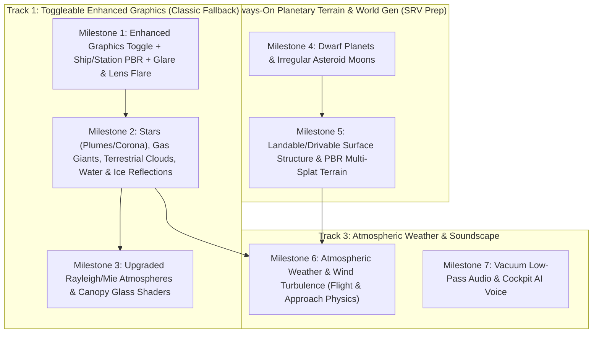

# Technical Implementation Plan: Graphics, Planetary Engine, Weather & Audio Overhaul

**Document Version**: 2.0  
**Status**: In Progress (Track 1 — Milestone 1)  
**Priority Tier**: Active Pillar (Foundation for SRV Surface Operations & Visual Polish)  
**Parent Roadmap**: [`01_EXPANSE_LONG_TERM_ROADMAP.md`](./01_EXPANSE_LONG_TERM_ROADMAP.md)  

---

## 1. Architectural Strategy: Three Clean Tracks

To preserve Pioneer's rock-solid playability and save/physics determinism while delivering a dramatic visual and planetary leap, this overhaul is split into three distinct tracks:

1. **Track 1 — Toggleable "Enhanced Graphics" (Settings Option, Classic Fallback Preserved)**
   * Controlled by a persistent **`EnhancedGraphics`** setting in Graphics Settings (toggles cleanly between **Enhanced** and **Classic Pioneer** rendering).
   * Purely visual/shader/post-processing upgrades that never alter hitboxes, terrain height, or gameplay determinism—so Classic remains a 100% playable fallback.
2. **Track 2 — Always-On Planetary Terrain & World Generation (Non-Toggleable, SRV Foundation)**
   * Heightfields, small-body generation (dwarf planets, irregular asteroid moons), and drivable/landable surface structure.
   * **Cannot be toggled off** because terrain geometry directly governs collisions, planetary starport placement, and future SRV suspension physics.
3. **Track 3 — Atmospheric Weather, Wind Turbulence & Soundscape**
   * Physically simulated atmospheric weather and wind/gust turbulence affecting atmospheric flight and planetary base approaches, paired with vacuum acoustics and cockpit voice advisories.

---

## 2. Track 1: Toggleable Enhanced Graphics (Settings Option)

### 2.1 Milestone 1 *(Active)*: Settings Toggle, Ship & Station PBR, Glare & Lens Flare
* **Enhanced Graphics Toggle (`EnhancedGraphics`)**:
  * Add `EnhancedGraphics` config key in `GameConfig` (default `1` / enabled), wired to C++ renderer/shader uniforms and exposed in the PiGui Video/Graphics Settings panel.
  * When `EnhancedGraphics == 0`, shaders execute the exact Classic Pioneer Blinn-Phong and star/atmosphere rendering paths with zero visual regressions.
* **Ship & Station PBR Beautification (`data/shaders/opengl/multi.*`, `lib.glsl`)**:
  * Upgrade `multi.frag` with a **Cook-Torrance GGX PBR** lighting model when Enhanced Graphics is enabled, deriving physically plausible roughness and metallic response from existing diffuse, specular, shininess, and AO maps (so all existing Pioneer ships and stations immediately benefit without requiring re-authored textures).
  * Add **analytical environment reflections / Fresnel grazing rim lighting** (star-lit specular sheen, metallic hull reflection of sky/nebula + local star, hemisphere ambient bounce, and crisp panel normal highlights) plus subtle filmic/ACES tone-mapping so bright highlights roll off naturally instead of clipping flat.
  * Enhance emissive glow on ship engines, windows, and station docking bays.
* **Star Glare & Optical Lens Flare (`src/Star.cpp`, `src/WorldView.cpp`, `data/shaders/opengl/lens_flare.*`)**:
  * Render crisp, physically tasteful **star glare, coronal diffraction spikes, and multi-element optical lens flare** for primary/nearby stars in the system.
  * Respect **line-of-sight occlusion** (smoothly attenuating when a planet, moon, or station eclipses the star) and fade smoothly with distance, star luminosity, and off-axis angle so it elevates cinematic beauty without obscuring HUD elements or combat targets.

### 2.2 Milestone 2: Stars, Gas Giants, Terrestrial Clouds, Water & Ice Reflections
* **Stars (`geosphere_star.*` + coronal shader)**: Animated convective granulation, limb darkening, radiant corona, and **stellar plumes / solar prominences** arching off stellar limbs.
* **Gas Giants (`gassphere_base.*`, `gen-gas-giant-colour.*`)**: Enhanced atmospheric limb scattering, richer multi-band storm/turbulence depth, and subtle terminator glow.
* **Terrestrial Cloud Layers**: Dedicated animated cloud shell rendering above terrestrial worlds with wind-drift parallax, variable coverage driven by `SystemBody` hydro/atmosphere parameters, and soft cloud-shadow tinting on the terrain below.
* **Water & Ice Surface Shaders**: Animated ocean micro-wave normal detail with Fresnel sky/sun reflections on liquid seas, and low-roughness crystalline specular glint on frozen/icy worlds.

### 2.3 Milestone 3: Upgraded Rayleigh/Mie Atmospheres & Canopy Glass
* **Unified Rayleigh/Mie Scattering**: Seamless orbital-to-surface transition, vivid twilight/sunset terminators, alien atmospheric chemistry tints (`SO2`, `CH4`, `NH3`), and Mie aerosol horizon haze.
* **Dynamic Cockpit Canopy (`cockpit_glass.*`)**: Subtle micro-abrasions catching starlight, coronal heat shimmer near stars, and cold-running frost crystallization (`< 20%` heat).

---

## 3. Track 2: Always-On Planetary Terrain & World Generation (Non-Toggleable)

* **Milestone 4 — Dwarf Planets & Asteroid Moons**: Expand procedural system generation and `TerrainHeightAsteroid*` / small-body generators to produce realistic cratered dwarf planets, oblate/irregular asteroid moons, and rocky sub-satellites.
* **Milestone 5 — Landable & Drivable Surface Structure**: Refine `GeoSphere` heightfield frequency profiles and surface micro-relief so plains, ridges, craters, and basins have realistic scale and drivable slopes for both ship touchdowns and Plan B SRV operations, paired with tri-planar PBR multi-splat texturing.

---

## 4. Track 3: Atmospheric Weather, Wind Turbulence & Soundscape

* **Milestone 6 — Atmospheric Weather & Wind Turbulence**:
  * Simulate localized wind vectors, vertical thermals, gust fronts, and storm intensity derived from planet atmospheric pressure, temperature, rotation speed, and cloud cover.
  * Apply physical aerodynamic buffeting and crosswind forces to ships flying in atmosphere—especially noticeable during final approach and touchdown at planetary starports (and later affecting SRV stability/dust).
  * Expose weather telemetry (wind speed/direction, turbulence level, storm advisory) to HUD/ATC approach readouts.
* **Milestone 7 — Vacuum Acoustics & Cockpit AI Voice**:
  * OpenAL low-pass vacuum filtering for exterior sounds vs. crisp hull-transducer impacts/thrusters, plus a non-overlapping priority-queued Cockpit AI advisory voice.

---

## 5. Verification Criteria (Milestone 1)

1. **Classic Fallback Integrity**: Toggle **Enhanced Graphics** OFF in Video Settings; verify ships, stations, and stars render identically to Classic Pioneer with no shader errors or artifacts.
2. **Ship & Station PBR Beautification**: Toggle **Enhanced Graphics** ON; inspect ships (in flight, external camera, and docked) and orbital/surface stations—verify realistic metallic/reflective specular highlights, Fresnel rim sheen, crisp panel normal response, and clean emissives without blown-out highlights.
3. **Star Glare & Lens Flare**: Look toward and away from the system star in normal space and Supercruise; verify smooth glare, subtle diffraction/optical flare elements, smooth distance/angle falloff, and proper attenuation when occluded behind a planet or station.
4. **Build & Tests**: `cmake --build build --target pioneer build-data unittest -j 8 && ./build/unittest` passes cleanly with zero shader compile warnings or runtime errors.
