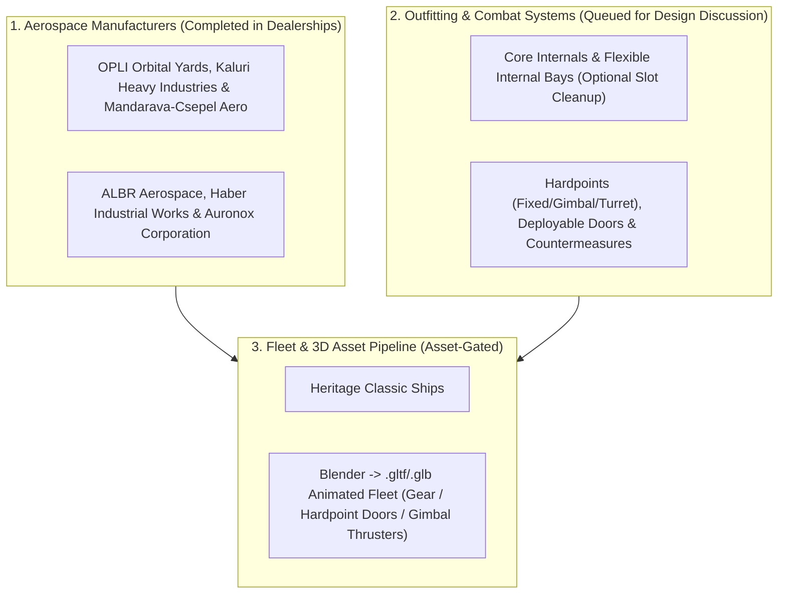

# Technical Implementation Plan: Aerospace Manufacturers, Modular Slots & Combat Systems

**Document Version**: 1.1  
**Status**: Partially Implemented (6 Manufacturer Dealerships & Station Profiles Completed; Mechanical Refactor Queued for Design Discussion)  
**Priority Tier**: Pillar 5 (Combat/Outfitting Refactor Queued; `.gltf` Fleet Asset-Gated)  
**Parent Roadmap**: [`01_EXPANSE_LONG_TERM_ROADMAP.md`](./01_EXPANSE_LONG_TERM_ROADMAP.md)  
**Target Files**:
* `src/ship/ShipType.h`, `src/ship/ShipType.cpp` *(manufacturer ID, core slot class definitions, hardpoint mount constraints)*
* `src/ship/EquipSet.h`, `src/ship/EquipSet.cpp` *(partitionable internal compartments & gimballed/turreted mount logic)*
* `src/GunManager.h`, `src/GunManager.cpp` *(Fixed / Gimballed tracking cone / 360-deg Turreted fire-control modes)*
* `src/ShipAICmd.cpp` *(turret auto-track & hardpoint deployment animation states)*
* `data/ships/*.json` *(assign manufacturer, core slot sizes, optional compartment sizes, Class 1–4 hardpoints)*
* `data/modules/Equipment/*.lua` *(refactor equipment onto Core Internals, Utilities, Avionics, and Optional Bays)*
* `data/lang/` & `data/icons/logos/` *(aerospace corporate crests for Sol-Dynamics, Aethelgard, Guan-Haber, Frontier Voidcraft)*
* `data/models/ships/` *(modernized `.gltf`/`.glb` animated ship models & heritage classic variants)*

---

## 1. System Overview & Architectural Goals

Pioneer's original outfitting system mixes fixed equipment sizes, loose slot strings, and generic ship lore. **Pillar 5** restructures the fleet around four **Aerospace Megacorporations** with unmistakable visual and engineering identities, introduces a clean *Elite Dangerous*-style **Four-Tier Modular Slot Architecture**, supports **Fixed / Gimballed / Turreted** weapon mounts across Classes 1–4, and establishes the **3D Asset Pipeline** preserving iconic classic Pioneer hulls alongside next-generation `.gltf`/`.glb` animated ships.

---

## 2. Aerospace Manufacturers & Dealerships *(Completed)*

Six native aerospace manufacturers operate faction- and purpose-weighted starport franchise showrooms alongside independent pre-owned brokers (`data/modules/ShipDealerships/`, `data/modules/SecondHand/`, `data/modules/StationProfiles/`, `data/icons/logos/corp_*.svg`):
* **OPLI Orbital Yards** (`corp_opli.svg`)
* **Kaluri Heavy Industries** (`corp_kaluri.svg`)
* **Mandarava-Csepel Aero** (`corp_mandarava.svg`)
* **ALBR Aerospace** (`corp_albr.svg`)
* **Haber Industrial Works** (`corp_haber.svg` / `faction_haber.svg`)
* **Auronox Corporation** (`corp_auronox.svg`)

---

## 3. Outfitting & Combat Mechanics *(Queued for Design Discussion)*

### 3.1 Modular Slot Architecture (`ShipType`, `EquipSet`, `Equipment/*.lua`)
* Streamline internal bays across Core Internals, Dedicated Avionics (`Docking Computer`, `Supercruise Assist`, `FSD Interdictor`, `Discovery/Warrant Scanners`), Utility Mounts, and Flexible Internal Compartments.
* **No Mandatory `SYS/ENG/WEP` Pip Juggling**: Pioneer does not currently implement a capacitor pip distributor, and this plan **omits** manual `SYS/ENG/WEP` pip micromanagement in favor of straightforward power-budget and thermal management.
* **Weapon Hardpoints & Utility Mounts (`GunManager`)**:
  * **Fixed**: Highest DPS, immune to chaff, zero tracking offset.
  * **Gimballed**: `~20%` lower base DPS, auto-tracks target inside `±22 deg` forward cone, disrupted by Chaff launchers.
  * **Turreted**: `~40%` lower base DPS, upper/lower hemisphere `360 deg` tracking under Fire-At-Will / Target-Only AI modes, hardpoint-axis occluded by own hull.
  * **Utility Mounts**: *Chaff Launcher*, *Heat Sink Launcher*, *Point Defense Turret*, *ECM Pod*.

---

## 4. 3D Asset Pipeline & Heritage Aging

1. **Heritage Classic Ships**:
   * Preserve beloved original Pioneer silhouettes (*Sinonatrix*, *Nerodia*, *Varanus*, *Natrix*) re-tagged as **Classic Generation** hulls—featuring worn cockpit textures, lower purchase cost, and enduring reliability for starter/frontier pilots.
2. **High-Fidelity `.gltf` / `.glb` Fleet Pipeline**:
   * Pioneer's Assimp loader already handles skeletal/node hierarchies cleanly; define standardized animation bone conventions for new hulls:
     * `gear_front`, `gear_left`, `gear_right`: Animated retraction synchronized with `Ship::GetWheelState()`.
     * `hardpoint_<idx>_door`, `hardpoint_<idx>_gimbal`: Deployed/retracted doors (`Weapons Deployed` toggle, required to fire guns & preventing FSD charge when deployed!).
     * `thruster_gimbal_<idx>`: Subtle vectoring tilt responding to rotational/lateral thruster input.
     * Detailed 3D cockpit interiors visible from `Cockpit` camera mode with holographic PiGui dashboard mount anchors.

---

## 5. Implementation Milestones

### Milestone 1: Modular Slot & Power-Budget Cleanup (`EquipSet`, `ShipType`, `Equipment/*.lua`) *(Queued)*
* [ ] Streamline internal bays across Core Internals, Dedicated Avionics, Utility Mounts, and Flexible Compartments without introducing mandatory `SYS/ENG/WEP` capacitor pip micromanagement.
* [ ] Add clean power-budget priority shedding (`< 100%` reactor MW capacity) if desired during design discussion.

### Milestone 2: Fixed / Gimballed / Turreted Weapons & Utilities (`GunManager`) *(Queued)*
* [ ] Add gimbal cone auto-aim (`±22 deg`), chaff dispersion noise, and hemisphere turret tracking in `GunManager.cpp` + hardpoint deployment state (`hardpointsDeployed` blocks FSD charge until retracted).
* [ ] Implement *Chaff Launcher*, *Heat Sink Launcher*, *Point Defense* (shoots incoming missiles), and *ECM* utility active abilities.

### Milestone 3: Manufacturer Lore, Shipyard Dealerships & SVG Logos *(Completed)*
* [x] Implemented 6 aerospace franchise dealerships (*OPLI*, *Kaluri*, *Mandarava-Csepel*, *ALBR*, *Haber*, *Auronox*), independent used brokers, 8 station profiles, and corporate SVG crests (`data/icons/logos/corp_*.svg`).

### Milestone 4: Modern `.gltf`/`.glb` Animated Fleet Rollout *(Asset-Gated)*
* [ ] Author/import Blender-rigged `.gltf`/`.glb` hulls with landing gear, hardpoint doors, and cockpit interiors while retaining Classic Heritage models.

---

## 6. Verification Criteria
1. **Outfitting Balance Test**: Verify slot constraints prevent fitting oversized weapons in smaller hardpoints, while undersizing Core FSD/Thrusters updates jump range and boost speeds cleanly.
2. **Gimbal / Chaff / Turret Combat Test**: Fire gimballed lasers at an NPC deploying Chaff; confirm tracking jitters briefly during chaff cloud duration while Fixed weapons hold dead-center aim.
3. **Power Priority & Hardpoints Test**: Deploy hardpoints exceeding `100%` reactor MW capacity and confirm low-priority non-essential modules (Cargo Scoop, FSD) power down automatically until weapons retract.
